# Laya × Multi3NLU++ (Turkish banking) with Ray

Fine-tune and evaluate [Laya](https://github.com/NandhaKishorM/laya) `laya-multilingual` on the
Turkish banking split of [Multi3NLU++](https://huggingface.co/datasets/uoe-nlp/multi3-nlu)
(CC-BY 4.0), using Ray Train for distributed training and Ray Data for distributed evaluation.

**Recommendation:** the go/no-go recommendation, rendered mechanically from the frozen verdict with every caveat,
is in [Recommendation (Phase 10)](#recommendation-phase-10).

## Task framing

Multi3NLU++ is **multi-label**: each message carries 0–6 of 48 compositional intent tags
(`card`, `lost_stolen`, `request_info`, …). Each tag becomes one Laya `noul` (yes/no)
question, so one forward pass returns a probability per tag. Tag wordings and the single
`QUESTIONS` definition are in `intents.py`.

## Setup

Everything installs from one hash-locked `requirements.txt` (Python 3.12, binary wheels only):

```bash
make env                    # python3.12 venv in .venv + pip install --require-hashes --only-binary :all:
source .venv/bin/activate
make data                   # download the pinned dataset, verify it, write data/splits/ and data/audit/
make test                   # offline pytest in the ACTIVE interpreter (fails if it is not the locked env)
make test-all               # also the network tests: pinned dataset + ~1.1 GB pinned weights on first run
make weights                # optional: prefetch and verify the pinned Laya + BERTurk weights (~1.1 GB)
```

`make test` runs in whatever interpreter is active and prints `sys.executable` first. A test
fails, listing every mismatched package, if that interpreter does not match the lock. Use
`make test PYTHON=.venv/bin/python` to run without activating the venv. `make test` is offline
(`pytest -m "not mps and not data and not weights"`); `make test-all` (`pytest -m "not mps"`) adds
the `data` and `weights` tests, which download the pinned dataset and weights on first run.

Maintainer commands: `make lock` regenerates `requirements.txt` from `pyproject.toml` (universal,
hashed, resolved as of a frozen date), and `make lock-check` proves the lock still resolves
binary-only with hashes on Linux x86_64, Linux aarch64 and macOS arm64.

## Frozen splits

`make data` writes five Laya JSONL files under `data/splits/` (gitignored) and the manifest
`data/splits.json` (committed):

| output | folds | messages | no-intent | role |
|--------|-------|----------|-----------|------|
| `selection_train` | banking 0–13 | 1,450 | 66 | train (model selection) |
| `val` | banking 14–15 | 208 | 7 | val |
| `final_train` | banking 0–15 | 1,658 | 73 | train (final models) |
| `test` | banking 16–19 | 413 | 15 | test |
| `hotels_probe` | hotels 0–19 | 1,009 | 274 (without hotel intents) | out-of-domain probe |

**Hash-verified, no override.** `data/splits.json` records the sha256 of every split and audit
file. `score.py` (and its `evaluate.py` wrapper) and `ray_train.py` refuse any file whose sha256 differs from the manifest, or
that the manifest does not register, before loading a model or starting Ray. There is no flag to
skip this: if a split is missing or stale, regenerate it with `make data`. If a rebuilt manifest
would differ from the committed one, `prepare_data.py` writes nothing. `--rewrite-manifest`
deliberately refreezes `data/splits.json`. That invalidates every result produced from the old
splits, so treat it as a protocol change, not a fix.

**No-intent rows are kept.** Banking messages without any intent stay in as all-negative rows by
default. `python prepare_data.py --no-include-no-intent --out OTHER_DIR` builds the variant without
them (1,384 / 201 / 1,585 / 398 messages). Write it to a different `--out` dir, because prepare
refuses to overwrite the committed manifest with a differing one. Consume it with
`--manifest OTHER_DIR/splits.json` on `score.py`, `report.py`, `evaluate.py` and `ray_train.py`; the files are still
hash-verified against that manifest, and the manifest must match the current code and pins. It
cannot change which file is train, val, test or probe: every split's role, path and folds must equal
`pilot.data.SPLITS`. Reports and checkpoints record `manifest_is_committed`.

**Every row labels all 48 tags.** `final_train` is 1,658 × 48 = 79,584 Laya items. There is no
prepare-time negative sampling. Sampling negatives per run seed arrives with the Phase 4 training
harness.

**The HOTELS probe is out-of-domain only.** It is never trained on. All 48 banking tags are
`false` on it, but hotel messages genuinely carry the 26 generic tags banking shares (`affirm`,
`thank`, …). So only the 22 banking-only tags, recorded as `ood_scoring_tags` in the manifest,
are valid gold when scoring it. `prepare_data.py` re-derives that set from the data and fails if it
drifts from `pilot/pins.py`. Its manifest `n_no_intent` (274) counts messages with no *hotel* intent
in the raw data; every probe row has all 48 banking tags `false`, so it is not a banking no-intent
count like the other splits' `n_no_intent`.

**The duplicate audit is report-only.** `data/audit/audit.md` (with `audit.json` and
`dup_flags.json`) lists exact and Turkish-normalized duplicate messages, conflicting labels, and
test/val messages that duplicate training messages. It never changes split membership. Its files
are hash-registered too, so later phases can trust the flag list.

**Duplicate uids hard-fail.** A repeated uid anywhere in the 3,080 raw banking + HOTELS rows stops
`make data` before any file is written.

## Files

| file | what it does |
|------|--------------|
| `intents.py` | the 48 tags phrased as yes/no questions; the only `QUESTIONS` definition |
| `prepare_data.py` | CLI for `make data`: pinned folds → `data/splits/*.jsonl`, `data/audit/`, `data/splits.json` |
| `pilot/pins.py` | every pinned revision and sha256 (dataset, raw folds, weights, OOD tag subset) |
| `pilot/data.py` | split producer and `verify_split_file`, the one verifier every consumer calls |
| `pilot/audit.py` | duplicate audit (report-only) |
| `pilot/weights.py` | pinned, digest-verified weight fetch (`make weights`) |
| `pilot/laya_adapter.py` | the only module that uses Laya's private API, pinned to laya 0.4.6 and contract-tested |
| `pilot/dumps.py` | the logit dump format: writer, the one hard-failing reader, gold labels, run ids |
| `pilot/metrics.py` | torch-free metrics, the val θ rule and the paired bootstrap, the same for every system; Phase 7: Brier, NLL, classwise ECE and reliability bins, the message-confidence rule, coverage and AURC, the false-positive rate and its Wilson interval |
| `pilot/runs.py` | torch-free run-record schema of `ray_train.py`, the run id, the neg-K item count, the MPS fallback ladder |
| `pilot/compute.py` | torch-free compute-checkpoint logic: projection, what-if table, disk budget, report and markdown; Phase 9: the few-shot projection on the committed rates and the frozen compute-fallback decision (`fewshot_projection`, `fewshot_decision`) |
| `ray_train.py` | Ray Train `TorchTrainer` (DDP) fine-tune using Laya's own loss and checkpoint format, uncalibrated (T = 1) checkpoints; cpu, cuda or one MPS worker; resumes by rerunning; Phase 9: `--fewshot-base` trains a label-masked base (the held-out tags deleted from every row before negative sampling; `--mask-tags` only names them) and `--fewshot-draw D --fewshot-k K` continues a masked base on a frozen support set plus its replay set, both bound to the frozen protocol by refusal |
| `score.py` | the only place a model runs: one system on one val, test or hotels_probe split → a logit dump (in-process or Ray Data actors); Phase 8: a fine-tuned checkpoint reaches test or HOTELS only through the protocol gate (one of the frozen protocol's final seeds, once); Phase 9: a few-shot checkpoint listed in `results/fewshot/runs.json` reaches test only, once, its sidecar bound to that manifest (`fewshot_runs_sha256`) |
| `report.py` | dumps → metrics (numpy only, no model); `--compare` paired bootstrap; `--table` results table; `--confidence` the Phase 7 confidence record (calibration, abstention, no-intent and, on `--split hotels_probe`, out-of-domain false positives) with its reliability diagram; `--confidence-table` its markdown; Phase 8: `RUN_DIR --split test --postfit RECORD` reports a final seed at its postfit record's θ, `--verdict` writes the verdict record of the frozen protocol, `--final-table` and `--go-block` print the results table and the GO block; Phase 9: `--verdict --fewshot RECORD` decides criterion (d)'s few-shot path from the few-shot results record, recomputed from the dumps |
| `evaluate.py` | one-step wrapper: `score.py --model laya`, then `report.py`'s report of that dump |
| `mps_spike.py` | Phase 2 MPS feasibility spike (`results/spike/`) |
| `compute_checkpoint.py` | Phase 4 compute checkpoint: a measured MPS fine-tune probe and the projected experiment-matrix runtime (`results/compute/`) |
| `pilot/postfit.py` | torch-free Phase 5 postfit: the val-fitted T, θ and the chosen epoch in one byte-reproducible record; the final-seed binding and manifest; the README Phase 5 block |
| `postfit.py` | Phase 5 and 6 CLI: val dumps → `results/postfit/laya.json` or `berturk.json` (the protocol by system kind), `--prune`, `--print-final-commands`, `--final-manifest`, `--render`, `--reference-check` and `--render-berturk` (BERTurk) |
| `berturk_train.py` | Phase 6 BERTurk trainer: the HF Trainer, masked BCE, encoder LR `--lr` and head LR `--head-lr` in their own param groups, `--epochs` (default 30), a per-epoch export, `--stop-after-epoch`, `--postfit` and `--reference` for the final seeds; one process, no Ray; Phase 9: `--fewshot-base` trains a label-masked base (the held-out label columns masked, so they get no gradient) and `--fewshot-draw D --fewshot-k K` continues a masked base from its own fine-tuned head on a frozen support set plus its replay set |
| `pilot/berturk.py` | torch-free BERTurk bookkeeping: the recipe and run id, labels in `INTENTS` order, the checkpoint identity, the postfit protocol, the BASE-03 reference check, the final commands and manifest, the superseded chain (`SUPERSEDED`, `load_superseded`) and the README Phase 6 block |
| `latency.py` | Phase 7 latency harness: times every final seed of one system per message on one device, in-process at batch 1, fp32, through the load path that scored the dumps; `--render` the markdown; reported, not gated |
| `pilot/latency.py` | torch-free latency logic: the timing contract and loop, nearest-rank percentiles, the final-manifest reader, the `latency/1` report and its markdown |
| `protocol.json` | Phase 8: the frozen decision protocol (criteria and thresholds, verdict rules, seed averaging and bootstrap, collapse rule, systems, splits and inputs, the few-shot protocol); frozen once, its sha256 pinned in `pilot/protocol.py`, never rewritten |
| `pilot/protocol.py` | builds, pins and reads the frozen protocol: `require_frozen` (every consumer's first call), the gated-split and final-seed checks of `score.py`'s gate, the README protocol block (`--render`) and `--check` |
| `pilot/verdict.py` | the mechanical GO block: criteria (a) to (d) and the alternative GO from the frozen thresholds, the collapse rule, the overall verdict, the `verdict/1` record, the results table and the GO block markdown |
| `pilot/fewshot.py` | the frozen few-shot protocol as code: held-out tags, k values, draw seeds, replay, the support-set sampler and its digests, the eligibility check; Phase 9: the row builders of both trainers (`masked_rows`, `laya_rows`, `berturk_rows`), the binding of every few-shot command to the frozen protocol (`binding`, `check_base`, `check_continued`, the compute mode `read_mode`), the runs manifest (`check_runs`, `read_runs`) and the test admission `score.py` calls (`admitted`) |
| `pilot/fewshot_report.py` | Phase 9: the few-shot results record (`fewshot-results/1`) from the dumps the runs manifest lists, numpy only, no model: new-tag macro-AP per draw and k, forgetting at each masked base's val θ, beside it a post hoc variant at the θ of each base's trained columns (descriptive, not a decision input), the descriptive bootstrap; the README Phase 9 block |
| `fewshot.py` | the few-shot runner behind `require_frozen`: `--support-sets` re-checks the frozen draws against the verified `selection_train`; Phase 9 added `--counts` (row, item and step counts), `--projection` (the compute decision record), `--inspect` and `--runs-manifest` (the allow-list, from the checkpoints' own records), `--prune` and `--drop-storage` (guarded deletion), `--report` (the results record) and `--render` (the README Phase 9 block); training runs through `ray_train.py` and `berturk_train.py` |
| `results/` | committed dumps (`dumps/`), full-test reports (`reports/`), legacy-protocol reports (`legacy/`), spike (`spike/`), compute checkpoint (`compute/`), postfit records (`postfit/`: `laya*.json`, and `berturk.json`, `berturk-reference.json`, `berturk-final.json`), the two discarded BERTurk selection runs kept as disclosed history (`superseded/berturk-tied-head-lr/`, `superseded/berturk-10-epoch-grid/`, never current), the Phase 7 val confidence records and reliability diagrams (`confidence/`) and latency reports (`latency/`); Phase 8: the final seeds' gated test and HOTELS dumps and the zero-shot HOTELS reference (`dumps/`), and the verdict, per-seed test reports and test/HOTELS confidence records with their diagrams (`final/`); Phase 9: `fewshot/` holds the compute decision record (`projection.json`), the runs manifest (`runs.json`, the allow-list) and the few-shot results record (`fewshot.json`), and `dumps/` the few-shot dumps (each masked base on val and test, each continued run on test) |
| `tests/` | pytest suite (markers `unit`, `data`, `weights`, `ray`, `mps`) |

## Run

```bash
# full-encoder fine-tune on the Apple GPU: one Ray worker, the Phase 2 spike's start config, neg8 items
python ray_train.py --data data/splits/selection_train.jsonl --base multilingual --out ckpt \
    --device mps --workers 1 --micro-batch 8 --grad-accum 4 --max-len 128
python ray_train.py ... --print-run-id     # the run id: its Ray dir ray_results/<run_id>/ and resume key
# after a kill or crash, rerun the identical command: it resumes from the last completed epoch

# Phase 5 final seeds: print the commands from the val-selected record, then run each one (one at a time on MPS);
# each is ray_train.py on final_train with --stop-after-epoch at the chosen epoch and --postfit, which serves the val T
python postfit.py --print-final-commands results/postfit/laya.json --storage ray_results --out-prefix ckpt-final
python ray_train.py --data data/splits/final_train.jsonl ... --epochs 4 --stop-after-epoch 3 --seed 0 \
    --postfit results/postfit/laya.json --no-export-epochs --storage ray_results --out ckpt-final-s0

# Phase 6 BERTurk baseline: the 30-epoch selection run, val scoring of each export, postfit and the BASE-03 check
python berturk_train.py --data data/splits/selection_train.jsonl --device mps --epochs 30 --lr 2e-05 --head-lr 0.0001
python score.py data/splits/val.jsonl --model berturk --checkpoint berturk_runs/RUN_ID/exports/epoch-001 \
    --device mps --workers 0                     # on test only a final seed, through the Phase 8 protocol gate
make berturk-postfit                             # results/postfit/berturk.json from the 30 committed val dumps
python postfit.py --reference-check results/postfit/berturk.json --out results/postfit/berturk-reference.json
python postfit.py --print-final-commands results/postfit/berturk.json \
    --reference results/postfit/berturk-reference.json --storage berturk_runs --out-prefix ckpt-berturk-final

# CPU smoke fine-tune (CUDA: drop --freeze-encoder/--max-messages, add --device cuda; --gpu is the same)
python ray_train.py --data data/splits/selection_train.jsonl --base multilingual --out ckpt \
    --workers 2 --freeze-encoder --max-messages 100 --epochs 2

# score one system on one split into a logit dump (--workers 0 runs in-process without Ray)
python score.py data/splits/val.jsonl --model laya --checkpoint multilingual --workers 2 --cpus-per-worker 4
python score.py data/splits/val.jsonl --model laya --checkpoint ./ckpt --device mps --workers 0   # fp32 on MPS
python score.py data/splits/test.jsonl --model prior          # baselines: --model majority | prior
# an existing dump is never overwritten: --force rescores it (results/dumps is the committed audit record)

# dumps -> metrics, no model (add --out PATH to save the JSON)
python report.py results/dumps/laya-zeroshot-7b928d82 --split test

# paired bootstrap of A - B on test (B = 10,000 replicates, seed 0)
python report.py --compare results/dumps/laya-zeroshot-7b928d82 results/dumps/prior --split test

# one-step wrapper: score.py --model laya, then report.py (dumps go to a temp dir unless --out-root is given)
python evaluate.py data/splits/test.jsonl --checkpoint ./ckpt --workers 0 --n 20

# Phase 3 baselines: rescore majority, prior and zero-shot Laya on val + test, rebuild results/reports/
make baselines              # needs make data and the pinned weights; about 5 minutes on the M4
make baseline-reports       # rebuild the reports and print the results table from the committed dumps, no model

# Phase 7 confidence and latency (val only, in-sample)
make confidence-reports     # the val confidence records and reliability diagrams from the committed dumps, no model
python report.py --confidence results/dumps/RUN_ID --split val --postfit results/postfit/laya.json \
    --out results/confidence/RUN_ID-val.json
python report.py --confidence-table results/confidence
python latency.py --system laya --device mps --out results/latency/laya-mps.json   # also laya cpu, berturk mps|cpu
python latency.py --render results/latency --out results/latency/latency.md

# Phase 8: the frozen protocol, the once-only scoring of the final seeds, then the verdict from the committed dumps
python -m pilot.protocol --check           # require_frozen(): refuses a missing or changed protocol, prints its sha256
python -m pilot.protocol --render          # the README protocol block
make final-scoring          # ran once in Phase 8; never rerun: the gate refuses an existing gated dump
make final-reports          # rebuild results/final/ from the committed dumps, no model
python report.py results/dumps/RUN_ID --split test --postfit results/postfit/laya.json   # a final seed at its record θ
python report.py --verdict --out results/final/verdict.json
python report.py --final-table results/final/verdict.json    # the README results table
python report.py --go-block results/final/verdict.json       # the README GO block
python fewshot.py --support-sets           # re-check the frozen few-shot draws

# Phase 9: the few-shot experiment under the frozen protocol (every command refuses a missing or changed protocol.json)
python fewshot.py --counts                 # the masked-base and per-(draw, k) row, item and step counts
python fewshot.py --projection --out results/fewshot/projection.json   # the compute decision record (written once)
python ray_train.py --data data/splits/selection_train.jsonl --base multilingual --device mps --workers 1 \
    --micro-batch 8 --grad-accum 4 --max-len 128 --epochs 4 --stop-after-epoch 3 --neg 8 --seed 0 \
    --encoder-lr 2e-05 --head-lr 0.0001 --fewshot-base --no-export-epochs --out ckpt-fewshot-laya-base-s0
python ray_train.py --data data/splits/selection_train.jsonl --base ckpt-fewshot-laya-base-s0 --device mps \
    --workers 1 --micro-batch 8 --grad-accum 4 --max-len 128 --epochs 10 --neg 8 --seed 0 --encoder-lr 2e-05 \
    --head-lr 0.0001 --fewshot-draw 0 --fewshot-k 10 --no-export-epochs --out ckpt-fewshot-laya-d0-k10
python berturk_train.py --data data/splits/selection_train.jsonl --base berturk --device mps --epochs 30 \
    --stop-after-epoch 29 --lr 2e-05 --head-lr 0.0001 --seed 0 --fewshot-base --no-export-epochs \
    --out ckpt-fewshot-berturk-base-s0
python berturk_train.py --data data/splits/selection_train.jsonl --base ckpt-fewshot-berturk-base-s0 --device mps \
    --epochs 10 --lr 2e-05 --head-lr 0.0001 --seed 0 --fewshot-draw 0 --fewshot-k 10 --no-export-epochs \
    --out ckpt-fewshot-berturk-d0-k10
python fewshot.py --drop-storage ckpt-fewshot-laya-base-s0 --storage ray_results   # free a finished run's Ray storage
python fewshot.py --inspect CKPT...        # one runs-manifest entry per checkpoint: its binding and masking proof
python fewshot.py --runs-manifest CKPT... --out results/fewshot/runs.json   # the allow-list, written once
make fewshot-scoring        # ran once in Phase 9; never rerun: the gate refuses an existing dump
python fewshot.py --prune CKPT...          # delete listed checkpoints once their verified dumps exist
make fewshot-reports        # rebuild results/fewshot/fewshot.json from the committed dumps, no model
python fewshot.py --render results/fewshot/fewshot.json   # the README Phase 9 block
python report.py --verdict --fewshot results/fewshot/fewshot.json --out results/final/verdict.json   # (d) few-shot path
```

`--checkpoint` (score, evaluate) and `--base` (train) accept `multilingual`, which loads the pinned,
sha256-verified Laya weights, or a local Laya checkpoint dir. Nothing downloads an unpinned
revision. `ray_train.py --data` only accepts a registered split with role `train`; `score.py` only
a registered `val`, `test` or `hotels_probe` split (`hotels_probe` for `--model laya` and `berturk` only), and a
fine-tuned checkpoint on test or HOTELS only through the Phase 8 protocol gate (a Phase 9 few-shot checkpoint
listed in `results/fewshot/runs.json` on test only).

Useful flags: `--neg K` (negatives kept per training message, default 8; 0 = all 48 labels),
`--freeze-embeddings` / `--freeze-encoder` (the MPS out-of-memory fallback rungs; `--freeze-encoder`
trains the head only and gains much less), `--max-messages N` (subsample for smoke tests),
`--loss rlcd|soft-ce`. A training run records its device, memory, per-epoch wall clock and fallback rung
in the checkpoint config (`training.ray_train.record`). An MPS out-of-memory error during training names the
flags of the next rung. After the last epoch (the final save, or the model move of a rerun that only writes the final
checkpoint) every epoch is already saved, so that error says to rerun the same command instead: a rung flag would
change the run id and retrain from epoch 0. There is no calibration stage: training writes uncalibrated checkpoints
(T = 1), and `postfit.py` fits T on val afterwards.

## Scoring path

Every system (majority, label prior, zero-shot Laya, later the fine-tuned models) goes through the
same two steps. `score.py` writes `results/dumps/RUN_ID/SPLIT.npz` (float32 logits [n, 48] in
`INTENTS` order plus the message uids; no text) and a sidecar `SPLIT.json` (split, manifest,
question and tag-order hashes, system identity, the shipped temperature, `dump_sha256`).
`report.py` recomputes every number from verified dumps with numpy alone, so anyone with the repo
and `make data` can rebuild a report without the weights. A tampered, renamed or stale dump fails
to load; there is no override.

- **Temperatures:** each report has a `shipped` variant (the checkpoint's served temperature; the
  headline) and a `raw` variant (T = 1). P(tag) = sigmoid(logit / T).
- **Thresholds:** each variant has a row at θ 0.5 and a row at the val-selected θ. The global θ
  maximises val micro-F1 over 0.05..0.95 in 0.01 steps; a tag gets its own θ only with 10 or more
  val positives; ties go to the θ closest to 0.5. θ is chosen on the same run's full val dump and
  never on test, and the report discloses it.
- **Baselines** come from the training split matching the scored role (`final_train` for test,
  `selection_train` for val), never from the labels being scored.
- **Comparisons** (`--compare`) are a paired, message-level bootstrap: one resample of the test
  messages is shared by both systems, per-seed probabilities are averaged before thresholding, and
  the 95% percentile interval of A − B is reported. They are descriptive only.

## Pinned artifacts

- Dataset: `uoe-nlp/multi3-nlu` at `cde8e2537d7ac06212ef4b25df2cf3084f26ec0f` (CC-BY 4.0),
  Turkish banking and hotels folds, all 40 raw fold sha256s checked.
- Laya: `convaiinnovations/laya` subfolder `multilingual` at `7b928d828b7b0e022f929d9bd2e44165aa270148`.
- BERTurk baseline: `dbmdz/bert-base-turkish-cased` at `b6e1de16c983e0f2c70664591ea3f22810072608`.
- Weights load from `.safetensors` only, never pickle, TF or Flax files. Each pinned file's
  sha256 is checked after download, and a moving ref (branch or tag) is refused.

## Platform notes

macOS arm64 (Apple silicon, MPS) is the primary platform. On Linux the lock installs the default
PyPI `torch==2.14.1` wheel, which is built for CUDA 13. It needs an sm_75+ GPU (a T4 works, a P100
does not) and a 580-series or newer driver. Disk: about 1.5 GB for `.venv`, about 1.1 GB for the
weights in the Hugging Face cache, and a few MB for the data. A training run also needs room for its
train state, per-epoch exports and final checkpoint under `ray_results/`; `ray_train.py` refuses to start
when the free disk is too low.

Training (`ray_train.py --device mps --workers 1`) and scoring (`score.py --device mps --workers 0`, fp32)
run on the M4's GPU. Ray has no MPS device manager, so an MPS run is one Ray worker on an explicit
`torch.device("mps")`, and every run asserts that its parameters landed on the requested device.

The Phase 2 MPS feasibility spike (`results/spike/mps_spike.md`, raw numbers in
`results/spike/mps_spike.json`) found that a full-encoder Laya fine-tune **fits** on a 16 GB M4: verdict FITS at
micro-batch 8, max_len 128, grad-accum 4, no frozen layers and no CPU-fallback ops
(`PYTORCH_ENABLE_MPS_FALLBACK=0`), with a projected 14.3 min per `selection_train` neg8 epoch and a peak of about
8.8 GiB. Training starts from that config on MPS, and the Phase 4 compute checkpoint below measured it on the
real data, so the Kaggle GPU contingency stays unused. To rerun the spike on a quiet Mac (about 20-40 min):
`python mps_spike.py --out results/spike`.

## Compute checkpoint (Phase 4)

`results/compute/compute_checkpoint.md` (raw numbers in `results/compute/compute_checkpoint.json`) is one real
`compute_checkpoint.py` run on the 16 GB M4: a full-encoder Laya fine-tune of `selection_train` with neg8 items in
one Ray worker on MPS, from the spike's start config (micro-batch 8, max_len 128, grad-accum 4, rung none, no
fallback), with gradient checkpointing on, AMP off and `PYTORCH_ENABLE_MPS_FALLBACK=0`.

| epoch | train min | s / optimizer step | optimizer steps | items | peak GiB (driver + RSS) | swap delta MiB |
|---|---|---|---|---|---|---|
| 1 | 13.8 | 1.835 | 452 | 14,439 | 8.63 | 0 |
| 2 (resumed) | 13.8 | 1.827 | 452 | 14,439 | 9.09 | 423 |

- **Resume:** the run was killed 60 s into epoch 2 and the identical command was rerun; it continued from the
  epoch-1 checkpoint (resume load 3.6 s, peak 5.33 GiB while resuming).
- **Swap:** swap grew by 423 MiB during the resumed epoch 2 (none in epoch 1; the idle preflight saw no growth). The
  run was kept as the compute checkpoint by the user's decision, and the swap growth is stated here and in the
  approval; the epoch-2 rate is no slower than epoch 1.
- **Other rates:** BERTurk 0.396 s per optimizer step (batch 32, fp32, peak 5.01 GiB) and 0.0019 s per message for
  inference; Laya scoring on MPS in fp32 0.321 s per message.
- **Projection:** the whole experiment matrix (Laya selection, val scoring and final seeds, BERTurk selection and
  final seeds, few-shot base, incremental and scoring, final scoring) is projected at **14.81 h** at the
  provisional matrix (LR grid 3, epoch ceiling 4, 3 seeds); the what-if table ranges from 9.06 h (LR grid 1,
  2 epochs) to 14.81 h, and the few-shot compute fallback (1 base run per model) gives 12.79 h. One training run
  needs up to 13.79 GiB of disk; `ray_train.py` refuses to start below 14.79 GiB free.

No experiment-matrix run (Laya selection or final seeds, BERTurk training, few-shot) starts before the user
approves this budget. To rerun the checkpoint on a quiet Mac on AC power (about 45-55 min):
`caffeinate -i python compute_checkpoint.py --out results/compute`.

## Why a custom Ray loop

`laya.train.finetune` / `laya-train` are single-device. `ray_train.py` reuses Laya's building
blocks (`items_from_rows`, `encode_item`, `soft_ce_loss` / `rlcd_loss`, `save_checkpoint`) and adds:
rank sharding, DDP via `ray.train.torch.prepare_model`, `no_sync` on gradient-accumulation steps and
per-epoch checkpoints reported to Ray. Training no longer calibrates: every message trains, and the
checkpoints ship T = 1. `postfit.py` fits the temperature on the val messages after training (LAYA-05);
laya's own temperature fit is only the oracle the tests check it against.
The output loads with `laya.load(path)`. It does not reproduce `laya-train`'s before/after report
or abstention-threshold fitting — use `score.py` + `report.py` for held-out metrics. The Laya
internals it uses are reached through `pilot/laya_adapter.py`, the only module allowed to touch
Laya's private API.

## Laya val selection and final seeds (Phase 5)

How Laya's epoch count, temperature and thresholds were chosen, on validation messages only, and how the three
final Laya seeds were trained with those settings fixed (LAYA-05, LAYA-08).

- **Temperature after training, on val only.** `ray_train.py` writes uncalibrated checkpoints (T = 1). After
  training, `postfit.py` fits one noul T on all 208 val messages x 48 tags: the minimiser of the mean binary
  cross-entropy over log T in [0.5, 5.0], laya's own clamp band (scipy's bounded minimiser). It equals laya's own
  temperature fit within 2e-3, which the tests check (LAYA-05).
- **One selection run, 4 epoch candidates.** One run on `selection_train` with seed 0, scored on val at every epoch
  of its 4-epoch schedule (the approved max_epochs 4), gives the 4 candidates.
- **The encoder LR is fixed at 2e-05, not tuned.** On 2026-10-15 the user decided to run one LR. That was before any
  fine-tuned val metric existed, so the LR 3e-05 and 5e-05 runs were never trained. The approved compute budget
  (lr_grid 3) is still recorded as approved in `pilot/compute.py` and `results/compute/`. A later LR search would be
  a separate decision, and its new postfit record would orphan the final seeds below.
- **θ and the selection rule.** θ uses the same val rule as the baselines (global θ over 0.05..0.95, a tag's own θ
  only with 10 or more val positives), for the shipped variant (after T) and the raw one (T = 1). The objective is
  val micro-F1 at the global θ after T, compared exactly as a fraction; ties go to fewer epochs, then the lower LR.
- **Bounds.** Every candidate's shipped global θ, not only the chosen one, sits on the top edge 0.95 of the
  0.05..0.95 θ grid (the chosen raw global θ, 0.33, does not). Every fitted T is close to the upper bound 5.0 (epoch
  1's is on it), because the raw margins are overconfident on val. So each candidate is scored at its own margin
  cutoff T x logit(0.95), set by its fitted T, and not at its best θ: the epoch ranking is a ranking at that clipped
  cutoff, not a clean optimum. Past the edge the ranking flips. Recomputed from the committed val dumps (these numbers
  are not in the record; the command is below the list), val micro-F1 at θ 0.95 / 0.96 / 0.97 is
  0.8107 / 0.8178 / 0.8260 for epoch 3 and 0.8033 / 0.8129 / 0.8294 for epoch 4, so at θ 0.97, two grid steps past
  the edge, epoch 4 would win. Both grids are part of the pre-declared rule. On 2026-10-21 the user decided to keep
  the rule and disclose this (05-REVIEW CR-01), so epoch 3 stands as the rule's result. The block below shows the
  θ-edge count and the margin cutoffs.
- **In-sample caveat.** The epoch, T and θ were all chosen on the same 208 val messages, so the val numbers below are
  optimistic. They are not test results.
- **Final seeds.** Seeds 0, 1 and 2 train on `final_train` (folds 0-15) with the same 4-epoch schedule, stopped after
  the chosen epoch (`--stop-after-epoch`), and serve the val-fitted T. Their checkpoints are kept outside git for
  Phase 8; `results/postfit/laya-final.json` binds them to the record's sha256.
- **Audit record.** MPS runs are not bit-reproducible, so the committed val dumps under `results/dumps/` are the audit
  record: `make laya-postfit` rebuilds `results/postfit/laya.json` from them byte for byte, without a model.
- **Nothing fine-tuned was scored on test before Phase 8.** Until then `score.py` refused a fine-tuned checkpoint on
  test; Phase 8's protocol gate replaced that interlock and admits only the frozen protocol's final seeds, once.
  `postfit.py` reads val dumps only.

The θ-edge numbers in the Bounds bullet, recomputed from the committed val dumps (needs `make data`, no model):

```bash
python - <<'EOF'
import json
from pilot import dumps, metrics
from pilot.data import DEFAULT_MANIFEST as M
for c in json.load(open("results/postfit/laya.json"))["candidates"]:
    logits, uids, _, entry = dumps.load_dump("results/dumps/" + c["dump_run_id"], "val", M)
    Y, P = dumps.read_gold(entry, M, uids), metrics.probabilities(logits, c["temperature"])
    print(c["epoch"], *("%.4f" % metrics.metrics(Y, P, t)["micro_f1"] for t in (0.95, 0.96, 0.97)))
EOF
```

```bash
# the selection run: one LR, 4 epochs, an uncalibrated export per epoch under ray_results/<run_id>/exports/
python ray_train.py --data data/splits/selection_train.jsonl --base multilingual --device mps --workers 1 \
    --micro-batch 8 --grad-accum 4 --max-len 128 --epochs 4 --neg 8 --seed 0 --encoder-lr 2e-05 --head-lr 0.0001 \
    --storage ray_results --out ckpt-sel
# score each epoch export on val (fp32 on MPS), then delete the export once its verified val dump exists
python score.py data/splits/val.jsonl --model laya --checkpoint ray_results/RUN_ID/exports/epoch-001 \
    --device mps --workers 0
python postfit.py --prune ray_results/RUN_ID/exports/epoch-001
# fit T and θ and choose the epoch over the 4 val dumps (make laya-postfit rebuilds the committed record)
python postfit.py results/dumps/DUMP_1 results/dumps/DUMP_2 results/dumps/DUMP_3 results/dumps/DUMP_4 \
    --out results/postfit/laya.json
make laya-postfit
# the 3 final-seed commands, printed from the record; then the manifest of the finished checkpoints
python postfit.py --print-final-commands results/postfit/laya.json --storage ray_results --out-prefix ckpt-final
python postfit.py --final-manifest results/postfit/laya.json ckpt-final-s0 ckpt-final-s1 ckpt-final-s2 \
    --out results/postfit/laya-final.json
# the generated block below
python postfit.py --render results/postfit/laya.json results/postfit/laya-final.json
```

The block between the markers is generated by the last command from the committed record and final manifest; a test
fails if it is edited by hand or goes stale.

<!-- laya-postfit:start -->
**Chosen on val** (selection run on selection_train, seed 0, 208 val messages x 48 tags; val numbers, in-sample)

| setting | value |
|---|---|
| train run id | laya-selection_train-neg8-s0-d92447f4 |
| encoder LR | 2e-05 (head LR 0.0001) |
| epoch | 3 of 4, --stop-after-epoch 3 |
| val-fitted T | 4.7698 (bounds [0.5, 5.0]) |
| val NLL at T / at T = 1 | 0.09417 / 0.35502 |
| global θ shipped / raw | 0.95 / 0.33 |
| tags with their own θ (shipped / raw) | 13 / 13 |
| val micro-F1 at the global θ | 0.8107 (852/1051) |
| val micro-F1 at θ 0.5 | 0.8000 |

- Rule: val micro-F1 at the val-selected global θ on probabilities after the val-fitted T, compared exactly as 2TP / (2TP + FP + FN) of the summed counts; tie order: equal objectives: fewer epochs first, then the lower encoder LR.
- Encoder LR grid: 2e-05 (one value, fixed, not tuned; the approved budget allows lr_grid 3).
- Grid edge: interior in the epoch grid: epoch 3 of the epoch grid 1..4 (approved max_epochs 4); θ clipped at the grid edge (see the θ-edge line), so the epoch is not a clean optimum of the objective.
- Bounds: on the θ grid 0.05..0.95 the chosen global θ is shipped 0.95 (at the upper edge) and raw 0.33 (inside); the candidates' fitted T span 4.7698..5.0000 in laya's band [0.5, 5.0] (1 of 4 on a bound), and the chosen T 4.7698 is 0.2302 below the upper bound 5.0.
- θ grid edge: 4 of 4 candidates choose the shipped global θ on the upper edge 0.95 and 0 on the lower edge 0.05 (raw: 1 upper, 0 lower), so the epoch ranking is a ranking at a T-dependent margin cutoff (T x logit(θ): 14.04..14.72 over the clipped candidates), not at each candidate's best θ; the objective is clipped at the edge, and a θ outside the pre-declared grid may rank the epochs differently.
- Per-tag θ grid edge: the chosen candidate's per-tag θ on an edge of the grid 0.05..0.95: shipped transfer_payment_deposit 0.95; raw none (of 13 / 13 tags with their own θ); over all 4 candidates, 8 shipped per-tag θ (4 candidates) and 0 raw per-tag θ (0 candidates) sit on an edge. A per-tag θ on an edge is clipped there for its tag; per-tag θ serve the val-selected rows and the final seeds, and the selection objective uses the global θ only.

**Candidates** (one full val dump per epoch export; the objective is micro-F1 at the global θ)

| epoch | encoder LR | T | NLL at T | NLL at T = 1 | micro-F1 @0.5 | micro-F1 @global θ | θ shipped | θ raw | pick |
|---|---|---|---|---|---|---|---|---|---|
| 1 | 2e-05 | 5.0000 | 0.12536 | 0.49554 | 0.7386 | 0.7598 (810/1066) | 0.95 | 0.93 |  |
| 2 | 2e-05 | 4.9974 | 0.10344 | 0.40539 | 0.7705 | 0.7859 (822/1046) | 0.95 | 0.74 |  |
| 3 | 2e-05 | 4.7698 | 0.09417 | 0.35502 | 0.8000 | 0.8107 (852/1051) | 0.95 | 0.33 | chosen |
| 4 | 2e-05 | 4.8746 | 0.10398 | 0.39724 | 0.7747 | 0.8033 (866/1078) | 0.95 | 0.95 | runner-up |

**Final seeds** (final_train, --epochs 4 stopped after epoch 3, serving T 4.7698; not scored before Phase 8)

| seed | train run id | epochs trained | final-epoch loss | peak GiB | largest swap delta MiB | rung | code changed on resume |
|---|---|---|---|---|---|---|---|
| 0 | laya-final_train-neg8-s0-95cf6955 | 3 | 0.2826 | 8.75 | 0 | none | False |
| 1 | laya-final_train-neg8-s1-07a1ee59 | 3 | 0.2936 | 8.75 | 0 | none | False |
| 2 | laya-final_train-neg8-s2-bbb5230e | 3 | 0.2591 | 8.95 | 0 | none | False |
<!-- laya-postfit:end -->

## BERTurk baseline (Phase 6)

How the BERTurk baseline (`dbmdz/bert-base-turkish-cased`, pinned) was trained, selected on validation messages only,
checked against the published Multi3NLU++ numbers and kept as three final seeds (BASE-01, BASE-02, BASE-03). It is
the well-known baseline that fine-tuned Laya is compared against in Phase 8.

- **Recipe.** `berturk_train.py` fine-tunes a `BertForSequenceClassification` with the HF Trainer as a 48-label
  multi-label classifier, labels in `INTENTS` order (the dump's column order), with a masked BCE loss. It uses batch
  32, max_len 128 WordPiece tokens, fp32 and AdamW with weight decay 0.01. The encoder trains at 2e-05 and the freshly
  initialised classifier head at 1e-4, in their own param groups. A linear schedule with a 10% warm-up spans the 30
  epochs of the selection schedule. One process on MPS, no Ray; the HF Trainer needs `accelerate`, so
  `accelerate==1.15.0` was added to the lock.
- **Equal settings.** Both models use the same encoder LR, 2e-05. It is fixed, not tuned: the user decided on
  2026-10-15 to run one LR for both models. Both also use the same head LR 1e-4, the same split (`selection_train` for
  selection, `final_train` for the final seeds), the same seeds (0 for selection; 0, 1 and 2 for the final seeds),
  the same max_len and the same postfit: `postfit.py` runs Laya's own functions, objective, tie order, T rule and θ
  rule on BERTurk's val dumps.
- **Two protocol changes after a val outcome.** BERTurk's recipe was changed twice after its val numbers had been
  seen. First, the first selection run tied the head LR to the encoder LR (2e-05). It scored 0.272 at val, below the
  0.707 floor, and was discarded under the BASE-03 fix the user chose at the 06-10 gate: train the head at 1e-4.
  Second, that head-LR run scored 0.475 at the upper edge of its 10-epoch grid, still rising, and was discarded under
  the second fix the user chose at the 06-16 gate: raise the epoch grid to 30. So BERTurk had three selection runs
  while Laya had one. This is a disclosed deviation from equal tuning effort. Both discarded runs are kept byte for
  byte under `results/superseded/` (`berturk-tied-head-lr/`, `berturk-10-epoch-grid/`), each with its own README, and
  the generated table below lists them.
- **The epoch grid.** BERTurk has 30 epoch candidates; Laya has 4 (max_epochs 4). Picking the best of 30 in-sample
  candidates is more optimistic than picking the best of 4. 30 also exceeds the approved compute budget
  berturk_epochs 10 (approved 2026-10-14), which `pilot/compute.py` and `results/compute/` still record as approved.
  The linear schedule and its warm-up span all 30 epochs, so the 30-epoch run's epoch 10 is not the 10-epoch run's
  epoch 10. The warm-up now takes 138 of 1,380 optimizer steps (epochs 1-3, against 1 epoch before). At the end of
  epoch 10 the 30-epoch run still trains at about 0.74 of the peak LR, while the 10-epoch run had decayed to 0.
- **Selection on val only.** The candidates are epochs 1..30 of one run on `selection_train` with seed 0, each scored
  on val (fp32 on MPS). `postfit.py` fits one T and the θ on val and picks the epoch by Laya's rule. The chosen epoch
  29 sits next to the upper edge of the grid: epoch 30 is the runner-up, 0.0003 lower, so the objective has flattened
  at the top. The chosen T (0.7430) and both global θ (0.19 shipped, 0.26 raw) are inside their bounds and grids.
  The epoch, T and θ were all chosen on the same 208 val messages, so the val numbers below are optimistic. They
  are not test results.
- **The BASE-03 reference check.** The chosen candidate's val micro-F1 at its val-selected global θ is compared with
  0.707, more than 10 points below the lower published reference 80.7 (Moghe et al., Table 12, Turkish BANKING,
  frozen-encoder MLPs at θ 0.3). It reads 389/478 = 0.8138, status ok, so no resolution was needed. It is not a
  like-for-like comparison: the block lists every setup difference and the in-sample caveat next to the value.
- **Final seeds.** Seeds 0, 1 and 2 train on `final_train` with the 30-epoch schedule, stopped after the chosen epoch
  29 (`--stop-after-epoch 29`), and serve the val-fitted T. `berturk_train.py --postfit --reference` refuses to train
  unless the reference check is of that record and reads ok (or records a resolution). The checkpoints are kept
  outside git for Phase 8; `results/postfit/berturk-final.json` binds them to the record's sha256.
- **Audit record.** MPS runs are not bit-reproducible, so the committed val dumps under `results/dumps/` are the audit
  record: `make berturk-postfit` rebuilds `results/postfit/berturk.json` from them byte for byte, without a model.
- **Nothing fine-tuned was scored on test before Phase 8.** Until then `score.py --model berturk` refused any split
  with role test and, under any manifest, any split that holds committed test content (the committed test sha256 or
  uid list, or any of its (uid, message) pairs), as for Laya. Phase 8's protocol gate replaced that interlock and
  admits only the frozen protocol's final seeds, once. `postfit.py` reads val dumps only.

```bash
# the selection run: 30 epochs, encoder LR 2e-05, head LR 1e-4, an export per epoch under berturk_runs/<run_id>/exports/
python berturk_train.py --data data/splits/selection_train.jsonl --base berturk --device mps --epochs 30 \
    --lr 2e-05 --head-lr 0.0001 --seed 0 --storage berturk_runs
# score each epoch export on val (fp32 on MPS, in-process), then delete the export once its verified val dump exists
python score.py data/splits/val.jsonl --model berturk --checkpoint berturk_runs/RUN_ID/exports/epoch-001 \
    --device mps --workers 0
python postfit.py --prune berturk_runs/RUN_ID/exports/epoch-001
# fit T and θ and choose the epoch over the 30 val dumps (make berturk-postfit rebuilds the committed record)
python postfit.py results/dumps/DUMP_1 ... results/dumps/DUMP_30 --out results/postfit/berturk.json
make berturk-postfit
# the BASE-03 reference check of the record (--resolution TEXT only on an investigate status)
python postfit.py --reference-check results/postfit/berturk.json --out results/postfit/berturk-reference.json
# the 3 final-seed commands, printed from the record behind the BASE-03 gate; each one stops after the chosen epoch
python postfit.py --print-final-commands results/postfit/berturk.json \
    --reference results/postfit/berturk-reference.json --storage berturk_runs --out-prefix ckpt-berturk-final
python berturk_train.py --data data/splits/final_train.jsonl ... --epochs 30 --lr 2e-05 --head-lr 0.0001 \
    --stop-after-epoch 29 --seed 0 --postfit results/postfit/berturk.json \
    --reference results/postfit/berturk-reference.json --no-export-epochs --storage berturk_runs \
    --out ckpt-berturk-final-s0
# the manifest of the finished checkpoints, then the generated block below
python postfit.py --final-manifest results/postfit/berturk.json ckpt-berturk-final-s0 ckpt-berturk-final-s1 \
    ckpt-berturk-final-s2 --out results/postfit/berturk-final.json
python postfit.py --render-berturk results/postfit/berturk.json results/postfit/berturk-reference.json \
    results/postfit/berturk-final.json
```

The block between the markers is generated by the last command from the committed record, reference check and final
manifest, plus the superseded history under `results/superseded/` (read and sha256-checked by
`pilot.berturk.load_superseded`); a test fails if it is edited by hand or goes stale.

<!-- berturk-postfit:start -->
**Chosen on val** (selection run on selection_train, seed 0, 208 val messages x 48 tags; val numbers, in-sample; no BERTurk test number exists before Phase 8)

| setting | value |
|---|---|
| train run id | berturk-selection_train-s0-4f36ae05 |
| encoder LR / head LR | 2e-05 / 0.0001 |
| epoch | 29 of 30, --stop-after-epoch 29 |
| val-fitted T | 0.7430 (bounds [0.5, 5.0]) |
| val NLL at T / at T = 1 | 0.05821 / 0.06491 |
| global θ shipped / raw | 0.19 / 0.26 |
| tags with their own θ (shipped / raw) | 13 / 13 |
| val micro-F1 at the global θ | 0.8138 (778/956) |
| val micro-F1 at θ 0.5 | 0.7570 |

- Rule: val micro-F1 at the val-selected global θ on probabilities after the val-fitted T, compared exactly as 2TP / (2TP + FP + FN) of the summed counts; tie order: equal objectives: fewer epochs first, then the lower encoder LR (Laya's rule, run by pilot.postfit on BERTurk's val dumps).
- LRs: encoder LR grid 2e-05 (one value, fixed, not tuned; Laya's grid 2e-05), head LR 0.0001 (Laya's 0.0001).
- Epoch grid: 1..30, every epoch of one run a candidate; Laya's is 1..4 (approved max_epochs 4), and the approved compute budget for BERTurk is berturk_epochs 10, so this grid is a disclosed deviation from both, and a selection over 30 in-sample candidates is more optimistic than over 4.
- Grid edge: next to the upper edge: epoch 29 of the epoch grid 1..30, one epoch below it; runner-up epoch 30 at 0.8135 (772/949), 0.0003 below the chosen.
- Bounds: on the θ grid 0.05..0.95 the chosen global θ is shipped 0.19 (inside) and raw 0.26 (inside); the candidates' fitted T span 0.5000..0.9862 in laya's band [0.5, 5.0] (1 of 30 on a bound), and the chosen T 0.7430 is 0.2430 above the lower bound 0.5 and 4.2570 below the upper bound 5.0.
- θ grid edge: 0 of 30 candidates choose the shipped global θ on the upper edge 0.95 and 0 on the lower edge 0.05 (raw: 0 upper, 0 lower); no candidate's objective is clipped at a θ-grid edge.
- Per-tag θ grid edge: the chosen candidate's per-tag θ on an edge of the grid 0.05..0.95: shipped none; raw none (of 13 / 13 tags with their own θ); over all 30 candidates, 18 shipped per-tag θ (13 candidates) and 3 raw per-tag θ (3 candidates) sit on an edge. A per-tag θ on an edge is clipped there for its tag; per-tag θ serve the val-selected rows and the final seeds, and the selection objective uses the global θ only.

**Published reference check (BASE-03)** (Moghe et al., Multi3NLU++ (multilingual, multi-intent, multi-domain NLU dataset), ACL Findings 2023; https://arxiv.org/abs/2212.10455)

| check | value |
|---|---|
| BERTurk val micro-F1 at the global θ (epoch 29, T 0.7430) | 0.8138 (389/478) |
| threshold | 0.707: below 0.707 (more than 10 micro-F1 points below the lower published reference 80.7) triggers an investigation; exactly 0.707 passes |
| status | ok (below the threshold: False) |
| resolution | none recorded (nothing to resolve when the status is ok) |
| checked record | results/postfit/berturk.json (sha256 83b34dfb524e) |

- Quoted source, Table 12 (In-language in-domain results for intent detection with MLP-based setup (F1 x100); Turkish, in-language, BANKING; Large: 10-fold cross-validation, train on 9 of 10 folds (about 1,860 messages)): MLP on frozen LaBSE (frozen encoder, θ 0.3) 82.8; MLP on frozen mpnet (frozen encoder, θ 0.3) 80.7.
- Quoted source, Table 18 (QA-based intent detection): QA mDeBERTa 90.1; lower reference 80.7.
- Not like-for-like. Setup differences: a fixed split (selection train folds 0–13 with about 1,450 messages; final train folds 0–15 with about 1,658); a different test portion (folds 16–19); a fine-tuned BERTurk rather than a frozen encoder; a single split rather than cross-validation averages; this check itself reads val folds 14-15.
- Caveats: θ and T were chosen on the same val messages, so the value is in-sample and optimistic; the paper uses a fixed θ 0.3 on frozen-encoder MLPs; neither of our numbers is like-for-like.

**Candidates** (one full val dump per epoch export of berturk-selection_train-s0-4f36ae05, encoder LR 2e-05; the objective is micro-F1 at the global θ, as 2TP/(2TP + FP + FN) unreduced; the reference check above reduces it)

| epoch | T | NLL at T | NLL at T = 1 | micro-F1 @0.5 | micro-F1 @global θ | θ shipped | θ raw | pick |
|---|---|---|---|---|---|---|---|---|
| 1 | 0.5000 | 0.45520 | 0.54154 | 0.1252 | 0.1320 (352/2666) | 0.46 | 0.48 |  |
| 2 | 0.6665 | 0.18027 | 0.20944 | 0.0000 | 0.2393 (190/794) | 0.13 | 0.22 |  |
| 3 | 0.9353 | 0.17364 | 0.17444 | 0.0000 | 0.2654 (280/1055) | 0.10 | 0.11 |  |
| 4 | 0.9862 | 0.17101 | 0.17104 | 0.0000 | 0.2696 (272/1009) | 0.12 | 0.12 |  |
| 5 | 0.9263 | 0.16343 | 0.16441 | 0.0000 | 0.3197 (290/907) | 0.15 | 0.16 |  |
| 6 | 0.8890 | 0.15192 | 0.15414 | 0.1147 | 0.3979 (382/960) | 0.13 | 0.15 |  |
| 7 | 0.8226 | 0.13590 | 0.14153 | 0.2768 | 0.4736 (494/1043) | 0.11 | 0.16 |  |
| 8 | 0.8316 | 0.12473 | 0.12952 | 0.3609 | 0.5349 (506/946) | 0.13 | 0.17 |  |
| 9 | 0.8079 | 0.11338 | 0.11943 | 0.4071 | 0.6043 (510/844) | 0.16 | 0.18 |  |
| 10 | 0.8136 | 0.10631 | 0.11174 | 0.4606 | 0.6536 (632/967) | 0.12 | 0.17 |  |
| 11 | 0.7486 | 0.09490 | 0.10468 | 0.5433 | 0.6985 (672/962) | 0.13 | 0.19 |  |
| 12 | 0.7754 | 0.09054 | 0.09785 | 0.5581 | 0.7224 (700/969) | 0.12 | 0.18 |  |
| 13 | 0.7283 | 0.08254 | 0.09309 | 0.6240 | 0.7418 (698/941) | 0.16 | 0.23 |  |
| 14 | 0.7361 | 0.07963 | 0.08913 | 0.6451 | 0.7460 (696/933) | 0.17 | 0.24 |  |
| 15 | 0.7610 | 0.07786 | 0.08525 | 0.6433 | 0.7550 (718/951) | 0.16 | 0.22 |  |
| 16 | 0.7274 | 0.07239 | 0.08190 | 0.6789 | 0.7697 (722/938) | 0.18 | 0.25 |  |
| 17 | 0.7411 | 0.07097 | 0.07918 | 0.6824 | 0.7734 (710/918) | 0.21 | 0.27 |  |
| 18 | 0.7416 | 0.06879 | 0.07673 | 0.6918 | 0.7761 (714/920) | 0.21 | 0.28 |  |
| 19 | 0.7262 | 0.06581 | 0.07463 | 0.7141 | 0.7861 (702/893) | 0.27 | 0.33 |  |
| 20 | 0.7508 | 0.06553 | 0.07251 | 0.6933 | 0.7978 (734/920) | 0.21 | 0.27 |  |
| 21 | 0.7254 | 0.06274 | 0.07120 | 0.7241 | 0.7954 (766/963) | 0.17 | 0.24 |  |
| 22 | 0.7439 | 0.06276 | 0.06989 | 0.7236 | 0.7978 (742/930) | 0.21 | 0.27 |  |
| 23 | 0.7572 | 0.06258 | 0.06881 | 0.7250 | 0.8047 (750/932) | 0.20 | 0.26 |  |
| 24 | 0.7476 | 0.06099 | 0.06767 | 0.7336 | 0.8017 (744/928) | 0.22 | 0.28 |  |
| 25 | 0.7487 | 0.06025 | 0.06679 | 0.7398 | 0.8051 (764/949) | 0.20 | 0.26 |  |
| 26 | 0.7474 | 0.05951 | 0.06608 | 0.7383 | 0.8082 (784/970) | 0.17 | 0.24 |  |
| 27 | 0.7488 | 0.05923 | 0.06567 | 0.7469 | 0.8115 (762/939) | 0.21 | 0.24 |  |
| 28 | 0.7493 | 0.05888 | 0.06525 | 0.7488 | 0.8128 (764/940) | 0.21 | 0.27 |  |
| 29 | 0.7430 | 0.05821 | 0.06491 | 0.7570 | 0.8138 (778/956) | 0.19 | 0.26 | chosen |
| 30 | 0.7416 | 0.05808 | 0.06485 | 0.7600 | 0.8135 (772/949) | 0.20 | 0.26 | runner-up |

**Protocol changes after a val outcome (BASE-03 fixes)** (each discarded run below scored under 0.707 at val; the user chose the fix at its gate; the run is kept as disclosed history, never current)

| discarded train run | changed by the fix (old -> new) | chosen epoch | val micro-F1 at the global θ | status | gate plan, date and reply | history |
|---|---|---|---|---|---|---|
| berturk-selection_train-s0-c0c9505e | head_lr: tied to the encoder LR (2e-05) -> 0.0001 | 10 of 10 | 0.2722 (150/551) | investigate (resolution: none) | 06-10, 2026-10-21: `fix: head LR 1e-4 (Recommended)` | results/superseded/berturk-tied-head-lr/ |
| berturk-selection_train-s0-8c033154 | epochs: 10 -> 30 | 10 of 10 | 0.4748 (113/238) | investigate (resolution: none) | 06-16, 2026-10-21: `fix: extend epochs (Recommended)` | results/superseded/berturk-10-epoch-grid/ |

- berturk-selection_train-s0-c0c9505e: the classifier head's LR stops being tied to the encoder LR 2e-05 and becomes 1e-4, Laya's head LR (pilot.postfit.HEAD_LR); the encoder LR and every other setting are unchanged.
- berturk-selection_train-s0-8c033154: the epoch grid of the selection schedule grows from 10 to 30 epochs, the user's choice at the 06-16 gate, while the encoder LR 2e-05, the head LR 1e-4 and every other setting stay; the linear schedule and its warm-up then span 30 epochs.
- BERTurk had 2 more selection runs than Laya: 3 in all (the current berturk-selection_train-s0-4f36ae05 and the 2 discarded above), against Laya's 1; every recipe change above was made after a val outcome, a disclosed deviation from equal tuning effort.

**Final seeds** (final_train, --epochs 30 stopped after epoch 29, serving T 0.7430; not scored before Phase 8)

| seed | train run id | epochs trained | final-epoch loss | peak GiB | largest swap delta MiB |
|---|---|---|---|---|---|
| 0 | berturk-final_train-s0-8a167355 | 29 | 0.0416 | 6.26 | 0 |
| 1 | berturk-final_train-s1-3c44e7ff | 29 | 0.0391 | 6.07 | 0 |
| 2 | berturk-final_train-s2-44f81396 | 29 | 0.0401 | 5.26 | 0 |
<!-- berturk-postfit:end -->

## Confidence, out-of-domain and latency metrics (Phase 7)

How the calibration, abstention, false-positive and latency numbers are defined, and what they read on validation
messages, before any fine-tuned model is scored on test (EVAL-03, EVAL-04, EVAL-05, EVAL-06). Phase 8 freezes these
definitions in its protocol; nothing here is a test or held-out result.

- **Definitions.** Each is one function in `pilot/metrics.py` (numpy only, the same for every system), and its text is
  copied into every record:
  - Brier: the mean of (p - y)^2 over every (message, tag) pair (48 x this is the per-message sum).
  - NLL: the mean binary cross-entropy over every (message, tag) pair, with p clipped to [1e-12, 1 - 1e-12].
  - Classwise ECE: per tag, the sum over 15 equal-width bins of |sum of y - sum of p| / n, averaged over all 48 tags,
    zero-support tags included (Kull et al. 2019).
  - Message confidence: the joint decision probability, the sum over the 48 tags of log q with q = p for a tag
    predicted at θ and 1 - p otherwise (the model's own probability that every tag decision is right).
  - Coverage: keep the (c * n + 99) // 100 most confident messages (an integer ceiling; ties keep split-file order),
    then report micro precision and exact-match accuracy at 50, 70, 80 and 90% coverage.
  - AURC: the mean over k = 1..n of 1 - the exact-match rate of the k most confident messages; lower is better.
  - False positives: a message with no gold tag among the scored columns is counted, and it is a false positive when
    any scored column is predicted at θ (P >= θ). The no-intent rate scores all 48 columns; the out-of-domain rate
    scores the 22 banking-only tags of the manifest (`ood_scoring_tags`). Every rate is shown as k/n with its 95%
    Wilson score interval.
- **On val, in-sample.** Every number in the block below is on the 208 val messages. For a fine-tuned model, T, θ
  and the epoch were chosen on those same messages (Phases 5 and 6), so the numbers are optimistic and are not
  held-out estimates. The rows are the chosen selection candidate of each model, bound to its postfit record, and
  zero-shot Laya as a reference row (its θ by the baselines' val rule).
- **Both temperature variants.** Every table shows the headline variant (the val-fitted T) and the raw one (T = 1),
  so the favourable variant is never shown alone. From T = 1 to the val-fitted T, NLL falls for both fine-tuned
  models, but their classwise ECE moves in opposite directions: Laya's rises and BERTurk's falls. An NLL-fitted T
  does not have to lower a binned ECE.
- **Definition disclosure.** The message-confidence rule was fixed on principle at planning time, because it is the
  model's own probability of the event that the abstention accuracy scores (exact match). The Phase 7 research had
  already computed the val AURC under this rule and under a weakest-tag rule (the minimum over tags of q), and had
  seen that the order of the two fine-tuned models depends on the rule at the val-fitted temperature. The rule was
  not chosen by that outcome; Phase 8 freezes it knowing both directions.
- **No-intent sample size.** The val split holds 7 no-intent messages and the test split 15, so every no-intent
  interval is wide (on val, about half the unit interval), and val cannot separate the two fine-tuned models on this
  rate.
- **Out-of-domain (HOTELS).** The out-of-domain false-positive rate on the 22 banking-only tags is implemented
  (`report.py --confidence RUN_DIR --split hotels_probe`, with θ and T from banking val only) and tested on synthetic
  HOTELS dumps. Phase 7 scored nothing on HOTELS: Phase 8 opened `hotels_probe` to the final seeds behind `score.py`'s
  protocol gate and to the zero-shot Laya reference the protocol names, and a hygiene test keeps every other HOTELS
  dump out of git.
- **Latency, reported, not gated.** `latency.py` times each of the three final seeds of each model per message, at
  batch 1, in-process (no Ray), fp32 with autocast off, through the load path that scored the dumps. After each seed's
  load, one untimed warm-up pass runs every one of the 208 val messages, and then all 208 are timed between device
  syncs. Every seed therefore follows the same sequence, and every timed input has already run once on that seed's
  model in the process (warm-up policy `full_pass_per_seed`, recorded in every report). The seeds always run in
  manifest order (0, 1, 2), so a residual seed-order effect is not separated from a seed effect. The committed Laya
  reports show such a difference: seed 0 is slower than the mean of seeds 1 and 2 on 144/208 messages on CPU (mean
  +5.94 ms, +0.86%) and on 151/208 on MPS (mean +0.44 ms, +0.13%), both far beyond chance (two-sided sign test, p <
  1e-7). This design cannot tell whether it comes from seed 0's weights or from running first. BERTurk shows no
  consistent direction: seed 0 is slower on 100/208 messages on CPU and 104/208 on MPS (sign test p 0.63 and 1.00;
  mean -0.02 ms, -0.09%, and +0.04 ms, +0.45%). The four reports were regenerated under this policy. The first runs
  warmed each seed on 10 messages only, so the first seed in each process paid one-time costs such as MPS kernel
  compilation for each new input shape. The `rules` field of each of the four reports keeps the rules text in force
  when it was timed: its warm-up line (rule 3) still says that a seed's times do not depend on when the seed runs, a
  claim this design cannot support (see above). The reports are the audit record and stay as timed; the rules in the
  generated block below are the current wording, and the block marks every report whose recorded rules differ from
  them. Laya's own fp16 autocast default on MPS is not what is timed. Latency is reported, not gated: it is not a
  decision criterion in this pilot. The Laya CPU report (`laya-cpu.json`) records uncommitted changes.

```bash
# the three val confidence records and their reliability diagrams, rebuilt from the committed dumps (no model)
make confidence-reports
python report.py --confidence results/dumps/RUN_ID --split val --postfit results/postfit/laya.json \
    --out results/confidence/RUN_ID-val.json       # also writes RUN_ID-val.svg
# the generated confidence block below
python report.py --confidence-table results/confidence
# latency of the final seeds, one run at a time on a quiet machine (--checkpoint-root DIR: checkpoints elsewhere)
python latency.py --system laya --device mps --out results/latency/laya-mps.json
python latency.py --system laya --device cpu --out results/latency/laya-cpu.json
python latency.py --system berturk --device mps --out results/latency/berturk-mps.json
python latency.py --system berturk --device cpu --out results/latency/berturk-cpu.json
# the generated latency block below (and results/latency/latency.md)
python latency.py --render results/latency --out results/latency/latency.md
```

The two blocks between the markers are generated by `report.py --confidence-table results/confidence` from the
committed records under `results/confidence/` and by `latency.py --render results/latency` from the committed
reports under `results/latency/`; a test fails if either is edited by hand or goes stale.

<!-- confidence:start -->
### Calibration on val (θ-free)

| system | run_id | variant | T | Brier | NLL | classwise ECE (15 bins) |
|---|---|---|---|---|---|---|
| berturk (train run berturk-selection_train-s0-4f36ae05, epoch 29) | berturk-f24d8fe3c899-50e28523-29446b61 | headline | 0.7430 | 0.0154 | 0.0582 | 0.0193 |
| berturk (train run berturk-selection_train-s0-4f36ae05, epoch 29) | berturk-f24d8fe3c899-50e28523-29446b61 | raw | 1.0000 | 0.0155 | 0.0649 | 0.0294 |
| laya (train run laya-selection_train-neg8-s0-d92447f4, epoch 3) | laya-047381259d3b-cf0f7846-cc216d59 | headline | 4.7698 | 0.0204 | 0.0942 | 0.0305 |
| laya (train run laya-selection_train-neg8-s0-d92447f4, epoch 3) | laya-047381259d3b-cf0f7846-cc216d59 | raw | 1.0000 | 0.0214 | 0.3550 | 0.0216 |
| laya (multilingual) | laya-zeroshot-7b928d82 | headline | 1.0000 | 0.0917 | 0.3414 | 0.1150 |
| laya (multilingual) | laya-zeroshot-7b928d82 | raw | 1.0000 | 0.0917 | 0.3414 | 0.1150 |

- laya-zeroshot-7b928d82: headline temperature is 1.0, so its raw rows equal its headline rows.

### Reliability diagrams

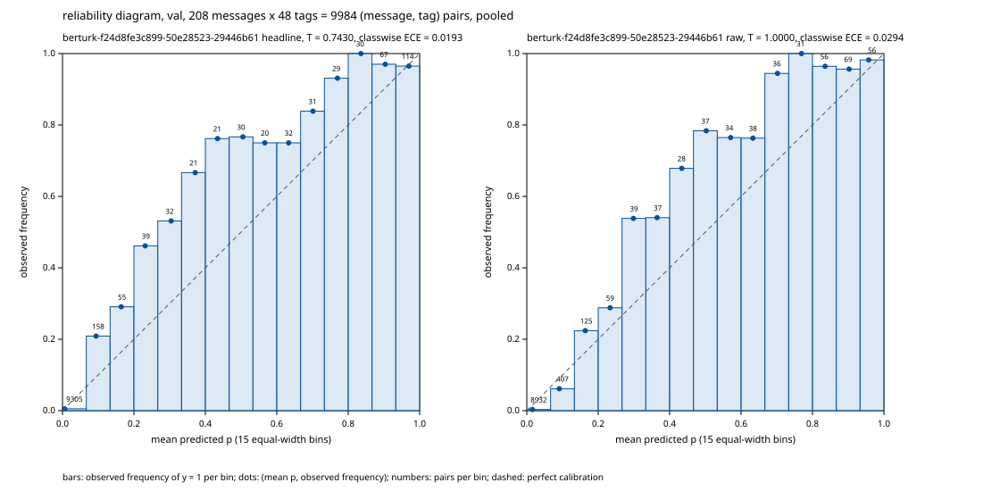

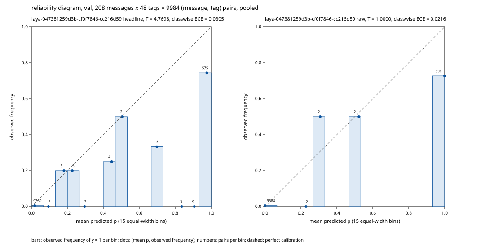

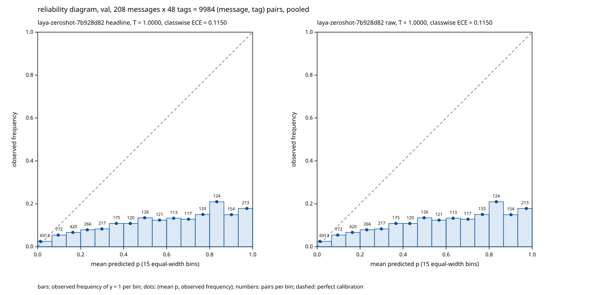

### Abstention on val (message confidence)

| system | run_id | variant | θ | precision@50% | precision@70% | precision@80% | precision@90% | accuracy@50% | accuracy@70% | accuracy@80% | accuracy@90% | AURC |
|---|---|---|---|---|---|---|---|---|---|---|---|---|
| berturk (train run berturk-selection_train-s0-4f36ae05, epoch 29) | berturk-f24d8fe3c899-50e28523-29446b61 | headline | 0.5 | 0.914 | 0.920 | 0.923 | 0.909 | 0.433 | 0.384 | 0.359 | 0.340 | 0.526 |
| berturk (train run berturk-selection_train-s0-4f36ae05, epoch 29) | berturk-f24d8fe3c899-50e28523-29446b61 | headline | val-selected, global 0.19 | 0.919 | 0.892 | 0.896 | 0.884 | 0.538 | 0.534 | 0.527 | 0.505 | 0.441 |
| berturk (train run berturk-selection_train-s0-4f36ae05, epoch 29) | berturk-f24d8fe3c899-50e28523-29446b61 | raw | 0.5 | 0.916 | 0.912 | 0.918 | 0.907 | 0.423 | 0.370 | 0.353 | 0.340 | 0.533 |
| berturk (train run berturk-selection_train-s0-4f36ae05, epoch 29) | berturk-f24d8fe3c899-50e28523-29446b61 | raw | val-selected, global 0.26 | 0.913 | 0.907 | 0.885 | 0.878 | 0.548 | 0.541 | 0.509 | 0.495 | 0.444 |
| laya (train run laya-selection_train-neg8-s0-d92447f4, epoch 3) | laya-047381259d3b-cf0f7846-cc216d59 | headline | 0.5 | 0.819 | 0.772 | 0.756 | 0.735 | 0.587 | 0.486 | 0.455 | 0.415 | 0.482 |
| laya (train run laya-selection_train-neg8-s0-d92447f4, epoch 3) | laya-047381259d3b-cf0f7846-cc216d59 | headline | val-selected, global 0.95 | 0.819 | 0.772 | 0.759 | 0.747 | 0.587 | 0.486 | 0.455 | 0.426 | 0.480 |
| laya (train run laya-selection_train-neg8-s0-d92447f4, epoch 3) | laya-047381259d3b-cf0f7846-cc216d59 | raw | 0.5 | 0.814 | 0.774 | 0.756 | 0.734 | 0.606 | 0.493 | 0.443 | 0.415 | 0.420 |
| laya (train run laya-selection_train-neg8-s0-d92447f4, epoch 3) | laya-047381259d3b-cf0f7846-cc216d59 | raw | val-selected, global 0.33 | 0.814 | 0.774 | 0.756 | 0.734 | 0.606 | 0.493 | 0.443 | 0.415 | 0.420 |
| laya (multilingual) | laya-zeroshot-7b928d82 | headline | 0.5 | 0.205 | 0.206 | 0.189 | 0.171 | 0.058 | 0.041 | 0.036 | 0.032 | 0.924 |
| laya (multilingual) | laya-zeroshot-7b928d82 | headline | val-selected, global 0.32 | 0.235 | 0.201 | 0.196 | 0.182 | 0.048 | 0.034 | 0.030 | 0.027 | 0.919 |
| laya (multilingual) | laya-zeroshot-7b928d82 | raw | 0.5 | 0.205 | 0.206 | 0.189 | 0.171 | 0.058 | 0.041 | 0.036 | 0.032 | 0.924 |
| laya (multilingual) | laya-zeroshot-7b928d82 | raw | val-selected, global 0.32 | 0.235 | 0.201 | 0.196 | 0.182 | 0.048 | 0.034 | 0.030 | 0.027 | 0.919 |

- confidence: message confidence = sum over the 48 tags of log q, q = p if p >= θ (predicted) else 1 - p: the model's probability that every tag decision is right, assuming tag independence
- coverage: keep the k = ceil(c * n / 100) most confident messages, k computed as (c * n + 99) // 100; ties in confidence keep split-file order (stable sort)
- aurc: mean over k = 1..n of 1 - exact-match rate of the k most confident messages (Geifman et al. 2019); lower is better

**Definition disclosure:** The message-confidence rule (the joint decision probability) was fixed at planning time on principle, because it is the model's own probability of the event the abstention accuracy scores (exact match), after the Phase 7 research had computed val AURC under it and under a weakest-tag rule (the minimum over tags of q). At the headline (val-fitted) temperature the order of the two fine-tuned models' val AURC differs between the two rules (at T = 1 it does not); the rule was not chosen by that outcome, and Phase 8 freezes it in protocol.json knowing both directions.

### No-intent false positives on val

| system | run_id | variant | θ | k/n | rate | Wilson 95% |
|---|---|---|---|---|---|---|
| berturk (train run berturk-selection_train-s0-4f36ae05, epoch 29) | berturk-f24d8fe3c899-50e28523-29446b61 | headline | 0.5 | 1/7 | 0.143 | [0.026, 0.513] |
| berturk (train run berturk-selection_train-s0-4f36ae05, epoch 29) | berturk-f24d8fe3c899-50e28523-29446b61 | headline | val-selected, global 0.19 | 2/7 | 0.286 | [0.082, 0.641] |
| berturk (train run berturk-selection_train-s0-4f36ae05, epoch 29) | berturk-f24d8fe3c899-50e28523-29446b61 | raw | 0.5 | 1/7 | 0.143 | [0.026, 0.513] |
| berturk (train run berturk-selection_train-s0-4f36ae05, epoch 29) | berturk-f24d8fe3c899-50e28523-29446b61 | raw | val-selected, global 0.26 | 2/7 | 0.286 | [0.082, 0.641] |
| laya (train run laya-selection_train-neg8-s0-d92447f4, epoch 3) | laya-047381259d3b-cf0f7846-cc216d59 | headline | 0.5 | 2/7 | 0.286 | [0.082, 0.641] |
| laya (train run laya-selection_train-neg8-s0-d92447f4, epoch 3) | laya-047381259d3b-cf0f7846-cc216d59 | headline | val-selected, global 0.95 | 2/7 | 0.286 | [0.082, 0.641] |
| laya (train run laya-selection_train-neg8-s0-d92447f4, epoch 3) | laya-047381259d3b-cf0f7846-cc216d59 | raw | 0.5 | 2/7 | 0.286 | [0.082, 0.641] |
| laya (train run laya-selection_train-neg8-s0-d92447f4, epoch 3) | laya-047381259d3b-cf0f7846-cc216d59 | raw | val-selected, global 0.33 | 2/7 | 0.286 | [0.082, 0.641] |
| laya (multilingual) | laya-zeroshot-7b928d82 | headline | 0.5 | 4/7 | 0.571 | [0.250, 0.842] |
| laya (multilingual) | laya-zeroshot-7b928d82 | headline | val-selected, global 0.32 | 5/7 | 0.714 | [0.359, 0.918] |
| laya (multilingual) | laya-zeroshot-7b928d82 | raw | 0.5 | 4/7 | 0.571 | [0.250, 0.842] |
| laya (multilingual) | laya-zeroshot-7b928d82 | raw | val-selected, global 0.32 | 5/7 | 0.714 | [0.359, 0.918] |

- false_positive: a counted message has no gold tag among the scored columns; it is a false positive when at least one scored column is predicted at θ (P >= θ). No-intent: all 48 columns. Out-of-domain: the 22 banking-only columns (the manifest's ood_scoring_tags)
- wilson: 95% Wilson score interval, z = 1.959963984540054, no continuity correction

The val no-intent set holds 7 messages (15 on test), so every interval is wide.

### Caveat and definitions

**Caveat:** in-sample: θ (and, for a fine-tuned model, T and the epoch) were chosen on these val messages, so these numbers are not held-out estimates (berturk-f24d8fe3c899-50e28523-29446b61, laya-047381259d3b-cf0f7846-cc216d59, laya-zeroshot-7b928d82).

- bins: 15 equal-width bins [k/15, (k+1)/15), p = 1.0 in the last bin (Guo et al. 2017, M = 15)
- brier: mean over every (message, tag) pair of (p - y)^2; the per-message sum over 48 tags is 48 x this
- classwise_ece: Kull et al. 2019 Eq. 4: per tag, the sum over the 15 equal-width bins of |sum of y - sum of p| / n; averaged over all 48 tags, zero-support tags included
- nll: mean binary cross-entropy over every (message, tag) pair, p clipped to [1e-12, 1 - 1e-12]
<!-- confidence:end -->

<!-- latency:start -->
### Latency per message (Phase 7, EVAL-06): reported, not gated

Latency is reported, not gated: it is not a decision criterion (a latency budget is DEC-01, v2).

Rules:

1. batch 1, in-process, no Ray; one process per (system, device), every final seed of the final manifest
2. a message is one val row's text, passed unchanged to the checkpoint's tokenizer; its latency is the wall-clock seconds from that text to 48 probabilities on the host
3. warm-up (full_pass_per_seed): after each seed's load, one untimed forward of every message the seed then times, in split-file order, then one device sync; only then is every message timed; so every seed follows the same sequence and every input it times has already run once on its model in this process; the seeds run in manifest order, so a residual seed-order effect is not separated from a seed effect; the report records the policy and the count
4. the device is synchronised right before t0 and right after the host copy (torch.mps.synchronize on mps, torch.cuda.synchronize on cuda, nothing on cpu), under torch.no_grad
5. fp32 with autocast off, checked after the load and after the timed loop
6. val messages only; only times are kept (no outputs, text or uids)
7. p50 and p95 are nearest-rank with integer ranks s[(q * n + 99) // 100 - 1], never interpolated

#### berturk on cpu

Timed path: BertForSequenceClassification fp32 -> tokenizer of one message (truncated at the record max_len) -> one forward -> logits to host -> sigmoid(logit / T).

- Device cpu, torch.float32, autocast off, torch threads 4, batch 1; warm-up full_pass_per_seed: one untimed pass over all 208 message(s) per seed before its timed loop
- Recorded rules: this report's `rules` field differs from the rules above at rule(s) 3; it keeps the text in force when the report was timed, and the rules above are the current wording
- Versions: numpy 2.5.4, torch 2.14.1, transformers 5.19.0; PYTORCH_ENABLE_MPS_FALLBACK unset
- Code: 3beea81ca966
- Messages: 208 val messages of splits/val.jsonl (sha256 95f5cfe5ae59); final manifest results/postfit/berturk-final.json (sha256 0a611f198fcf, committed: True)
- Preflight: 7.98 GiB available (threshold 7.0), swap grew while idle: False
- Swap in use: 0 MiB before, 0 MiB after the timed loops

| Seed | Checkpoint | n | p50 ms | p95 ms | mean ms | min ms | max ms |
|---|---|---|---|---|---|---|---|
| 0 | ckpt-berturk-final-s0 | 208 | 24.6 | 26.8 | 24.8 | 19.1 | 28.7 |
| 1 | ckpt-berturk-final-s1 | 208 | 24.5 | 26.9 | 24.9 | 20.8 | 30.3 |
| 2 | ckpt-berturk-final-s2 | 208 | 24.5 | 26.8 | 24.9 | 19.2 | 28.1 |
| pooled | 3 seed(s) | 624 | 24.5 | 26.8 | 24.9 | 19.1 | 30.3 |

#### berturk on mps

Timed path: BertForSequenceClassification fp32 -> tokenizer of one message (truncated at the record max_len) -> one forward -> logits to host -> sigmoid(logit / T).

- Device mps, torch.float32, autocast off, torch threads 4, batch 1; warm-up full_pass_per_seed: one untimed pass over all 208 message(s) per seed before its timed loop
- Recorded rules: this report's `rules` field differs from the rules above at rule(s) 3; it keeps the text in force when the report was timed, and the rules above are the current wording
- Versions: numpy 2.5.4, torch 2.14.1, transformers 5.19.0; PYTORCH_ENABLE_MPS_FALLBACK unset
- Code: e8e326f4e1a3
- Messages: 208 val messages of splits/val.jsonl (sha256 95f5cfe5ae59); final manifest results/postfit/berturk-final.json (sha256 0a611f198fcf, committed: True)
- Preflight: 7.68 GiB available (threshold 7.0), swap grew while idle: False
- Swap in use: 0 MiB before, 0 MiB after the timed loops

| Seed | Checkpoint | n | p50 ms | p95 ms | mean ms | min ms | max ms |
|---|---|---|---|---|---|---|---|
| 0 | ckpt-berturk-final-s0 | 208 | 9.4 | 11.8 | 9.6 | 7.8 | 13.0 |
| 1 | ckpt-berturk-final-s1 | 208 | 9.4 | 11.7 | 9.6 | 7.9 | 13.1 |
| 2 | ckpt-berturk-final-s2 | 208 | 9.5 | 11.7 | 9.6 | 7.9 | 12.7 |
| pooled | 3 seed(s) | 624 | 9.4 | 11.7 | 9.6 | 7.8 | 13.1 |

#### laya on cpu

Timed path: laya.load (digests) -> la.force_fp32 -> la.noul_logits of one message (48 noul questions, one forward) -> sigmoid(margin / T) on the host.

- Device cpu, torch.float32, autocast off, torch threads 4, batch 1; warm-up full_pass_per_seed: one untimed pass over all 208 message(s) per seed before its timed loop
- Recorded rules: this report's `rules` field differs from the rules above at rule(s) 3; it keeps the text in force when the report was timed, and the rules above are the current wording
- Versions: laya 0.4.6, numpy 2.5.4, torch 2.14.1, transformers 5.19.0; PYTORCH_ENABLE_MPS_FALLBACK unset
- Code: bbf1a8543ed9, uncommitted changes
- Messages: 208 val messages of splits/val.jsonl (sha256 95f5cfe5ae59); final manifest results/postfit/laya-final.json (sha256 3d0b1a91e00e, committed: True)
- Preflight: 8.45 GiB available (threshold 7.0), swap grew while idle: False
- Swap in use: 0 MiB before, 0 MiB after the timed loops

| Seed | Checkpoint | n | p50 ms | p95 ms | mean ms | min ms | max ms |
|---|---|---|---|---|---|---|---|
| 0 | ckpt-final-s0 | 208 | 684.2 | 831.8 | 696.0 | 567.3 | 1014.5 |
| 1 | ckpt-final-s1 | 208 | 681.2 | 812.7 | 689.7 | 571.5 | 1016.0 |
| 2 | ckpt-final-s2 | 208 | 682.2 | 813.3 | 690.4 | 572.1 | 1020.6 |
| pooled | 3 seed(s) | 624 | 682.3 | 814.5 | 692.0 | 567.3 | 1020.6 |

#### laya on mps

Timed path: laya.load (digests) -> la.force_fp32 -> la.noul_logits of one message (48 noul questions, one forward) -> sigmoid(margin / T) on the host.

- Device mps, torch.float32, autocast off, torch threads 4, batch 1; warm-up full_pass_per_seed: one untimed pass over all 208 message(s) per seed before its timed loop
- Recorded rules: this report's `rules` field differs from the rules above at rule(s) 3; it keeps the text in force when the report was timed, and the rules above are the current wording
- Versions: laya 0.4.6, numpy 2.5.4, torch 2.14.1, transformers 5.19.0; PYTORCH_ENABLE_MPS_FALLBACK unset
- Code: bbf1a8543ed9
- Messages: 208 val messages of splits/val.jsonl (sha256 95f5cfe5ae59); final manifest results/postfit/laya-final.json (sha256 3d0b1a91e00e, committed: True)
- Preflight: 7.93 GiB available (threshold 7.0), swap grew while idle: False
- Swap in use: 0 MiB before, 0 MiB after the timed loops

| Seed | Checkpoint | n | p50 ms | p95 ms | mean ms | min ms | max ms |
|---|---|---|---|---|---|---|---|
| 0 | ckpt-final-s0 | 208 | 332.1 | 406.3 | 339.9 | 277.9 | 517.0 |
| 1 | ckpt-final-s1 | 208 | 330.6 | 406.5 | 339.4 | 278.0 | 514.6 |
| 2 | ckpt-final-s2 | 208 | 331.9 | 405.2 | 339.5 | 277.9 | 516.8 |
| pooled | 3 seed(s) | 624 | 331.9 | 406.3 | 339.6 | 277.9 | 517.0 |

Laya's own fp16 autocast default on MPS (laya_default_amp) is not what is timed: every run is fp32 with autocast off, the path that scored the dumps.
<!-- latency:end -->

## Frozen protocol and head-to-head verdict (Phase 8)

`protocol.json` at the repo root holds the decision rule, with a numeric threshold behind every criterion, and the
full few-shot protocol (REP-01). This prose holds no number of its own: every number in this section comes from a
generated block below, and a test fails if any block is edited by hand or goes stale.

- **Frozen first.** The protocol was frozen and hash-pinned before any fine-tuned model was scored on test or HOTELS.
  One commit wrote `protocol.json`, pinned the sha256 of its exact bytes in `pilot/protocol.py` (`PROTOCOL_SHA256`)
  and added the protocol block below. Every gated dump was added by a later commit, and a test checks that git order.
  Nothing in the protocol could be tuned to a test or HOTELS number, and a test fails if the file is ever modified.
- **Refused without it.** `score.py`, `fewshot.py` and `report.py --verdict` call `pilot.protocol.require_frozen`
  first, and they refuse a missing or changed protocol. In `score.py` this is the protocol gate, which replaced the
  Phase 5 and Phase 6 test interlocks. A fine-tuned checkpoint reaches test or HOTELS only when it is one of the
  protocol's final seeds, under the committed manifest, on the protocol's device and worker count, and without `--n`,
  `--force` or another `--out-root`.
- **Scored once.** Each of the six final seeds (three per model) was scored once on test and once on HOTELS
  (`make final-scoring`). They ran in-process on MPS in fp32, the device each seed's temperature was fitted on. The
  gate refuses a rerun, so the committed dumps are the audit record and are never rescored. Zero-shot Laya was scored
  once on HOTELS as an ungated reference row, on the scorer of its committed val dump. `make final-reports` rebuilds
  everything under `results/final/` from the committed dumps, without a model.
- **How to read the GO block.** `report.py --verdict` computes the GO block mechanically from the frozen thresholds
  and the committed test dumps, and nobody chooses its outcome. INCONCLUSIVE counts as NO-GO and means collect bank
  data. A verdict that depends on the few-shot path of criterion (d) stays provisional until Phase 9 runs that path
  under this same protocol. The macro-F1 interval of criterion (a) is shown, but it is labelled not resolvable at this
  test size and never gates.
- **Disclosures.** Criterion (a)'s non-inferiority margin was locked before any result and is kept. At this test size
  it has limited power: the power estimates in the protocol block put a pass near a coin flip even when the two models
  are truly equal. The val deltas known at freeze, also in the protocol block, are in-sample: the epoch, T and θ were
  chosen on those same val messages, by one selection seed per model. Each postfit record's θ was chosen on that one
  selection seed and is applied unchanged to the three-seed average, a θ transfer. It is never re-selected on the final
  seeds or on test. Classwise ECE is reported but does not gate, because its percentile bootstrap is biased; Brier
  carries the calibration path.
- **Not decided here.** Latency is reported, not gated (see Phase 7 above). The GO block is the output of the frozen
  rule, not the recommendation: the recommendation, the decision memo and the caveats are Phase 10.

The block below is generated from the frozen file by `python -m pilot.protocol --render` (a test fails if it differs).

<!-- protocol:start -->
### Frozen decision protocol (protocol.json)

Laya vs BERTurk on Turkish banking intents: the frozen decision protocol (REP-01)

- sha256: `0d337d2019f9fcb1874fa0eb23f5f2547312e1675c832f886449d573cef54a8a`
- Frozen before any fine-tuned model is scored on test or HOTELS (REP-01, ROADMAP Phase 8 criterion 1): every threshold, the seed-averaged bootstrap procedure and the few-shot protocol are fixed before a fine-tuned test number exists, so nothing can be tuned to the result.
- Identity: the sha256 of this file's exact bytes, pinned in pilot.protocol.PROTOCOL_SHA256 by the freeze commit; every consumer calls pilot.protocol.require_frozen and refuses a missing or changed file.
- Units: fractions in [0, 1]; points = fraction x 100.
- Built at git HEAD `68af35c9a9cccded6ac66ebf56471714915582eb` (dirty: false).

#### Criteria

Thresholds as frozen (units: fractions in [0, 1]; points = fraction x 100).

| criterion | name | frozen values |
|---|---|---|
| (a) | non-inferiority | micro_ci_lower_min: -0.02 (-2.00 points); micro_fail_ci_upper_below: -0.02 (-2.00 points); macro_point_min: -0.03 (-3.00 points); macro_ci_label: not resolvable at this test size (n = 413) |
| (b) | seeds and no collapsed run | seeds_per_model: 3 |
| (c) | latency | label: reported, not gated; status: REPORTED (not gated) |
| (d) calibration path | a clear edge on calibration, abstention or few-shot learning | metric: brier; delta_below: 0.0 (+0.00 points); ci_upper_below: 0.0 (+0.00 points) |
| (d) abstention path | a clear edge on calibration, abstention or few-shot learning | metric: precision_at_80; coverage: 80; delta_at_least: 0.03 (+3.00 points); ci_lower_above: 0.0 (+0.00 points) |
| (d) fewshot path | a clear edge on calibration, abstention or few-shot learning | metric: new_tag_macro_ap; k: 10; mean_delta_at_least: 0.05 (+5.00 points); until_phase_9: PENDING |
| alternative_go | alternative GO | metric: micro_f1; delta_above: 0.03 (+3.00 points); ci_lower_above: 0.0 (+0.00 points); requires: b PASS |

Rules, as frozen:

- (a) non-inferiority: PASS when the micro-F1 delta 95% CI lower bound >= micro_ci_lower_min and the macro-F1 delta point estimate >= macro_point_min; FAIL when the micro-F1 delta CI upper bound < micro_fail_ci_upper_below or the macro-F1 delta point estimate < macro_point_min; INCONCLUSIVE otherwise. The macro-F1 CI is reported with macro_ci_label, not gated; deltas are Laya - BERTurk fractions in [0, 1] (points = fraction x 100), compared unrounded
- (b) seeds and no collapsed run: PASS when no run the collapse rule applies to is collapsed and every model has exactly seeds_per_model distinct scored final seeds; FAIL otherwise
- (c) latency: per-message latency of every final seed is reported, not gated, in v1 (a budget is DEC-01, v2)
- (d) a clear edge on calibration, abstention or few-shot learning: PASS when any one path is MET; PENDING when none is MET and the few-shot path is pending; FAIL otherwise. calibration: the Brier delta < delta_below and its CI upper bound < ci_upper_below; abstention: the precision at coverage % delta >= delta_at_least and its CI lower bound > ci_lower_above; fewshot: the mean over draws of the new-tag macro-AP delta at k >= mean_delta_at_least (PENDING until Phase 9); deltas are Laya - BERTurk fractions in [0, 1] (points = fraction x 100), compared unrounded
- alternative GO: MET when the micro-F1 delta > delta_above and its 95% CI lower bound > ci_lower_above; it gives GO only with (b) PASS; deltas are Laya - BERTurk fractions in [0, 1] (points = fraction x 100), compared unrounded
- (d) reported only, classwise_ece: reported, not gated (A1): its percentile bootstrap is biased (binned ECE replicates are inflated, so the observed delta sat at the 93.8th percentile of its own replicates on val; Roelofs et al., AISTATS 2022) and its direction flips between T = 1 and the fitted T; Brier names the calibration path

#### Collapse rule (b)

- Rule: a run is collapsed when any component applied to it is collapsed; (b) needs no collapsed run
- Applies to:
  - the selection run of each model (its postfit record's chosen candidate): val_floor, loss
  - each final seed (its final-manifest entry and its test dump): loss, test_floor
- Components:
  - val_floor: collapsed when the chosen candidate's val micro-F1 at its global val θ after T, the exact fraction 2TP / (2TP + FP + FN) of the record's objective counts, is strictly below the label prior's val micro-F1 at the prior's own global val θ (prior_val_fraction); equal is not collapsed
  - loss: collapsed when any epoch's mean training loss is NaN or infinite, or the last epoch's is strictly above the first epoch's (divergent); equal is not collapsed
    - note: the per-epoch loss is the unweighted mean over micro-batches (Laya) or steps (BERTurk); Laya's RLCD sigma anneal makes its epochs not strictly comparable, but the rule still catches a blow-up
  - test_floor: collapsed when a final seed's test micro-F1 at its record's global shipped θ, the exact fraction 2TP / (2TP + FP + FN), is strictly below the label prior's test micro-F1 at the prior's global val θ (prior_test_fraction); equal is not collapsed
    - **marked addition**: Claude-recommended addition to the REP-01 default, frozen before any fine-tuned test number (08-RESEARCH Open Question 1)
- Not applied: the val floor is not applied to final seeds: final_train holds the val folds
- Label prior floors (results/dumps/prior/{val,test}: the label prior at T = 1; θ = its global val θ (pilot.metrics.select_theta); micro-F1 = 2TP / (2TP + FP + FN) over all 48 tags), at the prior's global val θ 0.12:
  - val: micro-F1 10/41 = 0.2439 (TP 135, FP 489, FN 348)
  - test: micro-F1 520/2163 = 0.2404 (TP 260, FP 979, FN 664)

#### Verdict

Units: deltas are Laya - BERTurk fractions in [0, 1] (points = fraction x 100), compared unrounded.

1. (b) FAIL -> NO-GO
2. alternative GO MET -> GO
3. (a) FAIL -> NO-GO
4. (a) INCONCLUSIVE -> INCONCLUSIVE (counts as NO-GO; collect bank data)
5. (a) PASS and (d) PASS -> GO
6. (a) PASS and (d) FAIL -> NO-GO
7. (a) PASS and (d) PENDING -> PROVISIONAL: the verdict is computed with the few-shot path of (d) MET and NOT MET; it is final when both agree

- INCONCLUSIVE means: counts as NO-GO; collect bank data.
- Provisional form: `PROVISIONAL: %s if the few-shot path of (d) is met, else %s` (each %s is the overall verdict computed with that few-shot outcome).
- Statuses: (a) PASS, FAIL, INCONCLUSIVE; (b) PASS, FAIL; (c) REPORTED (not gated); (d) PASS, FAIL, PENDING; alternative_go MET, NOT MET; overall GO, NO-GO, INCONCLUSIVE.

#### Seed averaging, θ and bootstrap

Variant:

- headline: each final seed's shipped T (= its postfit record's T) with the record's theta.shipped (global plus per-tag, pilot.metrics.theta_vector); every gating number uses it (A18)
- raw: T = 1 with the record's theta.raw; reported only, never gating
- references: majority, prior and zero-shot Laya keep D-12 on their own val dump (pilot.metrics.select_theta)

Seed averaging:

- rule: per seed s, P_s = sigmoid(logit_s / T_s) with T_s the record T; P = the mean over the 3 seeds per message and tag (pilot.metrics.seed_average); θ = the record's theta.shipped (global plus per-tag, theta_vector) applied to P; probabilities are averaged before any threshold, never metrics (EVAL-07, A5)
- raw: the same with T_s = 1 and the record's theta.raw; reported only
- theta_source: the postfit record's θ, chosen on val by one selection seed; a final seed has no clean val (final_train holds the val folds), so θ is never re-selected on the final seeds or on test

Bootstrap: B = 10000, seed 0, level 0.95, coverage 80%, unit message, method percentile (numpy linear interpolation).

- procedure: EVAL-07: a paired message-level bootstrap of Laya - BERTurk over the seed-averaged probabilities of each system; one index draw (pilot.metrics.bootstrap_weights(n, B, seed)) is shared by both systems and by every metric; each replicate's delta is computed at each system's fixed θ; the interval is the percentile interval of the replicate deltas; replicates where a delta is undefined are counted and left out
- extra: the draw is bootstrap_weights(n, B, seed), the same one paired_bootstrap uses, shared by both systems; Brier and classwise ECE replicates are count-weighted sums of per-message terms, so each equals the metric of the resampled rows; a precision-at-coverage replicate is selective on the rows idx[b] in draw order (stable ties follow draw order); the interval is the percentile interval of the replicate deltas A - B (percentile (numpy linear interpolation))

Scoring (each final seed, once per gated split):

- splits: test, hotels_probe
- device: mps
- workers: 0
- dtype: torch.float32
- amp_enabled: false
- dump_root: results/dumps
- once: `each final seed is scored once per split into results/dumps/<dump_run_id>/<split>; an existing dump is never replaced`
- refused:
  - --force
  - --n
  - an --out-root other than results/dumps
  - any checkpoint outside systems.*.final_seeds
  - a device or worker count other than this block's
  - a manifest other than the committed data/splits.json
- why: mps, fp32, in-process: the scorer of the val dumps the postfit T and θ were fitted on (A14)

#### Systems, splits and inputs

| system | chosen selection dump | epoch | T | θ shipped / raw (tags with their own θ) | encoder / head LR | postfit record | final manifest |
|---|---|---|---|---|---|---|---|
| laya | laya-047381259d3b-cf0f7846-cc216d59 | 3 of 4 | 4.7698 | 0.95 / 0.33 (13 / 13) | 2e-05 / 0.0001 | results/postfit/laya.json e08e8735b19c | results/postfit/laya-final.json 3d0b1a91e00e |
| berturk | berturk-f24d8fe3c899-50e28523-29446b61 | 29 of 30 | 0.7430 | 0.19 / 0.26 (13 / 13) | 2e-05 / 0.0001 | results/postfit/berturk.json 83b34dfb524e | results/postfit/berturk-final.json 0a611f198fcf |

Final seeds (the only fine-tuned checkpoints scored on the gated splits):

| system | seed | train run id | checkpoint | dump run id |
|---|---|---|---|---|
| laya | 0 | laya-final_train-neg8-s0-95cf6955 | ckpt-final-s0 | laya-a6a866dd69fc-88cfaa80-cc216d59 |
| laya | 1 | laya-final_train-neg8-s1-07a1ee59 | ckpt-final-s1 | laya-f43484c8aab4-b43eaa54-cc216d59 |
| laya | 2 | laya-final_train-neg8-s2-bbb5230e | ckpt-final-s2 | laya-6f66dfd4c331-23b93830-cc216d59 |
| berturk | 0 | berturk-final_train-s0-8a167355 | ckpt-berturk-final-s0 | berturk-c500b06ccf34-f37197ee-29446b61 |
| berturk | 1 | berturk-final_train-s1-3c44e7ff | ckpt-berturk-final-s1 | berturk-1f0bb00cd6f7-a14835e4-29446b61 |
| berturk | 2 | berturk-final_train-s2-44f81396 | ckpt-berturk-final-s2 | berturk-06685feeb69f-faf017a7-29446b61 |

| split | path | role | messages | no-intent | sha256 | uids sha256 |
|---|---|---|---|---|---|---|
| test | data/splits/test.jsonl | test | 413 | 15 | 3abfb1836033 | f0fc53ccb638 |
| hotels_probe | data/splits/hotels_probe.jsonl | ood_probe | 1009 | 274 | 6120dadef844 | 78172fd5dbd5 |
| val | data/splits/val.jsonl | val | 208 | 7 | 95f5cfe5ae59 | 6b68eac2f153 |
| selection_train | data/splits/selection_train.jsonl | train | 1450 | 66 | a3b5fad486b3 | 61dd38e5ee8f |
| final_train | data/splits/final_train.jsonl | train | 1658 | 73 | 01c7274d7c9b | 12d3ef8a9767 |

- hotels_probe ood_scoring_tags: account, appointment, arrival, balance, business, card, cheque, contactless, credit, current, debit, direct_debit, fees_interests, international, loan, mortgage, overdraft, pin, savings, standing_order, transfer_payment_deposit, withdrawal

- References: reference rows are reported, never gated; their θ is D-12 on their own committed val dump; majority and prior are not scored on hotels_probe; zero-shot Laya is scored once on hotels_probe as an ungated reference OOD row, on the scorer of its committed val dump (cpu, Ray workers 2 x 4 CPUs; A15)
  - majority:
    - run_id: majority
    - report: results/reports/majority.json
    - gated: false
    - hotels_probe: null
  - prior:
    - run_id: prior
    - report: results/reports/prior.json
    - gated: false
    - hotels_probe: null
  - laya-zeroshot-7b928d82:
    - run_id: laya-zeroshot-7b928d82
    - report: results/reports/laya-zeroshot-7b928d82.json
    - gated: false
    - hotels_probe:
      - device: cpu
      - workers: 2
      - cpus_per_worker: 4
      - gated: false
      - once: true

Inputs (sha256 of every committed file the verdict reads):

| input | sha256 |
|---|---|
| data/splits.json | 7376c5199685 |
| results/postfit/laya.json | e08e8735b19c |
| results/postfit/berturk.json | 83b34dfb524e |
| results/postfit/laya-final.json | 3d0b1a91e00e |
| results/postfit/berturk-final.json | 0a611f198fcf |
| results/postfit/berturk-reference.json | 1e65d9d58b3b |
| results/dumps/prior/val.json | 6b6d532dadd9 |
| results/dumps/prior/test.json | b628be308dc1 |
| results/reports/majority.json | 62ff065a1a83 |
| results/reports/prior.json | a000819eb346 |
| results/reports/laya-zeroshot-7b928d82.json | 771e4f930dad |
| results/latency/laya-mps.json | 94e294657de5 |
| results/latency/laya-cpu.json | 716481b7bbda |
| results/latency/berturk-mps.json | e409c0ca629b |
| results/latency/berturk-cpu.json | df598110eb77 |
| results/dumps/laya-047381259d3b-cf0f7846-cc216d59/val.json | 2ddd80899a20 |
| results/dumps/berturk-f24d8fe3c899-50e28523-29446b61/val.json | 1309816b664c |

#### Few-shot protocol (Phase 9 executes it unchanged)

| setting | value |
|---|---|
| tags | savings, loan, overdraft, appointment, contactless, direct_debit |
| k_values | 5, 10 |
| draw_seeds | 0, 1, 2 |
| neg_per_pos | 4 |
| replay | 200 |
| epochs | 10 |

- Source: selection_train, sha256 a3b5fad486b3, uids sha256 61dd38e5ee8f.
- Eligibility rule:
  - banking_only: every held-out tag is in pilot.pins.OOD_SCORING_TAGS
  - min_test_positives: 10
  - min_final_train_positives: 40
- Eligibility note: gold labels only, no model output: positives per held-out tag in the committed test and final_train splits

| held-out tag | test positives | final_train positives |
|---|---|---|
| savings | 13 | 56 |
| loan | 11 | 57 |
| overdraft | 13 | 56 |
| appointment | 13 | 52 |
| contactless | 13 | 50 |
| direct_debit | 12 | 42 |

- Sampler:
  - schema: fewshot-draw/1
  - rule: rows sorted by uid; one random.Random(seed) per draw (CPython 3.12 random); for each tag in TAGS order: rng.sample of max(k) positives from the sorted uids carrying the tag, then rng.sample of NEG_PER_POS x max(k) negatives from the sorted uids without it; the k support set is the union over tags of the first k positives and the first NEG_PER_POS x k negatives (in sample order), so the k = 5 set is nested in the k = 10 set; replay = rng.sample of REPLAY from the sorted uids outside the max-k support set; every stored list is sorted; a pool smaller than a draw needs is refused, never shortened
  - digest: sha256 of the compact (separators ',' and ':'), key-sorted, UTF-8 JSON of {"schema", "seed", "tags", "support": {k: sorted uids}, "replay": sorted uids}; k keys are strings

| draw | seed | base seed | k | support messages | replay messages | new-tag positives | digest |
|---|---|---|---|---|---|---|---|
| 0 | 0 | 0 | 5 | 143 | 200 | savings 9, loan 12, overdraft 8, appointment 8, contactless 8, direct_debit 8 | d72d8aa2e2c0 |
| 0 | 0 | 0 | 10 | 279 | 200 | savings 14, loan 16, overdraft 14, appointment 17, contactless 13, direct_debit 16 | d72d8aa2e2c0 |
| 1 | 1 | 1 | 5 | 142 | 200 | savings 6, loan 6, overdraft 8, appointment 10, contactless 10, direct_debit 7 | 7ecc9ca984f6 |
| 1 | 1 | 1 | 10 | 274 | 200 | savings 17, loan 12, overdraft 15, appointment 15, contactless 16, direct_debit 13 | 7ecc9ca984f6 |
| 2 | 2 | 2 | 5 | 144 | 200 | savings 11, loan 10, overdraft 11, appointment 10, contactless 10, direct_debit 5 | 847dc93d6628 |
| 2 | 2 | 2 | 10 | 278 | 200 | savings 16, loan 17, overdraft 22, appointment 16, contactless 18, direct_debit 14 | 847dc93d6628 |

Rules:

- base_runs:
  - split: selection_train
  - seeds: 0, 1, 2
  - laya:
    - trainer: ray_train.py
    - epochs: 4
    - stop_after_epoch: 3
    - neg: 8
    - encoder_lr: 2e-05
    - head_lr: 0.0001
    - device: mps
    - workers: 1
    - micro_batch: 8
    - grad_accum: 4
    - max_len: 128
  - berturk:
    - trainer: berturk_train.py
    - epochs: 30
    - stop_after_epoch: 29
    - encoder_lr: 2e-05
    - head_lr: 0.0001
    - batch: 32
    - max_len: 128
    - device: mps
    - dtype: float32
    - mask_label: -100.0
  - rule: one label-masked base run per model and seed on selection_train (folds 0-13, so val stays held out for the bases' θ) at the model's chosen recipe: Laya ray_train.py --epochs 4 --stop-after-epoch 3, neg 8, encoder LR 2e-05, head LR 1e-4, mps, one worker; BERTurk berturk_train.py --epochs 30 --stop-after-epoch 29, LR 2e-05, head LR 1e-4, batch 32, mps fp32; seeds 0, 1, 2, base seed d paired with draw d; the same recipe as the main experiment, so the comparison isolates the masking
- masking: every selection_train message is kept; the six held-out tags are removed from each row's expected before neg8 sampling for Laya (laya.train.items_from_rows skips a question with no expected entry, so the base sees no item of them) and set to pilot.berturk.MASK_LABEL -100 for BERTurk (masked BCE: zero gradient); the masked base sees no label of the six tags (Phase 9 proves it: base items per held-out question = 0, unmasked BERTurk labels in those columns = 0)
- new_question:
  - laya: the masked tag's existing intents.py question, QUESTIONS[tag] ({"type": "noul", "instructions": INTENTS[tag]}), never reworded: questions_sha256 is frozen in data/splits.json and a wording change refreezes every split; the base never sees it because items_from_rows skips a question without an expected entry
  - berturk: the base's own classifier row for the tag, trained on no label (masked BCE gives it zero gradient; weight decay only); no weight imprinting (XCMP-04 is v2)
- support_labels: every support message carries its full gold labels for all 48 tags; the support set of a k is the union over the six tags of their k positives and 4k negatives; the realised positive count of each new tag per k is reported: it can exceed k, through co-occurrence and because a negative drawn for one tag may carry another held-out tag (negatives lack only their own tag)
- replay: 200 selection_train messages outside the draw's k = 10 support set (the same replay set for k = 5 and k = 10), with old-tag labels only: the six new tags are masked as in the base runs
- continued_training:
  - epochs: 10
  - encoder_lr: 2e-05
  - head_lr: 0.0001
  - rule: 10 epochs from the masked base of seed = draw seed at the base LRs (encoder 2e-05, head 1e-4), on the support set plus the replay set, each trainer's own schedule over the 10 epochs (Laya cosine and sigma anneal, BERTurk linear with 10% warm-up), training seed = draw seed, no early stopping, no selection on val or test; epoch parity, not step parity, disclosed: BERTurk takes about 160 optimizer steps against Laya's about 2,000
- laya_item_rule: support rows: every positive, every label of the six new tags (positive or negative) and 8 random old-tag negatives; replay rows: neg8 over the 42 old tags; plain neg8 would drop most new-tag negatives; the asymmetry with BERTurk's full labels is disclosed as in the main experiment (neg8 against all 48 labels)
- primary_metric:
  - k: 10
  - rule: per new tag, average precision on test by pilot.metrics.AP_RULE on P = sigmoid(logit) (T-invariant: raw T = 1); macro-AP = mean over the six tags; the aggregate is the mean over the three draws; criterion (d) reads the mean over draws of (Laya - BERTurk) macro-AP at k = 10; k = 5 is reported
- secondary_metrics:
  - k = 0 new-tag macro-AP of each masked base (Laya answers the new question zero-shot; BERTurk's untrained row)
  - new-tag micro-F1 and 42-old-tag micro-F1 at the masked base's val θ (the val rule at T = 1)
  - forgetting: old-tag micro-F1 of the continued model minus the masked base's
  - a paired message-level bootstrap CI of the new-tag macro-AP delta (descriptive only)
  - incremental wall clock per continued-training run
- compute_fallback:
  - base_runs_per_model: 1
  - seed: 0
  - rule: 1 masked base run per model (seed 0), all three draws continued from it
  - trigger: the Phase 9 projection from the results/compute rates exceeds 10 h, or a primary base run still fails after the LAYA-03 ladder
  - disclosure: the results state that base-model variance is not captured
- gate: the few-shot runner calls pilot.protocol.require_frozen() before anything else and records protocol_sha256 in every Phase 9 record
- test_admission: a few-shot checkpoint reaches test only through the score.py protocol gate, once Phase 9 binds its run record to this protocol_sha256 and a draw digest; Phase 8's allow-list holds the six final seeds only
- phase_9_notes:
  - ray_train.py has no tag masking: add --mask-tags (an IDENTITY key dropped when None), applied to expected before spike.neg8_rows
  - berturk_train.py refuses continued training from a fine-tuned head (optimizer_groups requires a newly initialised head): add a continued-training mode
  - support sets are not registered splits: both trainers need a protocol-derived support-set source over the verified selection_train bytes; data/splits.json is never refrozen

#### Known at freeze (val, in-sample, one seed per model)

In-sample val deltas Laya - BERTurk of the two chosen selection candidates (split val, n = 208, in_sample true): Laya laya-047381259d3b-cf0f7846-cc216d59, BERTurk berturk-f24d8fe3c899-50e28523-29446b61.

**headline** (T: laya 4.7698; berturk 0.7430; θ: laya theta.shipped; berturk theta.shipped; n = 208, B = 10000, seed 0, level 0.95, coverage 80%, method percentile (numpy linear interpolation))

| metric | Laya | BERTurk | delta (Laya - BERTurk) | 95% CI | width | undefined replicates |
|---|---|---|---|---|---|---|
| micro_f1 | 0.8129 | 0.8284 | -0.0155 | [-0.0427, +0.0120] | 0.0547 | 0 |
| macro_f1 | 0.7999 | 0.6899 | +0.1100 | [+0.0507, +0.1581] | 0.1074 | 0 |
| exact_match | 0.4183 | 0.4615 | -0.0433 | [-0.1202, +0.0337] | 0.1538 | 0 |
| top1_hit | 0.8507 | 0.8856 | -0.0348 | [-0.0829, +0.0100] | 0.0929 | 0 |
| brier | 0.0204 | 0.0154 | +0.0050 | [+0.0025, +0.0078] | 0.0053 | 0 |
| classwise_ece | 0.0305 | 0.0193 | +0.0111 | [+0.0062, +0.0118] | 0.0055 | 0 |
| precision_at_80 | 0.7595 | 0.8956 | -0.1362 | [-0.1798, -0.0938] | 0.0859 | 0 |

**raw** (T: laya 1.0000; berturk 1.0000; θ: laya theta.raw; berturk theta.raw; n = 208, B = 10000, seed 0, level 0.95, coverage 80%, method percentile (numpy linear interpolation))

| metric | Laya | BERTurk | delta (Laya - BERTurk) | 95% CI | width | undefined replicates |
|---|---|---|---|---|---|---|
| micro_f1 | 0.8011 | 0.8280 | -0.0269 | [-0.0542, +0.0009] | 0.0551 | 0 |
| macro_f1 | 0.7805 | 0.6876 | +0.0930 | [+0.0305, +0.1434] | 0.1130 | 0 |
| exact_match | 0.3942 | 0.4567 | -0.0625 | [-0.1394, +0.0144] | 0.1538 | 0 |
| top1_hit | 0.8507 | 0.8856 | -0.0348 | [-0.0829, +0.0100] | 0.0929 | 0 |
| brier | 0.0214 | 0.0155 | +0.0059 | [+0.0032, +0.0089] | 0.0057 | 0 |
| classwise_ece | 0.0216 | 0.0294 | -0.0078 | [-0.0146, -0.0070] | 0.0077 | 0 |
| precision_at_80 | 0.7561 | 0.8847 | -0.1286 | [-0.1807, -0.0918] | 0.0890 | 0 |

Note: in-sample val: T, θ and the epoch were chosen on these 208 messages, by one selection seed per model, while the test system is a 3-seed average; the thresholds are the REP-01 defaults, written before any result, and are not tuned to these numbers; both (d) paths (Brier, precision at 80% coverage) favour BERTurk on val and (a) sits near the margin; recorded so that what was known at freeze time is disclosed

#### Power at the test size (research estimates)

research estimate, normal approximation (A19): 08-RESEARCH CI-width research, from the in-sample val deltas (B = 10,000, seed 0) scaled to the test size; the 3-seed average makes the SE somewhat smaller.

- n: 413
- micro_f1_delta_se: 0.0098
- p_a_lower_at_least_margin:
  - 0: 0.53
  - -0.005: 0.34
  - -0.01: 0.17
  - -0.0155: 0.07
- p_a_lower_note: P(the (a) micro-F1 delta CI lower bound >= -0.02) at a true micro-F1 delta of each key; -0.0155 is the in-sample val estimate
- margin_80_power: -0.0274
- margin_80_power_note: the non-inferiority margin with 80% power at a true delta of 0
- alternative_go_success:
  - 0.03: 0.5
  - 0.04: 0.85
  - 0.05: 0.98
- alternative_go_note: P(the alternative GO is MET) at a true micro-F1 delta of each key
- macro_f1_ci_half_width: 0.035
- precision_at_80_ci_half_width: 0.03
- precision_at_80_note: extrapolated by the square-root-of-n rule (A19)
- margin: the -0.02 margin is locked (REP-01) and kept; (a) is three-way, so a non-resolvable result reads INCONCLUSIVE, which counts as NO-GO plus collect bank data

#### Definitions

- brier: mean over every (message, tag) pair of (p - y)^2; the per-message sum over 48 tags is 48 x this
- nll: mean binary cross-entropy over every (message, tag) pair, p clipped to [1e-12, 1 - 1e-12]
- classwise_ece: Kull et al. 2019 Eq. 4: per tag, the sum over the 15 equal-width bins of |sum of y - sum of p| / n; averaged over all 48 tags, zero-support tags included
- bins: 15 equal-width bins [k/15, (k+1)/15), p = 1.0 in the last bin (Guo et al. 2017, M = 15)
- confidence: message confidence = sum over the 48 tags of log q, q = p if p >= θ (predicted) else 1 - p: the model's probability that every tag decision is right, assuming tag independence
- coverage: keep the k = ceil(c * n / 100) most confident messages, k computed as (c * n + 99) // 100; ties in confidence keep split-file order (stable sort)
- aurc: mean over k = 1..n of 1 - exact-match rate of the k most confident messages (Geifman et al. 2019); lower is better
- theta_tie: closest to 0.5; between two equally close points, the lower θ
- bootstrap_method: percentile (numpy linear interpolation)
- bootstrap_extra: the draw is bootstrap_weights(n, B, seed), the same one paired_bootstrap uses, shared by both systems; Brier and classwise ECE replicates are count-weighted sums of per-message terms, so each equals the metric of the resampled rows; a precision-at-coverage replicate is selective on the rows idx[b] in draw order (stable ties follow draw order); the interval is the percentile interval of the replicate deltas A - B (percentile (numpy linear interpolation))
- false_positive: a counted message has no gold tag among the scored columns; it is a false positive when at least one scored column is predicted at θ (P >= θ). No-intent: all 48 columns. Out-of-domain: the 22 banking-only columns (the manifest's ood_scoring_tags)
- average_precision: average precision of one tag: AP = sum over the distinct score thresholds, in decreasing order, of (R_n - R_(n-1)) * P_n, with P_n and R_n the precision and recall of the messages scoring at or above the n-th threshold; tied scores form one threshold; not interpolated (sklearn average_precision_score); a tag with no positive is refused; T-invariant (a monotone transform of the logits keeps the ranking)
- fewshot_sampler: rows sorted by uid; one random.Random(seed) per draw (CPython 3.12 random); for each tag in TAGS order: rng.sample of max(k) positives from the sorted uids carrying the tag, then rng.sample of NEG_PER_POS x max(k) negatives from the sorted uids without it; the k support set is the union over tags of the first k positives and the first NEG_PER_POS x k negatives (in sample order), so the k = 5 set is nested in the k = 10 set; replay = rng.sample of REPLAY from the sorted uids outside the max-k support set; every stored list is sorted; a pool smaller than a draw needs is refused, never shortened
- fewshot_digest: sha256 of the compact (separators ',' and ':'), key-sorted, UTF-8 JSON of {"schema", "seed", "tags", "support": {k: sorted uids}, "replay": sorted uids}; k keys are strings

#### Assumptions and delegation

- A1: (d)'s calibration path is Brier at the headline T; classwise ECE is reported only, its percentile bootstrap being biased
- A2: (a) is three-way: PASS when the micro-F1 delta CI lower bound >= -0.02 and the macro-F1 delta point >= -0.03; FAIL when the micro-F1 CI upper bound < -0.02 or the macro-F1 point < -0.03; INCONCLUSIVE otherwise
- A3: the overall verdict follows the verdict rules in order; INCONCLUSIVE counts as NO-GO; with (d) PENDING the verdict is PROVISIONAL only when the few-shot MET and NOT MET outcomes differ
- A4: the alternative GO is a micro-F1 delta > +0.03 with a CI lower bound > 0, and still needs (b) PASS
- A5: a seed-averaged final system uses its postfit record's theta.shipped at the record T
- A6: the collapse rule applies to each selection run (val floor 10/41 and loss) and to each final seed (loss and a test floor against the prior's 520/2163, a marked addition)
- A7: the held-out few-shot tags are the FEATURES TS-14 list; eligibility checks the list, never selects it
- A8: one masked base run per model and seed on selection_train at the chosen recipe; seeds 0-2 pair with draws 0-2
- A9: k is nested (5 within 10), 4k negatives per tag, full-label support rows, the union over tags, and 200 replay messages outside the k = 10 support set
- A10: the Laya few-shot item rule: every positive, every new-tag label and 8 old-tag negatives per message
- A11: 10 epochs of continued training at the base LRs with each trainer's schedule (epoch parity, not step parity)
- A12: new-tag AP has sklearn semantics, macro over the 6 tags, at T = 1, as the mean over draws; (d) reads k = 10
- A13: the compute fallback (1 base run per model, seed 0) triggers on a projection over 10 h or a base-run failure after the ladder
- A14: final seeds are scored on MPS, fp32, --workers 0: the device the postfit T was fitted on
- A15: zero-shot Laya on HOTELS is an ungated reference row (cpu, Ray workers 2 x 4 CPUs); majority and prior are not scored on HOTELS
- A16: the table's standard deviation over seeds is the sample std (ddof 1)
- A17: protocol.json sits at the repo root; its sha256 pin is in pilot/protocol.py
- A18: every gating number uses the headline variant (record T, theta.shipped); raw (T = 1, theta.raw) is reported only
- A19: power numbers are normal-approximation estimates; the precision at 80% coverage widths are extrapolated by the square-root-of-n rule
- OQ1: the test-floor collapse component is frozen, marked as a Claude-recommended addition to the REP-01 default
- OQ2: zero-shot Laya is scored once on HOTELS as an ungated reference OOD row; majority and prior are not
- OQ3: Phase 8 ships fewshot.py --support-sets behind require_frozen; Phase 9 extends the same entry point

All 22 were taken as 08-RESEARCH recommended under the standing delegation.

Delegation:

- standing:
  - given: 06-15 (2026-10-21)
  - quote: do the programatical control. i will not do manual control until all phases done.
  - meaning: every blocking-human gate is resolved by programmatic checks; the recommended option is taken and the delegation recorded
- restated:
  - given: 2026-10-23
  - quote: i already told you that i will not made a manual control untill all phases are done
- single_lr:
  - given: 2026-10-15
  - reply: assume it okey for now. defer for further learning rate grid search. we know that at least one hyperparameter works.
  - choice: Single LR now (Recommended)
  - decision: one encoder LR 2e-05 for both models, fixed, not tuned (head LR 1e-4)
- bank_name: the bank-name check is deferred to the end-of-milestone review
<!-- protocol:end -->

The results table below is generated from `results/final/verdict.json` by `python report.py --final-table results/final/verdict.json` (a test fails if it differs).

<!-- final-results:start -->
### Results on test (Phase 8)

Split test: n = 413 (15 no-intent), sha256 `3abfb1836033`, uids sha256 `f0fc53ccb638`; protocol sha256 `0d337d2019f9`.
Every value is at the val-selected θ and headline T: a reference row at its own val θ, a fine-tuned row as the mean ± sample std (ddof 1) over its final seeds with the per-seed values in seed order, the seed-averaged row the system the GO block compares (each seed at its record T, averaged, then the record's theta.shipped).

| system | run | micro-F1 | macro-F1 | exact match | top-1 |
|---|---|---|---|---|---|
| majority (train: final_train) | majority | 0.138 | 0.008 | 0.005 | 0.231 |
| prior (train: final_train) | prior | 0.184 | 0.048 | 0.000 | 0.231 |
| laya (multilingual) | laya-zeroshot-7b928d82 | 0.205 | 0.216 | 0.007 | 0.214 |
| laya fine-tuned (final seeds 0, 1, 2) | mean ± std (seed 0 / 1 / 2) | 0.793 ± 0.020 (0.779 / 0.784 / 0.815) | 0.790 ± 0.013 (0.784 / 0.781 / 0.805) | 0.390 ± 0.040 (0.370 / 0.363 / 0.436) | 0.890 ± 0.003 (0.887 / 0.892 / 0.892) |
| laya fine-tuned, seed-averaged (EVAL-07 system) | seeds 0, 1, 2 averaged | 0.826 | 0.815 | 0.460 | 0.922 |
| berturk fine-tuned (final seeds 0, 1, 2) | mean ± std (seed 0 / 1 / 2) | 0.832 ± 0.009 (0.829 / 0.826 / 0.843) | 0.759 ± 0.003 (0.758 / 0.757 / 0.762) | 0.532 ± 0.018 (0.523 / 0.521 / 0.552) | 0.927 ± 0.003 (0.927 / 0.925 / 0.930) |
| berturk fine-tuned, seed-averaged (EVAL-07 system) | seeds 0, 1, 2 averaged | 0.844 | 0.777 | 0.562 | 0.940 |

Settings (T and θ are each postfit record's, chosen on val, never re-selected on test):

| system | T | θ shipped global (per-tag) | θ raw global (per-tag) | epoch / schedule | encoder / head LR | seeds | train run ids | selection run (chosen dump) |
|---|---|---|---|---|---|---|---|---|
| majority (train: final_train) | 1.0000 | 0.50 (13) | n/a | n/a | n/a | n/a | n/a | n/a |
| prior (train: final_train) | 1.0000 | 0.12 (13) | n/a | n/a | n/a | n/a | n/a | n/a |
| laya (multilingual) | 1.0000 | 0.32 (13) | n/a | n/a | n/a | n/a | n/a | n/a |
| laya fine-tuned | 4.7698 | 0.95 (13) | 0.33 (13) | 3 / 4 | 2e-05 / 0.0001 | 0, 1, 2 | laya-final_train-neg8-s0-95cf6955, laya-final_train-neg8-s1-07a1ee59, laya-final_train-neg8-s2-bbb5230e | laya-selection_train-neg8-s0-d92447f4 (laya-047381259d3b-cf0f7846-cc216d59) |
| berturk fine-tuned | 0.7430 | 0.19 (13) | 0.26 (13) | 29 / 30 | 2e-05 / 0.0001 | 0, 1, 2 | berturk-final_train-s0-8a167355, berturk-final_train-s1-3c44e7ff, berturk-final_train-s2-44f81396 | berturk-selection_train-s0-4f36ae05 (berturk-f24d8fe3c899-50e28523-29446b61) |

- laya: postfit record results/postfit/laya.json `e08e8735b19c`, final manifest results/postfit/laya-final.json `3d0b1a91e00e`, config sha256 without the seed `4fe1e17f7701`.
- berturk: postfit record results/postfit/berturk.json `83b34dfb524e`, final manifest results/postfit/berturk-final.json `0a611f198fcf`, config sha256 without the seed `16cb358001af`.
<!-- final-results:end -->

The GO block below is computed mechanically from the frozen thresholds and the committed final-seed test dumps; regenerate it with `python report.py --go-block results/final/verdict.json` (a test fails if it differs).

<!-- go-block:start -->
### GO block (mechanical)

- Protocol: protocol.json sha256 `0d337d2019f9`.
- Split test: n = 413 (15 no-intent).
- Deltas: laya - berturk, seed-averaged, headline (T: laya 4.7698; berturk 0.7430; θ: laya theta.shipped; berturk theta.shipped); B = 10000, seed 0, 95% interval, percentile (numpy linear interpolation).
- Units: deltas are Laya - BERTurk fractions in [0, 1] (points = fraction x 100), compared unrounded.
- Few-shot path (Phase 9): k = 10, mean over 3 draws, mode primary; record results/fewshot/fewshot.json sha256 `2eac0da66a2a`.

| criterion | status | numbers |
|---|---|---|
| (a) non-inferiority | INCONCLUSIVE | micro-F1 delta -1.72 points, CI [-3.63, +0.22]; macro-F1 delta +3.86 points, CI [+0.59, +6.79] (not resolvable at this test size (n = 413)) |
| (b) seeds and no collapsed run | PASS | 8 runs, 0 collapsed; seeds laya 0, 1, 2; berturk 0, 1, 2 |
| (c) latency | REPORTED (not gated) | reported, not gated; laya mps p50 0.332 s, p95 0.406 s (n = 624); laya cpu p50 0.682 s, p95 0.814 s (n = 624); berturk mps p50 0.009 s, p95 0.012 s (n = 624); berturk cpu p50 0.025 s, p95 0.027 s (n = 624) |
| (d) a clear edge on calibration, abstention or few-shot learning | PASS | calibration (brier): NOT MET, delta +0.34 points, CI [+0.21, +0.48]; abstention (precision_at_80): NOT MET, delta -9.05 points, CI [-11.96, -6.08]; fewshot (new_tag_macro_ap): MET, mean delta +65.87 points |
| alternative GO | NOT MET | micro-F1 delta -1.72 points, CI [-3.63, +0.22] |

Statuses: (a) INCONCLUSIVE; (b) PASS; (c) REPORTED (not gated); (d) PASS; alternative GO NOT MET.

**Verdict: INCONCLUSIVE**

- Rule 4: (a) INCONCLUSIVE -> INCONCLUSIVE (counts as NO-GO; collect bank data)
- INCONCLUSIVE counts as NO-GO; collect bank data.

Descriptive, not gating: classwise_ece delta +1.66 points, CI [+1.31, +1.68]; exact_match delta -10.17 points, CI [-15.74, -4.60]; top1_hit delta -1.76 points, CI [-4.74, +1.23]; raw (T: laya 1.0000; berturk 1.0000; θ: laya theta.raw; berturk theta.raw) micro_f1 delta -8.57 points, CI [-10.68, -6.45].
<!-- go-block:end -->

The test and HOTELS confidence block below is generated from the records under `results/final/confidence/` by `python report.py --confidence-table results/final/confidence` (a test fails if it differs); every T and θ comes from val or the postfit record, never from test or HOTELS.

<!-- final-confidence:start -->
### Calibration on test (θ-free)

| system | run_id | variant | T | Brier | NLL | classwise ECE (15 bins) |
|---|---|---|---|---|---|---|
| berturk (train run berturk-final_train-s2-44f81396, epoch 29) | berturk-06685feeb69f-faf017a7-29446b61 | headline | 0.7430 | 0.0128 | 0.0488 | 0.0160 |
| berturk (train run berturk-final_train-s2-44f81396, epoch 29) | berturk-06685feeb69f-faf017a7-29446b61 | raw | 1.0000 | 0.0130 | 0.0550 | 0.0243 |
| berturk (train run berturk-final_train-s1-3c44e7ff, epoch 29) | berturk-1f0bb00cd6f7-a14835e4-29446b61 | headline | 0.7430 | 0.0131 | 0.0499 | 0.0159 |
| berturk (train run berturk-final_train-s1-3c44e7ff, epoch 29) | berturk-1f0bb00cd6f7-a14835e4-29446b61 | raw | 1.0000 | 0.0133 | 0.0562 | 0.0237 |
| berturk (train run berturk-final_train-s0-8a167355, epoch 29) | berturk-c500b06ccf34-f37197ee-29446b61 | headline | 0.7430 | 0.0132 | 0.0499 | 0.0159 |
| berturk (train run berturk-final_train-s0-8a167355, epoch 29) | berturk-c500b06ccf34-f37197ee-29446b61 | raw | 1.0000 | 0.0135 | 0.0567 | 0.0248 |
| laya (train run laya-final_train-neg8-s2-bbb5230e, epoch 3) | laya-6f66dfd4c331-23b93830-cc216d59 | headline | 4.7698 | 0.0188 | 0.0877 | 0.0284 |
| laya (train run laya-final_train-neg8-s2-bbb5230e, epoch 3) | laya-6f66dfd4c331-23b93830-cc216d59 | raw | 1.0000 | 0.0198 | 0.3250 | 0.0199 |
| laya (train run laya-final_train-neg8-s0-95cf6955, epoch 3) | laya-a6a866dd69fc-88cfaa80-cc216d59 | headline | 4.7698 | 0.0235 | 0.1064 | 0.0339 |
| laya (train run laya-final_train-neg8-s0-95cf6955, epoch 3) | laya-a6a866dd69fc-88cfaa80-cc216d59 | raw | 1.0000 | 0.0249 | 0.4138 | 0.0250 |
| laya (train run laya-final_train-neg8-s1-07a1ee59, epoch 3) | laya-f43484c8aab4-b43eaa54-cc216d59 | headline | 4.7698 | 0.0223 | 0.1041 | 0.0344 |
| laya (train run laya-final_train-neg8-s1-07a1ee59, epoch 3) | laya-f43484c8aab4-b43eaa54-cc216d59 | raw | 1.0000 | 0.0233 | 0.3976 | 0.0234 |
| laya (multilingual) | laya-zeroshot-7b928d82 | headline | 1.0000 | 0.0924 | 0.3563 | 0.1141 |
| laya (multilingual) | laya-zeroshot-7b928d82 | raw | 1.0000 | 0.0924 | 0.3563 | 0.1141 |
| prior (train: final_train) | prior | headline | 1.0000 | 0.0422 | 0.1704 | 0.0066 |
| prior (train: final_train) | prior | raw | 1.0000 | 0.0422 | 0.1704 | 0.0066 |

- laya-zeroshot-7b928d82: headline temperature is 1.0, so its raw rows equal its headline rows.
- prior: headline temperature is 1.0, so its raw rows equal its headline rows.

### Reliability diagrams

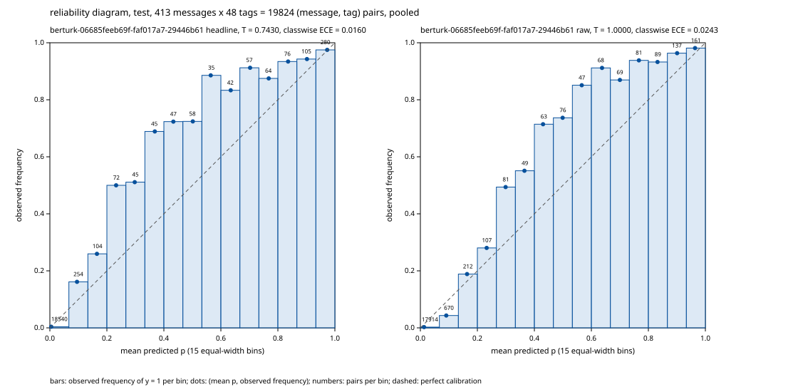

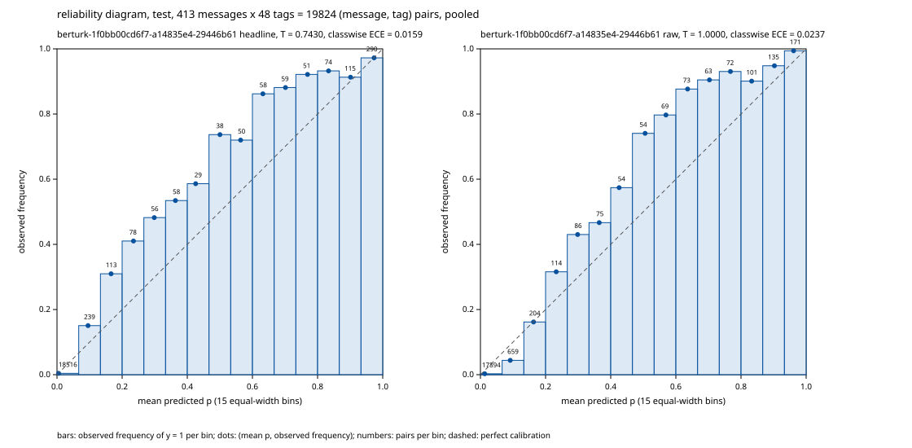

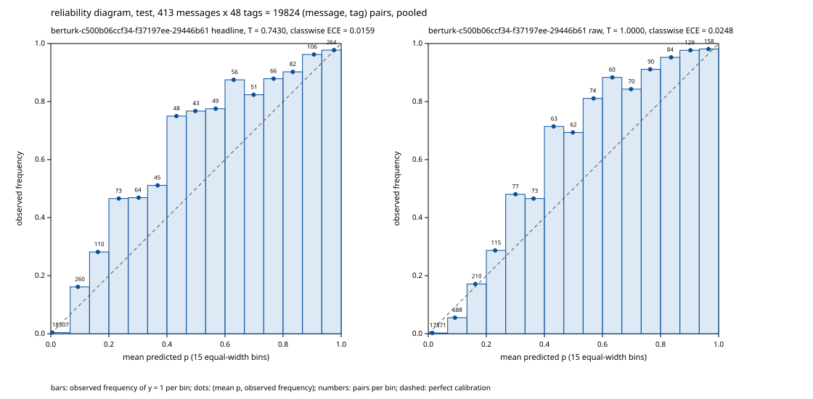

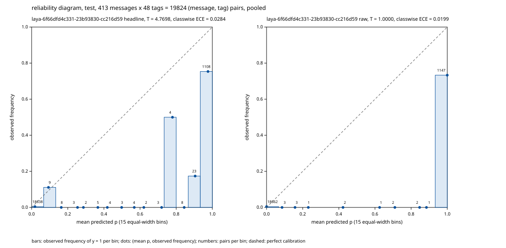

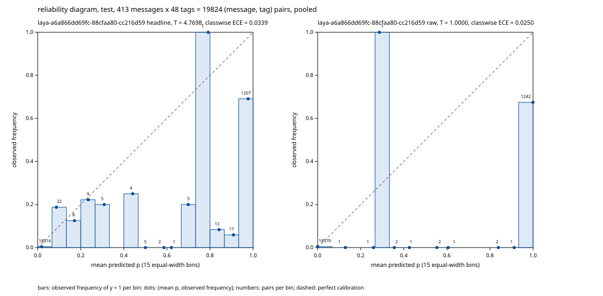

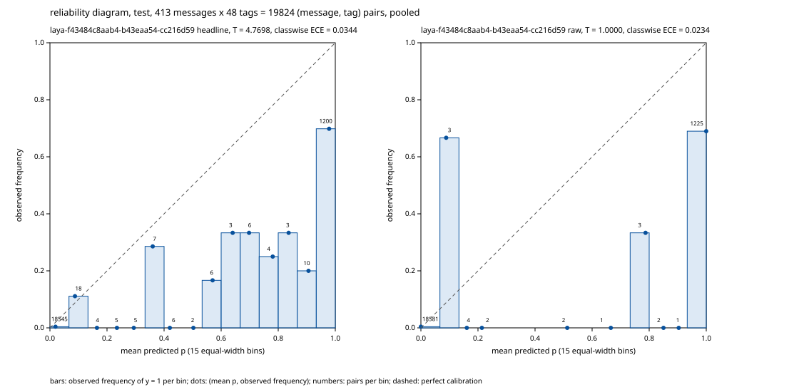

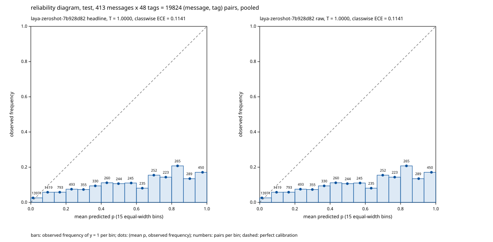

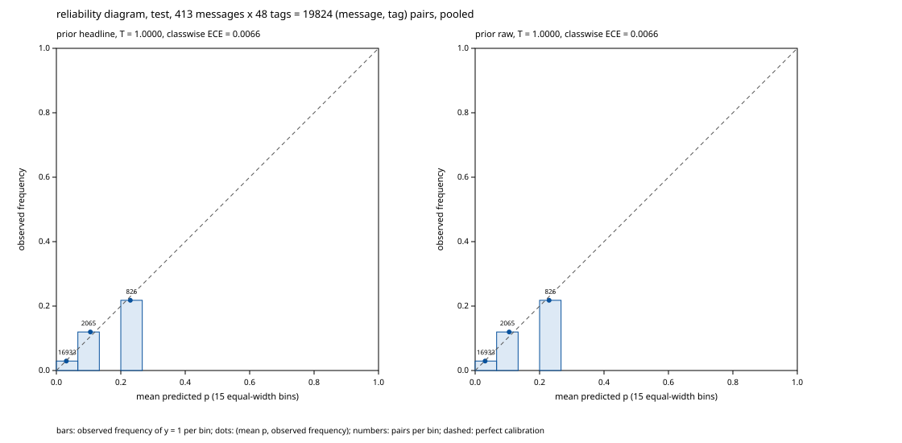

### Abstention on test (message confidence)

| system | run_id | variant | θ | precision@50% | precision@70% | precision@80% | precision@90% | accuracy@50% | accuracy@70% | accuracy@80% | accuracy@90% | AURC |
|---|---|---|---|---|---|---|---|---|---|---|---|---|
| berturk (train run berturk-final_train-s2-44f81396, epoch 29) | berturk-06685feeb69f-faf017a7-29446b61 | headline | 0.5 | 0.955 | 0.957 | 0.952 | 0.936 | 0.681 | 0.603 | 0.559 | 0.508 | 0.305 |
| berturk (train run berturk-final_train-s2-44f81396, epoch 29) | berturk-06685feeb69f-faf017a7-29446b61 | headline | val-selected, global 0.19 | 0.956 | 0.922 | 0.902 | 0.873 | 0.754 | 0.672 | 0.637 | 0.597 | 0.254 |
| berturk (train run berturk-final_train-s2-44f81396, epoch 29) | berturk-06685feeb69f-faf017a7-29446b61 | raw | 0.5 | 0.953 | 0.959 | 0.956 | 0.941 | 0.657 | 0.600 | 0.556 | 0.508 | 0.317 |
| berturk (train run berturk-final_train-s2-44f81396, epoch 29) | berturk-06685feeb69f-faf017a7-29446b61 | raw | val-selected, global 0.26 | 0.943 | 0.916 | 0.905 | 0.875 | 0.734 | 0.669 | 0.640 | 0.594 | 0.259 |
| berturk (train run berturk-final_train-s1-3c44e7ff, epoch 29) | berturk-1f0bb00cd6f7-a14835e4-29446b61 | headline | 0.5 | 0.955 | 0.954 | 0.936 | 0.920 | 0.686 | 0.614 | 0.571 | 0.524 | 0.307 |
| berturk (train run berturk-final_train-s1-3c44e7ff, epoch 29) | berturk-1f0bb00cd6f7-a14835e4-29446b61 | headline | val-selected, global 0.19 | 0.951 | 0.916 | 0.887 | 0.859 | 0.725 | 0.672 | 0.619 | 0.575 | 0.273 |
| berturk (train run berturk-final_train-s1-3c44e7ff, epoch 29) | berturk-1f0bb00cd6f7-a14835e4-29446b61 | raw | 0.5 | 0.946 | 0.948 | 0.931 | 0.922 | 0.657 | 0.603 | 0.568 | 0.524 | 0.319 |
| berturk (train run berturk-final_train-s1-3c44e7ff, epoch 29) | berturk-1f0bb00cd6f7-a14835e4-29446b61 | raw | val-selected, global 0.26 | 0.944 | 0.907 | 0.886 | 0.858 | 0.725 | 0.669 | 0.622 | 0.575 | 0.278 |
| berturk (train run berturk-final_train-s0-8a167355, epoch 29) | berturk-c500b06ccf34-f37197ee-29446b61 | headline | 0.5 | 0.942 | 0.944 | 0.941 | 0.933 | 0.671 | 0.593 | 0.544 | 0.511 | 0.326 |
| berturk (train run berturk-final_train-s0-8a167355, epoch 29) | berturk-c500b06ccf34-f37197ee-29446b61 | headline | val-selected, global 0.19 | 0.945 | 0.922 | 0.893 | 0.861 | 0.734 | 0.683 | 0.622 | 0.575 | 0.278 |
| berturk (train run berturk-final_train-s0-8a167355, epoch 29) | berturk-c500b06ccf34-f37197ee-29446b61 | raw | 0.5 | 0.944 | 0.945 | 0.940 | 0.930 | 0.657 | 0.586 | 0.541 | 0.508 | 0.330 |
| berturk (train run berturk-final_train-s0-8a167355, epoch 29) | berturk-c500b06ccf34-f37197ee-29446b61 | raw | val-selected, global 0.26 | 0.932 | 0.919 | 0.890 | 0.862 | 0.734 | 0.676 | 0.619 | 0.573 | 0.278 |
| laya (train run laya-final_train-neg8-s2-bbb5230e, epoch 3) | laya-6f66dfd4c331-23b93830-cc216d59 | headline | 0.5 | 0.835 | 0.795 | 0.772 | 0.749 | 0.575 | 0.524 | 0.483 | 0.444 | 0.424 |
| laya (train run laya-final_train-neg8-s2-bbb5230e, epoch 3) | laya-6f66dfd4c331-23b93830-cc216d59 | headline | val-selected, global 0.95 | 0.827 | 0.798 | 0.772 | 0.753 | 0.570 | 0.528 | 0.483 | 0.452 | 0.420 |
| laya (train run laya-final_train-neg8-s2-bbb5230e, epoch 3) | laya-6f66dfd4c331-23b93830-cc216d59 | raw | 0.5 | 0.847 | 0.805 | 0.776 | 0.747 | 0.599 | 0.528 | 0.483 | 0.441 | 0.386 |
| laya (train run laya-final_train-neg8-s2-bbb5230e, epoch 3) | laya-6f66dfd4c331-23b93830-cc216d59 | raw | val-selected, global 0.33 | 0.847 | 0.805 | 0.776 | 0.747 | 0.599 | 0.528 | 0.483 | 0.441 | 0.386 |
| laya (train run laya-final_train-neg8-s0-95cf6955, epoch 3) | laya-a6a866dd69fc-88cfaa80-cc216d59 | headline | 0.5 | 0.760 | 0.724 | 0.706 | 0.691 | 0.498 | 0.434 | 0.402 | 0.379 | 0.505 |
| laya (train run laya-final_train-neg8-s0-95cf6955, epoch 3) | laya-a6a866dd69fc-88cfaa80-cc216d59 | headline | val-selected, global 0.95 | 0.760 | 0.724 | 0.706 | 0.694 | 0.498 | 0.434 | 0.408 | 0.392 | 0.504 |
| laya (train run laya-final_train-neg8-s0-95cf6955, epoch 3) | laya-a6a866dd69fc-88cfaa80-cc216d59 | raw | 0.5 | 0.761 | 0.715 | 0.701 | 0.690 | 0.498 | 0.421 | 0.399 | 0.379 | 0.476 |
| laya (train run laya-final_train-neg8-s0-95cf6955, epoch 3) | laya-a6a866dd69fc-88cfaa80-cc216d59 | raw | val-selected, global 0.33 | 0.761 | 0.715 | 0.701 | 0.690 | 0.498 | 0.421 | 0.399 | 0.379 | 0.476 |
| laya (train run laya-final_train-neg8-s1-07a1ee59, epoch 3) | laya-f43484c8aab4-b43eaa54-cc216d59 | headline | 0.5 | 0.742 | 0.729 | 0.719 | 0.707 | 0.473 | 0.445 | 0.429 | 0.395 | 0.491 |
| laya (train run laya-final_train-neg8-s1-07a1ee59, epoch 3) | laya-f43484c8aab4-b43eaa54-cc216d59 | headline | val-selected, global 0.95 | 0.742 | 0.730 | 0.721 | 0.709 | 0.473 | 0.448 | 0.432 | 0.395 | 0.490 |
| laya (train run laya-final_train-neg8-s1-07a1ee59, epoch 3) | laya-f43484c8aab4-b43eaa54-cc216d59 | raw | 0.5 | 0.768 | 0.738 | 0.719 | 0.707 | 0.517 | 0.462 | 0.429 | 0.395 | 0.471 |
| laya (train run laya-final_train-neg8-s1-07a1ee59, epoch 3) | laya-f43484c8aab4-b43eaa54-cc216d59 | raw | val-selected, global 0.33 | 0.768 | 0.738 | 0.719 | 0.707 | 0.517 | 0.462 | 0.429 | 0.395 | 0.471 |
| laya (multilingual) | laya-zeroshot-7b928d82 | headline | 0.5 | 0.192 | 0.176 | 0.167 | 0.157 | 0.014 | 0.010 | 0.009 | 0.008 | 0.976 |
| laya (multilingual) | laya-zeroshot-7b928d82 | headline | val-selected, global 0.32 | 0.185 | 0.166 | 0.155 | 0.149 | 0.014 | 0.010 | 0.009 | 0.008 | 0.980 |
| laya (multilingual) | laya-zeroshot-7b928d82 | raw | 0.5 | 0.192 | 0.176 | 0.167 | 0.157 | 0.014 | 0.010 | 0.009 | 0.008 | 0.976 |
| laya (multilingual) | laya-zeroshot-7b928d82 | raw | val-selected, global 0.32 | 0.185 | 0.166 | 0.155 | 0.149 | 0.014 | 0.010 | 0.009 | 0.008 | 0.980 |
| prior (train: final_train) | prior | headline | 0.5 | 0.000 | 0.000 | 0.000 | 0.000 | 0.019 | 0.034 | 0.036 | 0.032 | 0.979 |
| prior (train: final_train) | prior | headline | val-selected, global 0.12 | 0.110 | 0.107 | 0.106 | 0.107 | 0.000 | 0.000 | 0.000 | 0.000 | 1.000 |
| prior (train: final_train) | prior | raw | 0.5 | 0.000 | 0.000 | 0.000 | 0.000 | 0.019 | 0.034 | 0.036 | 0.032 | 0.979 |
| prior (train: final_train) | prior | raw | val-selected, global 0.12 | 0.110 | 0.107 | 0.106 | 0.107 | 0.000 | 0.000 | 0.000 | 0.000 | 1.000 |

- confidence: message confidence = sum over the 48 tags of log q, q = p if p >= θ (predicted) else 1 - p: the model's probability that every tag decision is right, assuming tag independence
- coverage: keep the k = ceil(c * n / 100) most confident messages, k computed as (c * n + 99) // 100; ties in confidence keep split-file order (stable sort)
- aurc: mean over k = 1..n of 1 - exact-match rate of the k most confident messages (Geifman et al. 2019); lower is better

**Definition disclosure:** The message-confidence rule (the joint decision probability) was fixed at planning time on principle, because it is the model's own probability of the event the abstention accuracy scores (exact match), after the Phase 7 research had computed val AURC under it and under a weakest-tag rule (the minimum over tags of q). At the headline (val-fitted) temperature the order of the two fine-tuned models' val AURC differs between the two rules (at T = 1 it does not); the rule was not chosen by that outcome, and Phase 8 freezes it in protocol.json knowing both directions.

### No-intent false positives on test

| system | run_id | variant | θ | k/n | rate | Wilson 95% |
|---|---|---|---|---|---|---|
| berturk (train run berturk-final_train-s2-44f81396, epoch 29) | berturk-06685feeb69f-faf017a7-29446b61 | headline | 0.5 | 0/15 | 0.000 | [0.000, 0.204] |
| berturk (train run berturk-final_train-s2-44f81396, epoch 29) | berturk-06685feeb69f-faf017a7-29446b61 | headline | val-selected, global 0.19 | 0/15 | 0.000 | [0.000, 0.204] |
| berturk (train run berturk-final_train-s2-44f81396, epoch 29) | berturk-06685feeb69f-faf017a7-29446b61 | raw | 0.5 | 0/15 | 0.000 | [0.000, 0.204] |
| berturk (train run berturk-final_train-s2-44f81396, epoch 29) | berturk-06685feeb69f-faf017a7-29446b61 | raw | val-selected, global 0.26 | 0/15 | 0.000 | [0.000, 0.204] |
| berturk (train run berturk-final_train-s1-3c44e7ff, epoch 29) | berturk-1f0bb00cd6f7-a14835e4-29446b61 | headline | 0.5 | 1/15 | 0.067 | [0.012, 0.298] |
| berturk (train run berturk-final_train-s1-3c44e7ff, epoch 29) | berturk-1f0bb00cd6f7-a14835e4-29446b61 | headline | val-selected, global 0.19 | 1/15 | 0.067 | [0.012, 0.298] |
| berturk (train run berturk-final_train-s1-3c44e7ff, epoch 29) | berturk-1f0bb00cd6f7-a14835e4-29446b61 | raw | 0.5 | 1/15 | 0.067 | [0.012, 0.298] |
| berturk (train run berturk-final_train-s1-3c44e7ff, epoch 29) | berturk-1f0bb00cd6f7-a14835e4-29446b61 | raw | val-selected, global 0.26 | 1/15 | 0.067 | [0.012, 0.298] |
| berturk (train run berturk-final_train-s0-8a167355, epoch 29) | berturk-c500b06ccf34-f37197ee-29446b61 | headline | 0.5 | 0/15 | 0.000 | [0.000, 0.204] |
| berturk (train run berturk-final_train-s0-8a167355, epoch 29) | berturk-c500b06ccf34-f37197ee-29446b61 | headline | val-selected, global 0.19 | 1/15 | 0.067 | [0.012, 0.298] |
| berturk (train run berturk-final_train-s0-8a167355, epoch 29) | berturk-c500b06ccf34-f37197ee-29446b61 | raw | 0.5 | 0/15 | 0.000 | [0.000, 0.204] |
| berturk (train run berturk-final_train-s0-8a167355, epoch 29) | berturk-c500b06ccf34-f37197ee-29446b61 | raw | val-selected, global 0.26 | 1/15 | 0.067 | [0.012, 0.298] |
| laya (train run laya-final_train-neg8-s2-bbb5230e, epoch 3) | laya-6f66dfd4c331-23b93830-cc216d59 | headline | 0.5 | 7/15 | 0.467 | [0.248, 0.699] |
| laya (train run laya-final_train-neg8-s2-bbb5230e, epoch 3) | laya-6f66dfd4c331-23b93830-cc216d59 | headline | val-selected, global 0.95 | 7/15 | 0.467 | [0.248, 0.699] |
| laya (train run laya-final_train-neg8-s2-bbb5230e, epoch 3) | laya-6f66dfd4c331-23b93830-cc216d59 | raw | 0.5 | 7/15 | 0.467 | [0.248, 0.699] |
| laya (train run laya-final_train-neg8-s2-bbb5230e, epoch 3) | laya-6f66dfd4c331-23b93830-cc216d59 | raw | val-selected, global 0.33 | 7/15 | 0.467 | [0.248, 0.699] |
| laya (train run laya-final_train-neg8-s0-95cf6955, epoch 3) | laya-a6a866dd69fc-88cfaa80-cc216d59 | headline | 0.5 | 7/15 | 0.467 | [0.248, 0.699] |
| laya (train run laya-final_train-neg8-s0-95cf6955, epoch 3) | laya-a6a866dd69fc-88cfaa80-cc216d59 | headline | val-selected, global 0.95 | 7/15 | 0.467 | [0.248, 0.699] |
| laya (train run laya-final_train-neg8-s0-95cf6955, epoch 3) | laya-a6a866dd69fc-88cfaa80-cc216d59 | raw | 0.5 | 7/15 | 0.467 | [0.248, 0.699] |
| laya (train run laya-final_train-neg8-s0-95cf6955, epoch 3) | laya-a6a866dd69fc-88cfaa80-cc216d59 | raw | val-selected, global 0.33 | 7/15 | 0.467 | [0.248, 0.699] |
| laya (train run laya-final_train-neg8-s1-07a1ee59, epoch 3) | laya-f43484c8aab4-b43eaa54-cc216d59 | headline | 0.5 | 5/15 | 0.333 | [0.152, 0.583] |
| laya (train run laya-final_train-neg8-s1-07a1ee59, epoch 3) | laya-f43484c8aab4-b43eaa54-cc216d59 | headline | val-selected, global 0.95 | 5/15 | 0.333 | [0.152, 0.583] |
| laya (train run laya-final_train-neg8-s1-07a1ee59, epoch 3) | laya-f43484c8aab4-b43eaa54-cc216d59 | raw | 0.5 | 5/15 | 0.333 | [0.152, 0.583] |
| laya (train run laya-final_train-neg8-s1-07a1ee59, epoch 3) | laya-f43484c8aab4-b43eaa54-cc216d59 | raw | val-selected, global 0.33 | 5/15 | 0.333 | [0.152, 0.583] |
| laya (multilingual) | laya-zeroshot-7b928d82 | headline | 0.5 | 13/15 | 0.867 | [0.621, 0.963] |
| laya (multilingual) | laya-zeroshot-7b928d82 | headline | val-selected, global 0.32 | 14/15 | 0.933 | [0.702, 0.988] |
| laya (multilingual) | laya-zeroshot-7b928d82 | raw | 0.5 | 13/15 | 0.867 | [0.621, 0.963] |
| laya (multilingual) | laya-zeroshot-7b928d82 | raw | val-selected, global 0.32 | 14/15 | 0.933 | [0.702, 0.988] |
| prior (train: final_train) | prior | headline | 0.5 | 0/15 | 0.000 | [0.000, 0.204] |
| prior (train: final_train) | prior | headline | val-selected, global 0.12 | 15/15 | 1.000 | [0.796, 1.000] |
| prior (train: final_train) | prior | raw | 0.5 | 0/15 | 0.000 | [0.000, 0.204] |
| prior (train: final_train) | prior | raw | val-selected, global 0.12 | 15/15 | 1.000 | [0.796, 1.000] |

- false_positive: a counted message has no gold tag among the scored columns; it is a false positive when at least one scored column is predicted at θ (P >= θ). No-intent: all 48 columns. Out-of-domain: the 22 banking-only columns (the manifest's ood_scoring_tags)
- wilson: 95% Wilson score interval, z = 1.959963984540054, no continuity correction

The test no-intent set holds 15 messages, so every interval is wide.

### Out-of-domain false positives (HOTELS, 22 banking-only tags)

| system | run_id | variant | θ | k/n | rate | Wilson 95% |
|---|---|---|---|---|---|---|
| berturk (train run berturk-final_train-s2-44f81396, epoch 29) | berturk-06685feeb69f-faf017a7-29446b61 | headline | 0.5 | 28/1009 | 0.028 | [0.019, 0.040] |
| berturk (train run berturk-final_train-s2-44f81396, epoch 29) | berturk-06685feeb69f-faf017a7-29446b61 | headline | banking-val, global 0.19 | 102/1009 | 0.101 | [0.084, 0.121] |
| berturk (train run berturk-final_train-s2-44f81396, epoch 29) | berturk-06685feeb69f-faf017a7-29446b61 | raw | 0.5 | 28/1009 | 0.028 | [0.019, 0.040] |
| berturk (train run berturk-final_train-s2-44f81396, epoch 29) | berturk-06685feeb69f-faf017a7-29446b61 | raw | banking-val, global 0.26 | 99/1009 | 0.098 | [0.081, 0.118] |
| berturk (train run berturk-final_train-s1-3c44e7ff, epoch 29) | berturk-1f0bb00cd6f7-a14835e4-29446b61 | headline | 0.5 | 43/1009 | 0.043 | [0.032, 0.057] |
| berturk (train run berturk-final_train-s1-3c44e7ff, epoch 29) | berturk-1f0bb00cd6f7-a14835e4-29446b61 | headline | banking-val, global 0.19 | 151/1009 | 0.150 | [0.129, 0.173] |
| berturk (train run berturk-final_train-s1-3c44e7ff, epoch 29) | berturk-1f0bb00cd6f7-a14835e4-29446b61 | raw | 0.5 | 43/1009 | 0.043 | [0.032, 0.057] |
| berturk (train run berturk-final_train-s1-3c44e7ff, epoch 29) | berturk-1f0bb00cd6f7-a14835e4-29446b61 | raw | banking-val, global 0.26 | 146/1009 | 0.145 | [0.124, 0.168] |
| berturk (train run berturk-final_train-s0-8a167355, epoch 29) | berturk-c500b06ccf34-f37197ee-29446b61 | headline | 0.5 | 27/1009 | 0.027 | [0.018, 0.039] |
| berturk (train run berturk-final_train-s0-8a167355, epoch 29) | berturk-c500b06ccf34-f37197ee-29446b61 | headline | banking-val, global 0.19 | 114/1009 | 0.113 | [0.095, 0.134] |
| berturk (train run berturk-final_train-s0-8a167355, epoch 29) | berturk-c500b06ccf34-f37197ee-29446b61 | raw | 0.5 | 27/1009 | 0.027 | [0.018, 0.039] |
| berturk (train run berturk-final_train-s0-8a167355, epoch 29) | berturk-c500b06ccf34-f37197ee-29446b61 | raw | banking-val, global 0.26 | 109/1009 | 0.108 | [0.090, 0.129] |
| laya (train run laya-final_train-neg8-s2-bbb5230e, epoch 3) | laya-6f66dfd4c331-23b93830-cc216d59 | headline | 0.5 | 271/1009 | 0.269 | [0.242, 0.297] |
| laya (train run laya-final_train-neg8-s2-bbb5230e, epoch 3) | laya-6f66dfd4c331-23b93830-cc216d59 | headline | banking-val, global 0.95 | 243/1009 | 0.241 | [0.215, 0.268] |
| laya (train run laya-final_train-neg8-s2-bbb5230e, epoch 3) | laya-6f66dfd4c331-23b93830-cc216d59 | raw | 0.5 | 271/1009 | 0.269 | [0.242, 0.297] |
| laya (train run laya-final_train-neg8-s2-bbb5230e, epoch 3) | laya-6f66dfd4c331-23b93830-cc216d59 | raw | banking-val, global 0.33 | 273/1009 | 0.271 | [0.244, 0.299] |
| laya (train run laya-final_train-neg8-s0-95cf6955, epoch 3) | laya-a6a866dd69fc-88cfaa80-cc216d59 | headline | 0.5 | 340/1009 | 0.337 | [0.308, 0.367] |
| laya (train run laya-final_train-neg8-s0-95cf6955, epoch 3) | laya-a6a866dd69fc-88cfaa80-cc216d59 | headline | banking-val, global 0.95 | 319/1009 | 0.316 | [0.288, 0.345] |
| laya (train run laya-final_train-neg8-s0-95cf6955, epoch 3) | laya-a6a866dd69fc-88cfaa80-cc216d59 | raw | 0.5 | 340/1009 | 0.337 | [0.308, 0.367] |
| laya (train run laya-final_train-neg8-s0-95cf6955, epoch 3) | laya-a6a866dd69fc-88cfaa80-cc216d59 | raw | banking-val, global 0.33 | 340/1009 | 0.337 | [0.308, 0.367] |
| laya (train run laya-final_train-neg8-s1-07a1ee59, epoch 3) | laya-f43484c8aab4-b43eaa54-cc216d59 | headline | 0.5 | 174/1009 | 0.172 | [0.150, 0.197] |
| laya (train run laya-final_train-neg8-s1-07a1ee59, epoch 3) | laya-f43484c8aab4-b43eaa54-cc216d59 | headline | banking-val, global 0.95 | 160/1009 | 0.159 | [0.137, 0.182] |
| laya (train run laya-final_train-neg8-s1-07a1ee59, epoch 3) | laya-f43484c8aab4-b43eaa54-cc216d59 | raw | 0.5 | 174/1009 | 0.172 | [0.150, 0.197] |
| laya (train run laya-final_train-neg8-s1-07a1ee59, epoch 3) | laya-f43484c8aab4-b43eaa54-cc216d59 | raw | banking-val, global 0.33 | 174/1009 | 0.172 | [0.150, 0.197] |
| laya (multilingual) | laya-zeroshot-7b928d82 | headline | 0.5 | 731/1009 | 0.724 | [0.696, 0.751] |
| laya (multilingual) | laya-zeroshot-7b928d82 | headline | banking-val, global 0.32 | 827/1009 | 0.820 | [0.795, 0.842] |
| laya (multilingual) | laya-zeroshot-7b928d82 | raw | 0.5 | 731/1009 | 0.724 | [0.696, 0.751] |
| laya (multilingual) | laya-zeroshot-7b928d82 | raw | banking-val, global 0.32 | 827/1009 | 0.820 | [0.795, 0.842] |

- false_positive: a counted message has no gold tag among the scored columns; it is a false positive when at least one scored column is predicted at θ (P >= θ). No-intent: all 48 columns. Out-of-domain: the 22 banking-only columns (the manifest's ood_scoring_tags)
- wilson: 95% Wilson score interval, z = 1.959963984540054, no continuity correction
- ood_columns: the manifest's ood_scoring_tags (22 banking-only tags); θ and T come from banking val, never from HOTELS

### Caveat and definitions

- bins: 15 equal-width bins [k/15, (k+1)/15), p = 1.0 in the last bin (Guo et al. 2017, M = 15)
- brier: mean over every (message, tag) pair of (p - y)^2; the per-message sum over 48 tags is 48 x this
- classwise_ece: Kull et al. 2019 Eq. 4: per tag, the sum over the 15 equal-width bins of |sum of y - sum of p| / n; averaged over all 48 tags, zero-support tags included
- nll: mean binary cross-entropy over every (message, tag) pair, p clipped to [1e-12, 1 - 1e-12]
<!-- final-confidence:end -->

## Few-shot new-intent experiment (Phase 9)

Phase 9 asks whether each model learns intents it has never seen from a handful of labelled messages. It ran the
few-shot protocol that `protocol.json` froze in Phase 8, unchanged. This prose holds no number of its own: every number
in this section comes from the generated block below, and a test fails if the block is edited by hand or goes stale.

- **Masked bases.** The protocol's held-out tags were masked while each model's base was trained on `selection_train`,
  at the model's own recipe from the main experiment. Every message was kept. For Laya the held-out tags were deleted
  from each row's labels before negative sampling, so the base saw no question item for them. For BERTurk they were set
  to the masked label, so their columns got no gradient. The committed runs manifest (`results/fewshot/runs.json`)
  records the proof for each base: zero items or unmasked labels for every held-out tag.
- **Identical support sets.** Each model then continued from its own masked base on the identical frozen support sets
  plus the same replay messages: three draws, at k = 5 and k = 10, with the protocol's epochs and learning rates. Both
  models train the same number of epochs on the same rows. This is epoch parity, not step parity: BERTurk's batches
  hold many messages, so it takes far fewer optimizer steps than Laya.
- **Scored once.** The runs manifest is the allow-list. It was committed on its own before any few-shot test dump, and
  a test checks that git order. Every few-shot checkpoint was then scored once behind `score.py`'s protocol gate, and
  the gate refuses a rerun. `make fewshot-reports` rebuilds the record below from the committed dumps, without a model.
- **How to read it.** The primary metric is the new-tag average precision at k = 10: per draw, the macro average
  precision over the held-out tags, Laya minus BERTurk, then the mean over the draws. Average precision needs no
  threshold or temperature. Forgetting is the change in old-tag micro-F1 from each masked base to the runs continued
  from it, at that base's val θ, which was chosen on its own val dump and never on test. The bootstrap interval is
  descriptive and gates nothing.
- **Caveats.** BERTurk's new-tag micro-F1 in the forgetting table is zero on every continued run: its new-tag
  scores stay below its masked base's val θ, so at that θ it predicts none of the held-out tags. The cause is that θ,
  not the model alone: the masked BERTurk base's held-out classifier rows were never trained, so they score near one
  half on val, and choosing the global θ over all 48 columns pushes it up to avoid their false positives. Laya's θ is the same whether its held-out columns are counted or not. The record keeps the frozen
  reading's numbers and adds, beside them, a variant that is post hoc, not frozen, descriptive and not a decision
  input: each base's θ chosen on its trained columns only, with the new-tag and old-tag micro-F1 and forgetting at
  that θ. Average precision needs no θ, which is why it is the primary metric. Step parity (continued training to the same number of optimizer
  steps) is not in the frozen protocol, so it was not run; it is deferred and disclosed here. Laya trains on neg8
  items against BERTurk's full label rows, as in the main experiment, and a continued Laya run starts from its masked
  base as saved (fp16-rounded weights, the same checkpoint that is scored as the masked base); the record's notes
  state both.
- **Compute fallback.** The compute fallback was not used: the decision record reads mode primary, so every draw
  continued from its own masked base seed and the base-model variance is captured.
- **The GO block.** Criterion (d)'s few-shot path in the GO block reads this record's primary block at the frozen
  threshold. The few-shot path resolved the provisional mark without changing the verdict: criterion (d) is no
  longer pending, and the verdict and the rule that fired are the ones Phase 8 published, because that rule
  fires on criterion (a) before criterion (d) is read. The GO block is still the output of the frozen rule, not
  the recommendation, which is Phase 10.

Regenerate with `python fewshot.py --render results/fewshot/fewshot.json`.

<!-- fewshot:start -->
### Few-shot new-intent results (Phase 9)

Protocol `0d337d2019f9`, runs manifest `4eefd4d939ea`, decision record `c203fafb7064`, mode primary. Held-out tags: savings, loan, overdraft, appointment, contactless, direct_debit; k values 5, 10; draws 0 (digest `d72d8aa2e2c0`, base seed 0), 1 (digest `7ecc9ca984f6`, base seed 1), 2 (digest `847dc93d6628`, base seed 2).

Test split: 413 messages; positives per held-out tag: savings 13, loan 11, overdraft 13, appointment 13, contactless 13, direct_debit 12.

#### The primary metric: new-tag macro-AP at k = 10 (test, raw T = 1)

| Draw | Laya | BERTurk | Laya - BERTurk |
|---|---|---|---|
| 0 | 0.708 | 0.101 | +60.71 points |
| 1 | 0.781 | 0.157 | +62.33 points |
| 2 | 0.854 | 0.109 | +74.56 points |
| mean over draws |  |  | +65.87 points |

Criterion (d)'s few-shot path reads the mean over draws of Laya - BERTurk at k = 10, unrounded.

#### New-tag macro-AP by k (mean over draws)

| k | Laya | BERTurk | Laya - BERTurk |
|---|---|---|---|
| k = 0 (masked base) | 0.293 | 0.064 | +22.85 points |
| k = 5 | 0.699 | 0.101 | +59.75 points |
| k = 10 | 0.781 | 0.122 | +65.87 points |

#### Per-tag AP at k = 10 (mean over draws)

| Tag | Laya | BERTurk |
|---|---|---|
| savings | 0.526 | 0.243 |
| loan | 0.889 | 0.075 |
| overdraft | 0.488 | 0.142 |
| appointment | 0.976 | 0.040 |
| contactless | 0.974 | 0.097 |
| direct_debit | 0.832 | 0.136 |

#### Forgetting: micro-F1 at each masked base's val θ (test)

| Model | Run | New-tag micro-F1 | Old-tag micro-F1 | Old-tag change vs base (negative = forgetting) |
|---|---|---|---|---|
| Laya | base seed 0, k = 0 | 0.264 | 0.808 |  |
| Laya | base seed 1, k = 0 | 0.321 | 0.792 |  |
| Laya | base seed 2, k = 0 | 0.343 | 0.791 |  |
| Laya | draw 0, k = 5 | 0.671 | 0.771 | -3.73 points |
| Laya | draw 0, k = 10 | 0.691 | 0.814 | +0.58 points |
| Laya | draw 1, k = 5 | 0.564 | 0.800 | +0.84 points |
| Laya | draw 1, k = 10 | 0.816 | 0.809 | +1.69 points |
| Laya | draw 2, k = 5 | 0.708 | 0.780 | -1.08 points |
| Laya | draw 2, k = 10 | 0.786 | 0.806 | +1.48 points |
| BERTurk | base seed 0, k = 0 | 0.015 | 0.752 |  |
| BERTurk | base seed 1, k = 0 | 0.021 | 0.750 |  |
| BERTurk | base seed 2, k = 0 | 0.067 | 0.726 |  |
| BERTurk | draw 0, k = 5 | 0.000 | 0.781 | +2.86 points |
| BERTurk | draw 0, k = 10 | 0.000 | 0.783 | +3.13 points |
| BERTurk | draw 1, k = 5 | 0.000 | 0.762 | +1.19 points |
| BERTurk | draw 1, k = 10 | 0.000 | 0.769 | +1.84 points |
| BERTurk | draw 2, k = 5 | 0.000 | 0.749 | +2.25 points |
| BERTurk | draw 2, k = 10 | 0.000 | 0.751 | +2.50 points |

#### Post hoc, not frozen: micro-F1 at each masked base's val θ on its trained columns (test)

**Post hoc, not frozen, descriptive; not a decision input.** Rule: each masked base's θ is pilot.metrics.select_theta on its own val dump at T = 1 over its trained columns only: the held-out columns are excluded (gold False and P 0, so they add no TP, FP or FN), with the same grid, tie rule and per-tag eligibility; the base's θ is applied unchanged to the base and to every continued run from it, and the held-out tags use its global θ; nothing is chosen on test. It was added after the results were seen (09-REVIEW CR-01): the frozen reading (theta and f1, θ over all 48 columns, A1) stays the record's secondary numbers, and the primary metric and criterion (d) read neither. Cause: BERTurk's new-tag micro-F1 can be zero at the frozen reading because a masked BERTurk base's held-out classifier rows get no gradient (masked BCE), so they score near sigmoid(0) = 0.5 on val; a global θ below them adds false positives across every held-out column, so the 48-column val rule pushes the BERTurk base's global θ up, and the new-tag scores its continued runs reach on test can stay below it; the θ over the trained columns is set by the trained columns alone.

| Model | Base seed | Global θ, all 48 columns (frozen reading) | Global θ, trained columns (post hoc) | Same θ under both rules |
|---|---|---|---|---|
| Laya | 0 | 0.58 | 0.58 | yes |
| Laya | 1 | 0.50 | 0.50 | yes |
| Laya | 2 | 0.93 | 0.93 | yes |
| BERTurk | 0 | 0.69 | 0.21 | no |
| BERTurk | 1 | 0.66 | 0.23 | no |
| BERTurk | 2 | 0.72 | 0.29 | no |

| Model | Run | New-tag micro-F1 | Old-tag micro-F1 | Old-tag change vs base (negative = forgetting) |
|---|---|---|---|---|
| Laya | base seed 0, k = 0 | 0.264 | 0.808 |  |
| Laya | base seed 1, k = 0 | 0.321 | 0.792 |  |
| Laya | base seed 2, k = 0 | 0.343 | 0.791 |  |
| Laya | draw 0, k = 5 | 0.671 | 0.771 | -3.73 points |
| Laya | draw 0, k = 10 | 0.691 | 0.814 | +0.58 points |
| Laya | draw 1, k = 5 | 0.564 | 0.800 | +0.84 points |
| Laya | draw 1, k = 10 | 0.816 | 0.809 | +1.69 points |
| Laya | draw 2, k = 5 | 0.708 | 0.780 | -1.08 points |
| Laya | draw 2, k = 10 | 0.786 | 0.806 | +1.48 points |
| BERTurk | base seed 0, k = 0 | 0.059 | 0.826 |  |
| BERTurk | base seed 1, k = 0 | 0.059 | 0.824 |  |
| BERTurk | base seed 2, k = 0 | 0.058 | 0.820 |  |
| BERTurk | draw 0, k = 5 | 0.090 | 0.837 | +1.10 points |
| BERTurk | draw 0, k = 10 | 0.132 | 0.839 | +1.27 points |
| BERTurk | draw 1, k = 5 | 0.126 | 0.823 | -0.13 points |
| BERTurk | draw 1, k = 10 | 0.211 | 0.823 | -0.05 points |
| BERTurk | draw 2, k = 5 | 0.140 | 0.824 | +0.40 points |
| BERTurk | draw 2, k = 10 | 0.085 | 0.830 | +0.92 points |

#### Bootstrap of the mean-over-draws delta (descriptive, not gated)

| k | Laya - BERTurk | 95% CI | Undefined replicates | B |
|---|---|---|---|---|
| k = 0 (masked base) | +22.85 points | [+17.01, +29.93] points | 0 | 10000 |
| k = 5 | +59.75 points | [+52.46, +66.37] points | 0 | 10000 |
| k = 10 | +65.87 points | [+58.69, +70.25] points | 0 | 10000 |

#### Wall clock of each continued run (seconds, reported, not gated)

| Model | Draw | k | Seconds |
|---|---|---|---|
| Laya | 0 | 5 | 2548.4 |
| Laya | 0 | 10 | 3765.1 |
| Laya | 1 | 5 | 2500.4 |
| Laya | 1 | 10 | 3692.3 |
| Laya | 2 | 5 | 2586.8 |
| Laya | 2 | 10 | 3873.0 |
| BERTurk | 0 | 5 | 45.8 |
| BERTurk | 0 | 10 | 61.5 |
| BERTurk | 1 | 5 | 44.2 |
| BERTurk | 1 | 10 | 60.5 |
| BERTurk | 2 | 5 | 45.7 |
| BERTurk | 2 | 10 | 62.3 |

#### Realised positives per held-out tag in each support set

| Draw | k | savings | loan | overdraft | appointment | contactless | direct_debit |
|---|---|---|---|---|---|---|---|
| 0 | 5 | 9 | 12 | 8 | 8 | 8 | 8 |
| 0 | 10 | 14 | 16 | 14 | 17 | 13 | 16 |
| 1 | 5 | 6 | 6 | 8 | 10 | 10 | 7 |
| 1 | 10 | 17 | 12 | 15 | 15 | 16 | 13 |
| 2 | 5 | 11 | 10 | 11 | 10 | 10 | 5 |
| 2 | 10 | 16 | 17 | 22 | 16 | 18 | 14 |

#### Notes

- A1: each masked base's θ is pilot.metrics.select_theta on its own val dump at T = 1 over all 48 columns (the val rule unchanged: a global θ on val micro-F1, a tag's own θ only with >= 10 val positives); the held-out tags have fewer val positives, so they use the global θ; the base's θ is applied unchanged to the base and to every continued run from it (pilot.fewshot.base_seed_of); nothing is chosen on test.
- A3: one pilot.metrics.bootstrap_weights(n, B, seed) draw of test messages, shared by every model and draw; each replicate's statistic is the mean over draws of (Laya - BERTurk) new-tag macro-AP on the resampled messages; a replicate in which a held-out tag has no positive is undefined (AP is undefined there), counted in n_undefined and left out of the percentile interval; descriptive only, never gated.
- Epoch parity, not step parity: every continued run trains the frozen number of epochs on the same support and replay rows, so BERTurk (batch 32) takes far fewer optimizer steps than Laya (one item per question).
- Laya trains on neg8 items (pilot.fewshot.LAYA_ROWS_RULE) against BERTurk's full 48 labels per row, as in the main experiment.
- A continued Laya run starts from the masked base checkpoint as saved (fp16-rounded weights, the same checkpoint that is scored as k = 0); BERTurk checkpoints are fp32.
- AP is threshold-free and T-invariant: the primary metric uses raw T = 1 and no θ; only the secondary F1 numbers use the masked base's val θ.
- The support-set and replay uid lists live in protocol.json only; this record names each draw by its digest.
<!-- fewshot:end -->

## Recommendation (Phase 10)

Phase 10 states the go/no-go recommendation and its caveats. This prose holds no number of its own: every number in
this section comes from the generated block below, and a test fails if the block is edited by hand or goes stale.

- **The recommendation is the verdict.** It is the frozen protocol's mechanical verdict, rendered from
  `results/final/verdict.json` by `report.py --recommendation` after the protocol and the verdict record are checked;
  no human judgement is written into the repo. The verdict is INCONCLUSIVE, which counts as NO-GO and means collect
  bank data, so the recommendation reads NO-GO; collect bank data.
- **Audit and override.** Humans can audit this recommendation and override it outside the repo, from the records the
  block names: `protocol.json`, `results/final/verdict.json`, `results/fewshot/fewshot.json`, and the dumps under
  `results/dumps/` that every report and the verdict rebuild from.
- **The decision memo.** The one-page decision memo `results/final/memo.md` is generated by `make memo` from the same
  records, and every number in it is a line of a generated block.
- **Why INCONCLUSIVE.** Criterion (a), non-inferiority, is inconclusive at this test size: the interval of the
  micro-F1 delta is too wide to pass or fail it. The frozen rule order reads (a) before (d), so the few-shot edge in
  (d) cannot change the verdict.
- **Caveats.** None of them is softened by the verdict:
  - Multi3NLU++ Turkish is translated data, not customer messages: a small dataset and a single split, with no bank
    data.
  - The runs used laptop hardware: one Apple M4 laptop with unified memory, trained and scored on MPS; the block names
    the memory and the scorer device.
  - The no-intent test set is small, so every no-intent false-positive rate is uncertain; its size is in the block.
  - Each model's val settings (epoch, T and θ) were chosen on val and carried over to the final_train retrains; θ is
    transferred and never re-selected, and the seed-averaged systems use each record's θ.
  - The rule order is frozen: the rule for an inconclusive criterion (a) fires before any rule that reads (d), and the
    alternative GO fires before an (a) FAIL (08-REVIEW IN-08); changing either needs a new protocol.
  - BERTurk's new-tag micro-F1 is zero at its masked base's val θ, chosen over all columns, because its untrained
    held-out classifier rows push that θ up. The few-shot record adds a post hoc variant at the θ of the trained
    columns only, descriptive and not a decision input; average precision, the primary metric, needs no θ.
  - The few-shot runs have epoch parity, not step parity; Laya trains on sampled negatives against BERTurk's full label
    rows; a continued Laya run starts from its fp16-rounded masked base; no fallback was used.
  - The bootstrap intervals are descriptive; latency is reported, not gated; the human bank-name review is deferred to
    the milestone end.

Regenerate with `python report.py --recommendation results/final/verdict.json` (a test fails if it differs).

<!-- recommendation:start -->
### Recommendation (mechanical, from the frozen verdict)

**Recommendation: NO-GO; collect bank data**

- Verdict: INCONCLUSIVE, by rule 4: (a) INCONCLUSIVE -> INCONCLUSIVE (counts as NO-GO; collect bank data).
- Statuses: (a) INCONCLUSIVE; (b) PASS; (c) REPORTED (not gated); (d) PASS; alternative GO NOT MET.
- Records: results/final/verdict.json sha256 `a409aff73b46`, protocol.json sha256 `0d337d2019f9`, few-shot record results/fewshot/fewshot.json sha256 `2eac0da66a2a`. The verdict is computed mechanically by the frozen rule; humans can audit and override this recommendation from these records.
- Test split: n = 413 (15 no-intent).
- Final seeds: retrained on final_train, banking folds 0-15, with each model's epoch, T and θ carried over from its val selection.
- Hardware: arm64, 16 GiB unified memory (results/spike/mps_spike.json); test and HOTELS scored on mps (protocol.json scoring).
<!-- recommendation:end -->

## Results (Phase 3: baselines and zero-shot, full test split)

Majority (the most frequent `final_train` tag), the label prior (each tag's `final_train`
frequency) and zero-shot `laya-multilingual` (pinned revision `7b928d82`) are scored on the full
test split: 413 messages, including the 15 no-intent rows. θ is selected on the full val split
(208 messages) of the same run and never on test; the "val-θ" columns use it, the "@0.5" columns
use θ 0.5. Every number below is generated by `python report.py --table results/reports` from the
committed reports, which `make baseline-reports` rebuilds from the committed dumps under
`results/dumps/` without loading a model (a test fails if this block differs). The second table is
the paired bootstrap (B = 10,000 resamples of the test messages): zero-shot Laya minus the label
prior, and zero-shot Laya minus itself, which must be exactly zero.

<!-- results-table:start -->
| system | run_id | temperature | θ global (val) | per-tag θ | micro-F1 @0.5 | micro-F1 @val-θ | macro-F1 @0.5 | macro-F1 @val-θ | exact match @0.5 | exact match @val-θ | top-1 | split, n (no-intent) |
|---|---|---|---|---|---|---|---|---|---|---|---|---|
| laya (multilingual) | laya-zeroshot-7b928d82 | shipped, T = 1.00 | 0.32 | 13 | 0.197 | 0.205 | 0.201 | 0.216 | 0.007 | 0.007 | 0.214 | test, 413 (15) |
| laya (multilingual) | laya-zeroshot-7b928d82 | raw, T = 1.00 | 0.32 | 13 | 0.197 | 0.205 | 0.201 | 0.216 | 0.007 | 0.007 | 0.214 | test, 413 (15) |
| majority (train: final_train) | majority | shipped, T = 1.00 | 0.50 | 13 | 0.138 | 0.138 | 0.008 | 0.008 | 0.005 | 0.005 | 0.231 | test, 413 (15) |
| majority (train: final_train) | majority | raw, T = 1.00 | 0.50 | 13 | 0.138 | 0.138 | 0.008 | 0.008 | 0.005 | 0.005 | 0.231 | test, 413 (15) |
| prior (train: final_train) | prior | shipped, T = 1.00 | 0.12 | 13 | 0.000 | 0.184 | 0.000 | 0.048 | 0.036 | 0.000 | 0.231 | test, 413 (15) |
| prior (train: final_train) | prior | raw, T = 1.00 | 0.12 | 13 | 0.000 | 0.184 | 0.000 | 0.048 | 0.036 | 0.000 | 0.231 | test, 413 (15) |

| A | B | θ | metric | delta (A - B) | 95% CI | replicates |
|---|---|---|---|---|---|---|
| laya-zeroshot-7b928d82 | prior | 0.5 | micro_f1 | +0.197 | [0.180, 0.214] | 10000 |
| laya-zeroshot-7b928d82 | prior | 0.5 | macro_f1 | +0.201 | [0.172, 0.221] | 10000 |
| laya-zeroshot-7b928d82 | prior | 0.5 | exact_match | -0.029 | [-0.048, -0.012] | 10000 |
| laya-zeroshot-7b928d82 | prior | 0.5 | top1_hit | -0.018 | [-0.074, 0.042] | 10000 |
| laya-zeroshot-7b928d82 | prior | val-selected | micro_f1 | +0.021 | [0.005, 0.037] | 10000 |
| laya-zeroshot-7b928d82 | prior | val-selected | macro_f1 | +0.168 | [0.142, 0.186] | 10000 |
| laya-zeroshot-7b928d82 | prior | val-selected | exact_match | +0.007 | [0.000, 0.017] | 10000 |
| laya-zeroshot-7b928d82 | prior | val-selected | top1_hit | -0.018 | [-0.074, 0.042] | 10000 |
| laya-zeroshot-7b928d82 | laya-zeroshot-7b928d82 | 0.5 | micro_f1 | +0.000 | [0.000, 0.000] | 10000 |
| laya-zeroshot-7b928d82 | laya-zeroshot-7b928d82 | 0.5 | macro_f1 | +0.000 | [0.000, 0.000] | 10000 |
| laya-zeroshot-7b928d82 | laya-zeroshot-7b928d82 | 0.5 | exact_match | +0.000 | [0.000, 0.000] | 10000 |
| laya-zeroshot-7b928d82 | laya-zeroshot-7b928d82 | 0.5 | top1_hit | +0.000 | [0.000, 0.000] | 10000 |
| laya-zeroshot-7b928d82 | laya-zeroshot-7b928d82 | val-selected | micro_f1 | +0.000 | [0.000, 0.000] | 10000 |
| laya-zeroshot-7b928d82 | laya-zeroshot-7b928d82 | val-selected | macro_f1 | +0.000 | [0.000, 0.000] | 10000 |
| laya-zeroshot-7b928d82 | laya-zeroshot-7b928d82 | val-selected | exact_match | +0.000 | [0.000, 0.000] | 10000 |
| laya-zeroshot-7b928d82 | laya-zeroshot-7b928d82 | val-selected | top1_hit | +0.000 | [0.000, 0.000] | 10000 |

- laya-zeroshot-7b928d82: shipped temperature is 1.0, so the T = 1 rows equal the headline rows.
- majority: shipped temperature is 1.0, so the T = 1 rows equal the headline rows.
- prior: shipped temperature is 1.0, so the T = 1 rows equal the headline rows.
<!-- results-table:end -->

The label prior predicts no tag at θ 0.5 by construction: every `final_train` prior is below
0.26, so at 0.5 it scores micro-F1 0 and gets only the 15 no-intent messages exactly right
(15/413). These intervals are descriptive; the go/no-go decision rule and its thresholds are frozen
in Phase 8.

### Legacy protocol (not comparable)

These numbers predate the frozen splits and were run in a CPU sandbox (2 vCPU / 7 GB). They used
the old test split without no-intent rows and only 100 test messages, so they are not comparable to
the table above. The metric definitions changed too: the majority row used a test-derived tag and
the old top-1 denominator; current reports take the tag from the matching training split and
compute top-1 over messages with gold tags. The two reports are kept for provenance in
`results/legacy/`, whose [README](results/legacy/README.md) labels them as the legacy protocol.

| run (100 test messages) | micro-F1 @0.5 | macro-F1 @0.5 | top-1 hit | tags predicted / gold |
|---|---|---|---|---|
| always predict the most common tag (legacy: test-derived tag) | — | — | 0.26 | — |
| zero-shot `laya-multilingual` | 0.186 | 0.187 | 0.21 | 4.7 / 2.29 |
| Ray smoke fine-tune (120 msgs, head only, 2 epochs, CPU) | 0.194 | 0.168 | 0.24 | 3.6 / 2.29 |

The smoke run proves the pipeline (Ray Train → calibrated Laya checkpoint → Ray Data eval), not
accuracy: it saw 8% of the training data with the encoder frozen. A real result needs a full
fine-tune with the encoder unfrozen. Two Ray workers ran one DDP epoch here before the 7 GB sandbox
ran out of memory (each worker holds ~2.6 GB); use ≥16 GB per worker.
