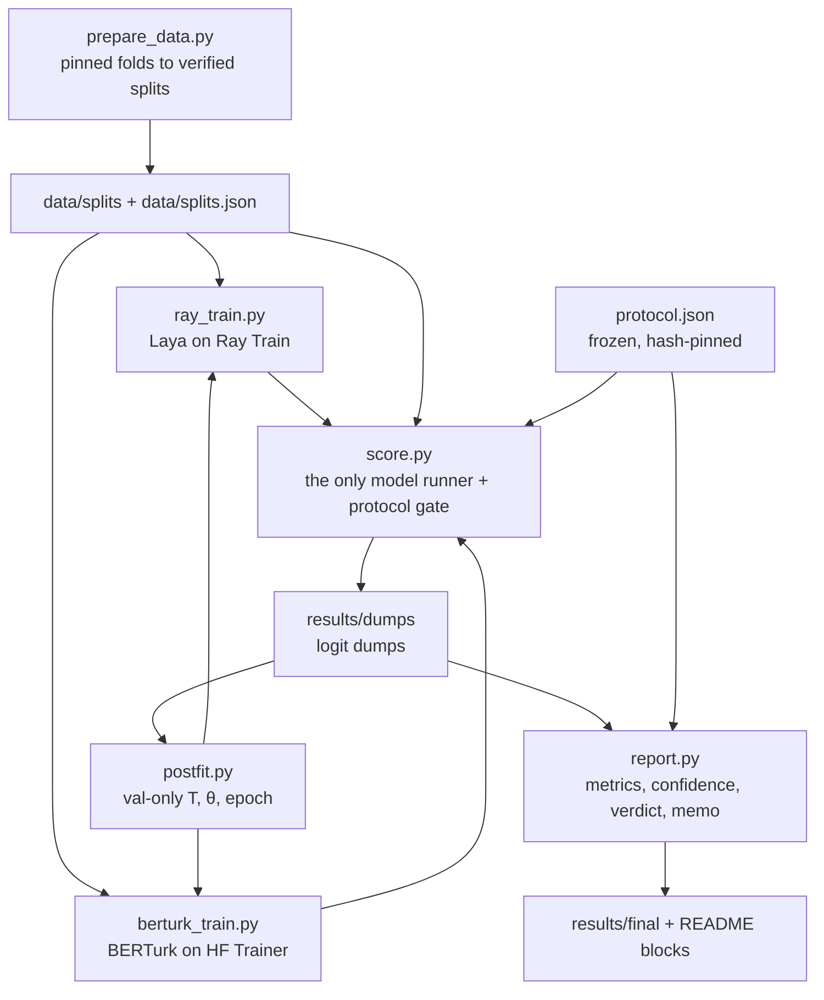

<!-- generated-by: gsd-doc-writer -->
# Architecture

This document describes how the repository is put together: the components, how data moves between them, the
abstractions that hold the design together, and why the directories are laid out as they are. The
[README](../README.md) is the command reference and holds the generated result blocks; the
[guide](GUIDE.md) explains how to read the numbers.

## System overview

The repository fine-tunes and evaluates the Laya `laya-multilingual` model on the Turkish banking split of
Multi3NLU++ (multi-label intent detection over 48 tags) and compares it, head to head, with a fine-tuned BERTurk
baseline, zero-shot Laya and two label-statistics baselines (majority and prior). Its input is a pinned public
dataset and pinned model weights; its output is a set of committed, hash-verified records under `results/` that end
in one mechanically computed verdict (`results/final/verdict.json`) and a recommendation rendered from it. The
architecture is a **staged batch pipeline of independent CLI scripts** that communicate only through files on disk:
verified JSONL splits in, logit dumps in the middle, JSON records out. Exactly one script runs a model on an
evaluation split (`score.py`); everything downstream of it (`report.py`, `postfit.py`, the verdict, the memo) is
numpy-only and can be rebuilt byte for byte from the committed dumps. Training is distributed with Ray Train
(`ray_train.py`, Laya) or runs in one process with the Hugging Face Trainer (`berturk_train.py`, BERTurk); scoring
can fan out over Ray Data actors. A frozen, hash-pinned decision protocol (`protocol.json`) gates every access to the
held-out test and out-of-domain splits.

## Component diagram



Arrows show data flow. `postfit.py` feeds back into the trainers because each final seed is trained with
`--postfit RECORD`, which binds its settings to the val-selected record and stamps the val-fitted temperature. Shared
logic lives in the `pilot/` package (not drawn); see [Key abstractions](#key-abstractions).

Supporting tools sit beside this core path:

| Tool | Role | Reads | Writes |
|------|------|-------|--------|
| `mps_spike.py` | feasibility spike: does a full-encoder Laya fine-tune fit on a 16 GB Apple M4 | `selection_train`, pinned weights | `results/spike/` |
| `compute_checkpoint.py` | measured MPS training probe with a kill and resume, projected runtime of the experiment matrix | spike record, `selection_train` | `results/compute/` |
| `latency.py` | per-message latency of every final seed at batch 1, reported, not gated | final manifests, final seed checkpoints, `val` | `results/latency/` |
| `fewshot.py` | the few-shot runner (support sets, projection, allow-list, guarded pruning, results record) | `protocol.json`, checkpoints, dumps | `results/fewshot/` |
| `evaluate.py` | thin wrapper: `score.py --model laya`, then `report.run_report` | a split, a checkpoint | a temporary dump dir |
| `reproduce.py` | one-command reproduction (`make reproduce`, `make report`) | committed records and dumps | rebuilt reports, README blocks, memo |
| `tune.py` | exploratory Ray Tune search of both systems; not a decision input | `selection_train` | `results/tune/` |
| `demo.py` + `ui/` | local chat and results dashboard on 127.0.0.1 | final seeds, committed records | nothing |

## Data flow

### 1. Data preparation

`prepare_data.py` (`make data`) downloads the pinned Multi3NLU++ revision, checks all 40 raw fold hashes against
`pilot/pins.py`, and writes five splits to `data/splits/`: `selection_train` (folds 0-13), `val` (14-15),
`final_train` (0-15), `test` (16-19) and `hotels_probe` (the HOTELS domain, out-of-domain). Each row is in Laya's
training schema: the message text, a uid, one `noul` (yes/no) question per tag from `intents.py`, and the gold
answer for every tag. The committed `data/splits.json` registers each file's path, role, folds and sha256. Every
consumer reads a split through `pilot.data.verify_split_file`, which hard-fails on a tampered, unregistered or
wrong-role file; training consumers additionally call `pilot.data.refuse_held_out`, keyed on content, so no held-out
message can enter a training split under any manifest.

### 2. Training

- **Laya (`ray_train.py`).** The driver verifies the split, resolves the base weights (`pilot.weights.fetch` for the
  pinned `multilingual` weights, or a local checkpoint), computes the run id from the canonical config
  (`pilot.runs.run_id`) and starts a `TorchTrainer`. Each worker runs `train_loop_per_worker`, which re-implements
  Laya's training loop with Laya's own loss and checkpoint format, reached only through `pilot/laya_adapter.py`. Every
  rank builds the same neg-K items from the same seed and takes an equal-sized shard so DDP collectives stay in step.
  Each epoch reports a Ray checkpoint (train state plus per-rank RNG state), so rerunning the identical command after a
  kill resumes from the last completed epoch. Rank 0 also writes an uncalibrated laya export per epoch to
  `exports/epoch-NNN`. On Apple silicon the run uses one worker on an explicit MPS device.
- **BERTurk (`berturk_train.py`).** One process, no Ray: the pinned `dbmdz/bert-base-turkish-cased` becomes a 48-label
  multi-label `BertForSequenceClassification` trained with the Hugging Face Trainer, a masked BCE loss and separate
  AdamW groups for the encoder and the new classifier head. It writes one export per epoch and has no resume.
- **Recipe defaults.** New runs of either trainer default to the best configuration of the committed exploratory
  search (`pilot/defaults.py`, bound by a test to `results/tune/`). Every committed run, record and the verdict used the
  frozen recipe in `pilot/postfit.py` and `pilot/berturk.py` (encoder LR 2e-05, head LR 1e-4), and every command that
  reproduces a past run passes or resolves that recipe itself.

Training never calibrates. Temperature and thresholds are fitted afterwards, on val only.

### 3. Scoring

`score.py` turns one system on one split into a logit dump: `results/dumps/RUN_ID/SPLIT.npz` (float32 logits
`[n, 48]` in `INTENTS` order plus uids, never message text) and a JSON sidecar (split and manifest hashes, the system's
identity, the served temperature, the run id, and for a fine-tuned checkpoint its training block). Systems are `laya`
(the pinned zero-shot weights or a local checkpoint, loaded through the public `laya.load` with a sha256), `berturk`,
`majority` and `prior`. Scoring is fp32 on every device. With `--workers N` the split fans out over Ray Data
`Predictor` actors; with `--workers 0` it runs in-process. An existing dump is never overwritten silently.

Before any checkpoint is hashed or loaded, the **protocol gate** (`gate_trigger`, `protocol_gate`,
`require_admitted`) decides whether the request touches test or HOTELS content. If it does, the run is refused unless
`protocol.json` matches its pin and the checkpoint is one of the frozen protocol's final seeds (or, on test only, a
few-shot checkpoint listed in `results/fewshot/runs.json`), scored once, in-process on MPS, with no `--force`, `--n`
or alternate output root. Admitted dumps carry `protocol_sha256` in their sidecar.

### 4. Post-fit selection (val only)

`postfit.py` reads the val dumps of one selection run (Laya: 4 epoch exports at one encoder LR; BERTurk: 30), fits a
single temperature T per candidate (`pilot.postfit.fit_temperature`), selects θ with `pilot.metrics.select_theta`,
and chooses the epoch by an exact micro-F1 objective (`pilot.postfit.select`). The result is a byte-reproducible
`postfit/1` record under `results/postfit/`. It then prints the final-seed training commands; each final seed is
trained on `final_train` with `--stop-after-epoch K --postfit RECORD`, and `pilot.postfit.check_final` refuses any
setting that differs from the chosen selection run. BERTurk adds a published reference check
(`results/postfit/berturk-reference.json`) that must pass before its final seeds may be trained.

### 5. Reporting, verdict and recommendation

`report.py` is numpy only and loads no model. It reads dumps through `pilot.dumps.load_dump` (the single,
hard-failing reader) and recomputes every metric: micro- and macro-F1, exact match, top-1 and per-tag F1 at θ 0.5 and
at the val-selected θ, for the shipped temperature and for T = 1; the paired bootstrap (`--compare`); calibration,
abstention and false-positive records (`--confidence`). θ-source rules are enforced by content: θ only comes from a
val dump of the same source, a final seed is never reported on data it trained on, and test or HOTELS never select
anything.

`report.py --verdict` calls `pilot.protocol.require_frozen`, loads exactly the protocol's final-seed test dumps,
seed-averages each system at its record's T and θ, and hands the numbers to `pilot.verdict.build_verdict`, which
applies the frozen criteria and rules mechanically. The current record reads INCONCLUSIVE (rule 4), which counts as
NO-GO; collect bank data. `--recommendation` and `--memo` render that record through `pilot/memo.py` with no number
of their own; `--final-table` and `--go-block` render the README blocks.

### 6. Few-shot experiment

The frozen protocol's few-shot block is executed unchanged. Each trainer's `--fewshot-base` mode trains a
label-masked base (the six held-out tags removed from training), and `--fewshot-draw D --fewshot-k K` continues a
masked base on a frozen support set plus a replay set. `pilot.fewshot.check_base` and `check_continued` bind every
command to the frozen recipe by refusal, and the worker's masking proof is stored in the run record. The allow-list
`results/fewshot/runs.json` admits the checkpoints to `score.py`'s gate on test only, and
`pilot/fewshot_report.py` builds `results/fewshot/fewshot.json` (new-tag average precision as the primary metric),
which `report.py --verdict --fewshot` reads for criterion (d).

### 7. Reproduction

`pilot/reproduce.py` registers 19 steps in pipeline order (`STEP_NAMES`: data, baselines, laya-selection, ..., report).
A step is done only when its committed artifacts verify through the existing readers and the `protocol.json` pins;
checkpoints and run directories are never consulted. `make report` (eval-only) rebuilds every report, the README
generated blocks and the memo from the committed dumps and fails, naming the path, if any rebuilt file differs.
`make reproduce` runs each todo step's commands in order and stops at the first divergence.

### 8. Demo

`demo.py` binds the six final seeds through `protocol.json` and their final manifests before any load
(`pilot.demo.bind_system`), loads them once in-process through `score.py`'s loaders, and answers `POST /api/classify`
with both seed-averaged systems computed the way the verdict defines them (`pilot.demo.system_answer`). Read-only
views of the committed records are served under `GET /api/<view>`, and the built React UI under `/`. It binds
127.0.0.1 only, never trains or scores into `results/`, imports no Ray module, and stores no message text.

## Key abstractions

| Abstraction | Location | What it is |
|-------------|----------|------------|
| `INTENTS`, `QUESTIONS` | `intents.py` | The 48 tags and their yes/no question text, the model input; the only definition, so tag order is fixed everywhere |
| Split manifest and `verify_split_file` | `data/splits.json`, `pilot/data.py` | The registry of every split's path, role, folds and sha256, and the one verifier every consumer calls; `refuse_held_out` and `holds_committed` key on content |
| Pins and weight identity | `pilot/pins.py`, `pilot/weights.py` | Every pinned revision and sha256; `fetch` downloads only pinned files, `identity` hashes every file `laya.load` reads |
| Laya adapter | `pilot/laya_adapter.py` | The only module that touches Laya's private API, pinned to laya 0.4.6 and contract-tested; an AST guard fails on a private import elsewhere |
| Logit dump | `pilot/dumps.py` | `write_dump` and `load_dump`, the interface between the model world and the numpy world; the reader hard-fails on any hash, split, question or tag-order mismatch |
| Run identity | `pilot/runs.py`, `pilot/berturk.py` | `run_id` of a canonical config (data and base digests, device and precision, every hyperparameter, seeds, never a path); it names the run's only storage directory and makes resume safe |
| Metrics | `pilot/metrics.py` | Torch-free metrics for every system: `select_theta`, `seed_average`, `paired_bootstrap`, calibration, `message_confidence`, coverage and false-positive rates |
| Post-fit record | `pilot/postfit.py` | `fit_temperature`, `select` and the `postfit/1` record; `check_final` binds a final seed to it |
| Frozen protocol | `protocol.json`, `pilot/protocol.py` | Criteria, thresholds, rules, systems, splits and the few-shot block, frozen once; `require_frozen` (sha256 of the exact bytes against `PROTOCOL_SHA256`) is every consumer's first call; `gated_split` and `final_seed_allowed` back the gate |
| Verdict | `pilot/verdict.py` | `build_verdict`, `decide` and `check_record`: the mechanical GO block, recomputable from its own numbers |
| `Predictor` | `score.py` | The only production class: a Ray Data actor that loads one checkpoint and scores batches |
| Few-shot binding | `pilot/fewshot.py` | Frozen held-out tags, k values and draws; `check_base`, `check_continued`, `check_runs` and `admitted` |
| Reproduce plan | `pilot/reproduce.py` | `plan`, `eval_only`, `run_full`, `dry_run`: done-ness from committed, hash-verified artifacts only |

## Design invariants

These rules shape most of the code and explain many of its refusals:

- **One model runner.** Only `score.py` runs a model on an evaluation split; reports, post-fit and the verdict work
  from dumps, so every published number can be recomputed without weights.
- **Refuse early, refuse in one line.** Validation errors are `SystemExit("<what>; <fix>")`, raised before any model
  load or `ray.init` where possible.
- **Content, not names.** Held-out checks key on sha256s, uid digests and (uid, message) pairs, so renaming or
  relabelling a file cannot smuggle test content into training or θ selection.
- **Val-only selection.** Epoch, temperature and θ are chosen on val; test and HOTELS are opened once per final seed,
  behind the gate.
- **Frozen records stay byte for byte.** `protocol.json` and every `.json`, `.npz` and `.svg` under `results/` are
  never edited; markdown renders and README generated blocks are regenerated from the records.
- **Import budgets.** Modules such as `pilot/protocol.py`, `pilot/fewshot.py`, `pilot/berturk.py`, `pilot/latency.py`,
  `pilot/tune.py` and `pilot/defaults.py` stay torch-free (several stdlib-only), and tests guard this, so the gate,
  the reports and the record readers never pay for heavy imports.
- **Single node.** `ray_train.py` refuses a multi-node Ray cluster because workers read driver-local paths.

## Directory structure rationale

```text
.
├── intents.py              # the 48 tags as noul questions (the model input)
├── prepare_data.py         # pinned dataset -> verified splits (make data)
├── ray_train.py            # Laya fine-tune on Ray Train (DDP; cpu, cuda or one MPS worker)
├── berturk_train.py        # BERTurk fine-tune on the HF Trainer (one process)
├── score.py                # the only model runner; the protocol gate
├── report.py               # numpy-only metrics, confidence, verdict, memo
├── postfit.py              # val-only T, θ and epoch selection; final-seed commands
├── evaluate.py             # score.py + report.py in one step
├── latency.py              # per-message latency of the final seeds
├── fewshot.py              # few-shot runner under the frozen protocol
├── mps_spike.py            # MPS feasibility spike
├── compute_checkpoint.py   # measured compute probe and runtime projection
├── reproduce.py            # one-command reproduction (make reproduce / make report)
├── tune.py                 # exploratory Ray Tune search
├── demo.py                 # local demo server (FastAPI + uvicorn)
├── protocol.json           # the frozen, hash-pinned decision protocol
├── pilot/                  # shared logic, mostly torch-free
├── data/                   # splits.json committed; splits/ and audit/ written by make data
├── results/                # the committed audit record
├── tests/                  # pytest suite with markers unit, data, weights, ray, mps
└── ui/                     # React + TypeScript demo UI, built by Vite
```

- **Root scripts** are the entry points. Each is an `argparse` CLI run directly (`python script.py ...`) or through
  a `Makefile` target; there is no installed package or console entry point.
- **`pilot/`** holds everything two or more scripts share, split one concern per module (`data.py`, `dumps.py`,
  `metrics.py`, `protocol.py`, `verdict.py`, and so on). Keeping this logic out of the scripts lets the torch-free
  parts be imported by the gate, the reports and the tests without loading torch, Ray or laya. `pilot/laya_adapter.py`
  isolates the one dependency on a private API so a laya upgrade has a single place to change.
- **`data/`** keeps only `data/splits.json` in git. The JSONL splits and the duplicate audit are regenerated by
  `make data` and verified against that manifest.
- **`results/`** is the audit record, grouped by the stage that produced it: `dumps/` (logit dumps),
  `reports/` and `legacy/` (baseline reports), `spike/`, `compute/`, `postfit/`, `superseded/` (two discarded BERTurk
  selection runs, kept as disclosed history and never current), `confidence/`, `latency/`, `final/` (the verdict,
  per-seed test reports, confidence records and `memo.md`), `fewshot/`, and `tune/` (exploratory, not a decision
  input). The `make` targets rebuild these from the committed dumps without a model.
- **`tests/`** mirrors the components (`test_score_*.py`, `test_postfit*.py`, `test_verdict.py`, `test_fewshot*.py`,
  ...), plus guards for repository hygiene, the dependency lock and the laya adapter contract. `tiny_laya.py` and
  `tiny_berturk.py` build small offline checkpoints so training and scoring can be tested on CPU.
- **`ui/`** is the demo front end: `ui/src/chat/` (chat view, input bar, reply and tag panels) and `ui/src/dashboard/`
  (training, selection, verdict and confidence views), with `ui/src/http.ts` for same-origin `/api/...` requests.
  Every number it shows comes from the server. The build output `ui/dist` and `ui/node_modules` are not committed.
- **Run storage** (`ray_results/`, `berturk_runs/`, `tune_runs/`, `tensorboard/`) and the final seed checkpoint
  directories (`ckpt-final-s*`, `ckpt-berturk-final-s*`) live in the working tree but outside git; records refer to
  them only by repo-relative path and sha256.
