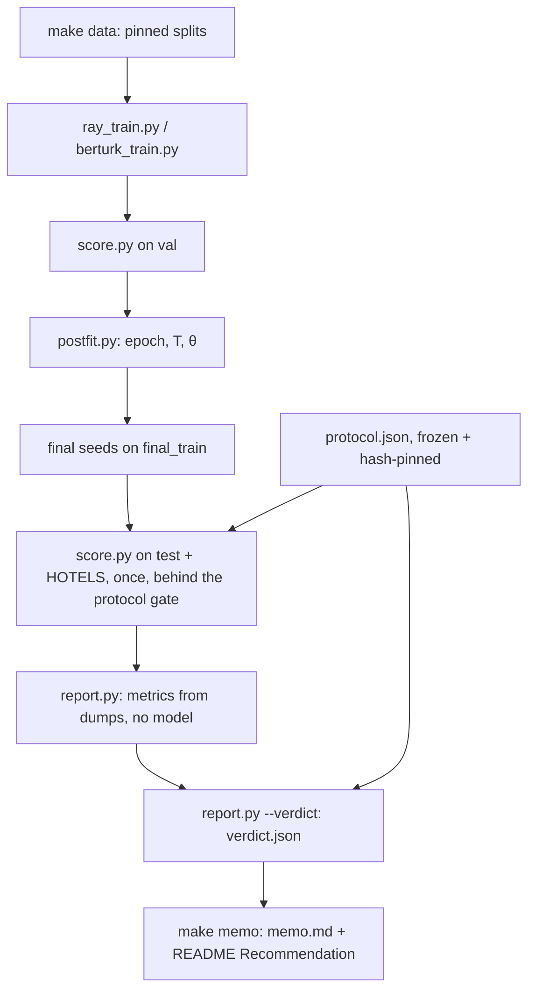

<!-- generated-by: gsd-doc-writer -->
# A guide for software engineers: what this pilot does, how to read it, how to run it

This guide is for engineers who know backend systems, CI and testing but have not worked in machine learning. It
explains the question the repo answers, how to read every number it reports, and how to run it safely. The
[README](../README.md) is the complete reference and holds the generated result blocks. This guide explains them.

Every number below is copied from a committed record or from a render command named next to it. If this guide and a
render ever disagree, the render is correct. Regenerate it with the command shown.

## Contents

- [Part 1: What we are doing and why](#part-1-what-we-are-doing-and-why)
  - [The business question](#the-business-question)
  - [The data and the task](#the-data-and-the-task)
  - [The systems being compared](#the-systems-being-compared)
  - [Train, val, test and the HOTELS probe](#train-val-test-and-the-hotels-probe)
  - [Probabilities, the threshold θ and the temperature T](#probabilities-the-threshold-θ-and-the-temperature-t)
  - [Seeds: three runs of the same recipe](#seeds-three-runs-of-the-same-recipe)
  - [The frozen protocol: a contract signed before the results](#the-frozen-protocol-a-contract-signed-before-the-results)
  - [The few-shot experiment](#the-few-shot-experiment)
  - [The pipeline end to end](#the-pipeline-end-to-end)
- [Part 2: How to compare results](#part-2-how-to-compare-results)
  - [Where every result lives](#where-every-result-lives)
  - [Metric glossary](#metric-glossary)
  - [Uncertainty: intervals, bootstrap, mean ± std](#uncertainty-intervals-bootstrap-mean--std)
  - [Reading the results table](#reading-the-results-table)
  - [The decision criteria (a) to (d)](#the-decision-criteria-a-to-d)
  - [Reading the GO block: why the verdict is INCONCLUSIVE](#reading-the-go-block-why-the-verdict-is-inconclusive)
  - [Reading the few-shot results](#reading-the-few-shot-results)
  - [Comparing systems yourself](#comparing-systems-yourself)
- [Part 3: How to run things](#part-3-how-to-run-things)
  - [Prerequisites](#prerequisites)
  - [Setup](#setup)
  - [Prove the committed results: make report](#prove-the-committed-results-make-report)
  - [The full pipeline: make reproduce](#the-full-pipeline-make-reproduce)
  - [Score and report one system yourself](#score-and-report-one-system-yourself)
  - [What not to do](#what-not-to-do)
  - [Common errors and what they mean](#common-errors-and-what-they-mean)

---

## Part 1: What we are doing and why

### The business question

A bank wants to route customer messages automatically, for example to tell whether a message is about a lost card or
a loan. The question is whether the **Laya** model (`laya-multilingual`) is good enough at this in Turkish to justify
a pilot. The answer has to be a **go/no-go** call that people can audit and override. To make the call, the repo
compares Laya with a well-known Turkish model, **BERTurk**, on accuracy, confidence quality and few-shot learning.

The output is a single, mechanically computed recommendation, backed by records anyone can rebuild:

```bash
python report.py --recommendation results/final/verdict.json
```

The current output is **NO-GO; collect bank data**. Part 2 explains why.

### The data and the task

Real customer messages cannot be used yet, so the pilot uses a **public stand-in**: the Turkish banking split of
[Multi3NLU++](https://huggingface.co/datasets/uoe-nlp/multi3-nlu) (CC-BY 4.0), which is translated data, not real
customer traffic. The repo downloads one pinned revision and checks the sha256 of every raw file (`make data`).

- **Intent.** An intent is a label for what the customer means, such as `card`, `lost_stolen` or `request_info`.
  There are 48 intent tags, all listed in `intents.py`.
- **Multi-label.** One message can carry several tags at once, or none. A message about a lost card can carry both
  `card` and `lost_stolen`, and some messages carry none of the 48. In the README's words, each message
  carries 0–6 of the 48 tags. The task is therefore 48 yes/no decisions per message, not "pick one of 48".
- **No-intent messages.** Messages with no tag stay in the data. They test whether a model invents intents that are
  not there.

Laya receives each tag as a yes/no question. `intents.py` maps every tag to its question, for example `"card": "Is the
message about a bank card?"`. One forward pass, which means one model call, returns a probability for each of the 48
questions. Changing a question's wording changes the model input, so a wording change requires regenerating the data
and rescoring the baselines.

### The systems being compared

| system | what it is | why it is there |
|---|---|---|
| **majority** | always predicts the single most frequent training tag | the floor: the score you get from no understanding at all |
| **prior** (label prior) | predicts each tag with its training-set frequency as the probability | a slightly smarter floor that knows how common each tag is |
| **zero-shot Laya** | the pinned, unmodified `laya-multilingual`, asked the 48 questions | shows what Laya does without seeing any banking examples |
| **fine-tuned Laya** | Laya trained further on the banking training messages | the candidate being evaluated |
| **fine-tuned BERTurk** | `dbmdz/bert-base-turkish-cased` trained as a 48-label classifier | the baseline Laya has to match or beat |

Terms used in that table:

- **Baseline**: a reference system you compare against. A candidate that cannot beat majority or prior has learned
  nothing useful.
- **Zero-shot**: using a model on a task it was never trained for, with no examples. This is like calling a generic
  library with no configuration.
- **Fine-tuning**: continuing to train an existing model on your own labelled examples so it adapts to your task.
  This is like taking a well-tested framework and specialising it with your domain code, instead of writing one
  from scratch.

### Train, val, test and the HOTELS probe

`make data` writes five frozen splits under `data/splits/` and registers each file's sha256 in `data/splits.json`. The
counts below come from the README's Frozen splits table.

| split | messages | role | backend analogy |
|---|---|---|---|
| `selection_train` (banking folds 0–13) | 1,450 | train: used to choose settings | the dev box where you tune |
| `val` (banking folds 14–15) | 208 | val: settings are chosen here | the staging environment you tune against |
| `final_train` (banking folds 0–15) | 1,658 | train: used for the final models | the release build, made with the settings staging approved |
| `test` (banking folds 16–19) | 413 | test: scored once, at the end | a **sealed exam**: opened once, after all answers are locked |
| `hotels_probe` (hotels folds 0–19) | 1,009 | out-of-domain probe | traffic from the wrong service, to see whether the model raises false alarms |

Why the split matters: a model, or the person tuning it, that ever sees the test answers can memorise them, and then
the test score says nothing about new messages. So:

- every setting (training length, θ, T, defined below) is chosen on **val**, never on test;
- **test** is scored only at the end, once per final model, behind a gate in code (the protocol gate);
- **HOTELS** messages are hotel-booking messages. A good banking model should predict almost no banking-only tag on
  them. Only the 22 banking-only tags count as valid gold there.

These rules are enforced in code, not just stated. For example, `score.py` refuses a training split, every consumer
checks each split file's sha256 against the manifest, and a split that holds committed test content can never be
used for training.

### Probabilities, the threshold θ and the temperature T

A model outputs a raw score called a **logit** for each (message, tag) pair. Two settings turn logits into yes/no
decisions:

- **Temperature T** rescales the scores before they become probabilities: `P = sigmoid(logit / T)`. T is fitted on
  val so that the probabilities are honest: when the model says 0.8, it should be right about 80% of the time.
  Fitting T is called **calibration**. In the README, *headline* (or *shipped*) means at the fitted T, and *raw* means
  at T = 1.
- **Threshold θ** (theta) is the cut-off: a tag is predicted when `P >= θ`. θ is chosen on val from a grid of
  0.05 to 0.95, maximising val micro-F1 (defined below). A tag with at least 10 val positives also gets its own θ.

The settings committed in `results/postfit/` are Laya T 4.7698 with shipped θ 0.95, and BERTurk T 0.7430 with
shipped θ 0.19 (README, "Results on test", Settings table). Do not compare these values across models. Each one only
makes sense together with its own model's T.

Why on val only: choosing θ on test is like picking the pass mark after reading the exam scores. The repo encodes
this rule: `postfit.py` refuses test input, and `report.py` refuses to take θ from a dump that is not a clean val
dump.

### Seeds: three runs of the same recipe

Training involves randomness, such as the order of examples and the initial weights. A **seed** fixes that randomness
so a run can be repeated. To avoid judging a model on one lucky or unlucky run, each fine-tuned model is trained
three times (seeds 0, 1 and 2) with the same recipe. The reports show the mean ± standard deviation over the three
seeds. The decision uses the **seed-averaged system**: for each message and tag, the three seeds' probabilities are
averaged, then thresholded. This is like running a flaky benchmark three times and reporting the spread, then
deploying the averaged result.

### The frozen protocol: a contract signed before the results

`protocol.json` at the repo root is the decision rule: every criterion, every threshold, the order in which the rules
fire, the statistics procedure and the full few-shot experiment. It was written and **frozen before any fine-tuned
model was scored on test or HOTELS**. The analogy is a contract signed before anyone sees the results.

- **Hash-pinned.** The sha256 of its exact bytes is pinned in `pilot/protocol.py` (`PROTOCOL_SHA256`, currently
  `0d337d2019f9...`). Every consumer calls `pilot.protocol.require_frozen()` first, and that call refuses a missing
  or changed file. This works like a lockfile hash: edit one byte and everything downstream refuses to run.
- **The protocol gate.** `score.py` lets a fine-tuned checkpoint reach test or HOTELS only if it is one of the six
  final seeds the protocol names, or a few-shot checkpoint listed in `results/fewshot/runs.json` (test only). It
  must also use the protocol's device (MPS, in-process) and run **once**. A rerun is refused, and so is `--force`.
  The committed dumps are the audit record.
- **Mechanical verdict.** `report.py --verdict` computes the outcome from the frozen thresholds and the committed
  dumps. Nobody chooses it, and the README shows it exactly as rendered.

Check the freeze yourself:

```bash
python -m pilot.protocol --check     # refuses a missing or changed protocol.json, prints the pin
python -m pilot.protocol --render    # the README protocol block
```

### The few-shot experiment

The bank will add new intents over time, so the pilot also asks how well each model learns a new intent from a
handful of examples.

1. Six tags (`savings`, `loan`, `overdraft`, `appointment`, `contactless`, `direct_debit`) are hidden: each model's
   **masked base** is trained on `selection_train` with those labels removed, and the record proves the model saw
   none of them.
2. Each base then continues training on a small, frozen **support set** with k = 5 or k = 10 positive examples per
   hidden tag, plus 200 replay messages of the old tags. There are three random draws of the support set.
3. Both models are scored once on test, and the primary metric is **new-tag average precision** at k = 10.

The support sets are fixed in `protocol.json` (uid lists and digests), so both models train on identical rows.

### The pipeline end to end

1. **Data**: `make data` downloads the pinned dataset and writes and verifies the splits.
2. **Train**: `ray_train.py` (Laya, on Ray Train) and `berturk_train.py` (BERTurk, on the HF Trainer) train on a
   training split.
3. **Select on val**: each training epoch is scored on val, and `postfit.py` picks the epoch, T and θ into
   `results/postfit/`.
4. **Final seeds**: each model is retrained three times on `final_train` with the chosen settings.
5. **Score into logit dumps**: `score.py` is the only place a model runs. It writes raw scores to
   `results/dumps/<run_id>/<split>.npz` plus a JSON sidecar. Test and HOTELS are scored once, behind the gate.
6. **Report**: `report.py` recomputes every metric from the dumps with numpy only. It loads no model.
7. **Verdict**: `report.py --verdict` applies the frozen protocol and writes `results/final/verdict.json`.
8. **Memo**: `make memo` renders `results/final/memo.md`, the one-page decision memo.



The key design choice is that steps 6 to 8 need no GPU and no model, only the committed dumps. That is what lets
`make report` rebuild and check every result on any machine in minutes.

---

## Part 2: How to compare results

### Where every result lives

| what | where | rebuild with |
|---|---|---|
| The recommendation | README "Recommendation" section | `python report.py --recommendation results/final/verdict.json` |
| One-page decision memo | `results/final/memo.md` | `make memo` |
| The verdict record (all criteria, all numbers, unrounded) | `results/final/verdict.json` | `make final-reports` |
| Results on test (accuracy table) | README "Results on test" | `python report.py --final-table results/final/verdict.json` |
| The GO block (criteria and statuses) | README "GO block (mechanical)" | `python report.py --go-block results/final/verdict.json` |
| Per-seed test reports | `results/final/reports/` | `make final-reports` |
| Calibration, abstention and false positives on test and HOTELS | `results/final/confidence/`, README "Calibration on test" and below | `python report.py --confidence-table results/final/confidence` |
| Baselines and zero-shot Laya | `results/reports/`, README "Results of the baselines" | `make baseline-reports` |
| Few-shot results | `results/fewshot/fewshot.json`, README "Few-shot new-intent results" | `make fewshot-reports`, `python fewshot.py --render results/fewshot/fewshot.json` |
| Val selection (epoch, T, θ) | `results/postfit/` | `make laya-postfit`, `make berturk-postfit` |
| Raw model outputs (logits) | `results/dumps/<run_id>/` | never rebuilt: this is the audit record |

### Metric glossary

Precision and recall come first, because most other metrics build on them.

- **Precision**: of the tags the model predicted, the fraction that were correct. Low precision means false alarms.
- **Recall**: of the tags that were really there, the fraction the model found. Low recall means misses.
- **F1**: the harmonic mean of precision and recall, `2TP / (2TP + FP + FN)`, where TP, FP and FN count true
  positives, false positives and false negatives. It is high only when both precision and recall are high.

| metric | plain meaning | better |
|---|---|---|
| **micro-F1** | F1 over every (message, tag) decision pooled together. Frequent tags dominate it. | higher |
| **macro-F1** | F1 per tag, then the plain average over tags. Rare tags count as much as common ones. | higher |
| **exact match** | the fraction of messages where the predicted tag set equals the gold set exactly (an empty prediction on a no-intent message counts as a hit) | higher |
| **top-1** | on messages with at least one gold tag: is the single most probable tag one of the gold tags? | higher |
| **per-tag F1 (with support)** | F1 of one tag, plus its count of gold positives | higher |
| **Brier score** | the mean of `(p - y)^2` over every (message, tag) pair: how far the probabilities are from the 0/1 truth | lower |
| **NLL** | negative log-likelihood (binary cross-entropy): punishes confident wrong answers hard | lower |
| **classwise ECE** | expected calibration error: per tag, the gap between the stated probability and the observed frequency, over 15 probability bins, averaged over tags | lower |
| **reliability diagram** | a plot of stated probability against observed frequency. A perfectly calibrated model lies on the diagonal. These are the SVGs under `results/*/confidence/`. | closer to the diagonal |
| **message confidence** | the model's probability that all 48 of its decisions on a message are right (the product of each decision's probability) | used for ranking |
| **coverage c%** | answer only the c% most confident messages and abstain on the rest, for example by handing them to a human | a setting |
| **precision@c%, accuracy@c%** | micro precision and exact-match rate on the kept c% of messages. Criterion (d) reads precision@80%. | higher |
| **AURC** | area under the risk-coverage curve: the average error rate as you keep more and more messages, most confident first | lower |
| **no-intent false-positive rate** | among messages with no gold tag, the fraction where the model predicted at least one tag (k/n) | lower |
| **out-of-domain false-positive rate** | the same on HOTELS, over the 22 banking-only tags | lower |
| **Wilson 95% interval** | a confidence interval for a rate like k/n that stays sensible for small n (the test set has only 15 no-intent messages) | narrower means more certain |
| **average precision (AP)** | for one tag, rank all messages by score and measure how well the positives sit at the top. It needs no θ and no T. | higher |
| **new-tag macro-AP** | AP averaged over the six held-out few-shot tags. This is the few-shot primary metric. | higher |
| **latency** | per-message time on each device | reported, not gated |

A *point* is one hundredth: a delta of −0.0172 is −1.72 points. Every delta in the GO block is **Laya − BERTurk**,
so a positive value favours Laya on a higher-is-better metric and favours BERTurk on a lower-is-better metric such as
Brier.

### Uncertainty: intervals, bootstrap, mean ± std

The test set has 413 messages, so every number carries sampling noise. The repo states that noise explicitly instead
of comparing point values.

- **Mean ± std over 3 seeds**: shows how much the score moves between training runs of the same recipe. The std is
  the sample standard deviation (ddof 1).
- **Paired bootstrap**: resample the 413 test messages with replacement 10,000 times (seed 0). On each resample,
  compute the delta Laya − BERTurk on the same messages, which is why it is called *paired*. The 2.5th and 97.5th
  percentiles of those deltas form the **95% confidence interval (CI)**. If the whole CI is below zero, BERTurk is
  better on that metric with reasonable confidence. If the CI straddles zero, the data cannot tell the two apart.
- A self-comparison is the sanity check: zero-shot Laya against itself has every replicate delta exactly zero and an
  interval of `[0.000, 0.000]` (README baselines table).

### Reading the results table

This table is copied from `python report.py --final-table results/final/verdict.json` (README "Results on test").
Every value is on test, at each system's val-selected θ and headline T.

| system | run | micro-F1 | macro-F1 | exact match | top-1 |
|---|---|---|---|---|---|
| majority (train: final_train) | majority | 0.138 | 0.008 | 0.005 | 0.231 |
| prior (train: final_train) | prior | 0.184 | 0.048 | 0.000 | 0.231 |
| laya (multilingual) | laya-zeroshot-7b928d82 | 0.205 | 0.216 | 0.007 | 0.214 |
| laya fine-tuned (final seeds 0, 1, 2) | mean ± std (seed 0 / 1 / 2) | 0.793 ± 0.020 (0.779 / 0.784 / 0.815) | 0.790 ± 0.013 (0.784 / 0.781 / 0.805) | 0.390 ± 0.040 (0.370 / 0.363 / 0.436) | 0.890 ± 0.003 (0.887 / 0.892 / 0.892) |
| laya fine-tuned, seed-averaged | seeds 0, 1, 2 averaged | 0.826 | 0.815 | 0.460 | 0.922 |
| berturk fine-tuned (final seeds 0, 1, 2) | mean ± std (seed 0 / 1 / 2) | 0.832 ± 0.009 (0.829 / 0.826 / 0.843) | 0.759 ± 0.003 (0.758 / 0.757 / 0.762) | 0.532 ± 0.018 (0.523 / 0.521 / 0.552) | 0.927 ± 0.003 (0.927 / 0.925 / 0.930) |
| berturk fine-tuned, seed-averaged | seeds 0, 1, 2 averaged | 0.844 | 0.777 | 0.562 | 0.940 |

How to read it:

1. **Floors first.** Majority and prior reach micro-F1 0.138 and 0.184. Any useful model must be far above them.
2. **Zero-shot Laya is near the floor** (micro-F1 0.205), so Laya needs fine-tuning for this task.
3. **Both fine-tuned models are far above the floors.** Compare the *seed-averaged* rows, because those are what the
   verdict compares.
4. **Mixed picture between them.** BERTurk is ahead on micro-F1 (0.844 against 0.826), exact match and top-1. Laya
   is ahead on macro-F1 (0.815 against 0.777), so Laya does relatively better on rare tags.
5. **Is the gap real?** The table cannot say. The bootstrap intervals in the GO block answer that.

### The decision criteria (a) to (d)

All thresholds come from `protocol.json` (README "Frozen decision protocol", Criteria table). Every comparison is
Laya − BERTurk on the seed-averaged systems, compared unrounded.

| criterion | question | rule in plain words |
|---|---|---|
| **(a) non-inferiority** | Is Laya at least not meaningfully worse? | PASS if the micro-F1 delta's CI lower bound is ≥ −2.00 points **and** the macro-F1 delta is ≥ −3.00 points. FAIL if the micro-F1 CI upper bound is < −2.00 points **or** the macro-F1 delta is < −3.00 points. Otherwise INCONCLUSIVE. |
| **(b) seeds and no collapsed run** | Did every run train properly? | PASS if each model has exactly 3 scored final seeds and no run "collapsed" (scored below the label prior, or its training loss blew up). |
| **(c) latency** | How fast is it? | Always REPORTED: reported, not gated. |
| **(d) a clear edge** | Does Laya bring something BERTurk does not? | PASS if any one path is MET: **calibration** (Brier delta < 0 and its CI upper bound < 0), **abstention** (precision@80% delta ≥ +3.00 points and its CI lower bound > 0), or **few-shot** (mean new-tag macro-AP delta at k = 10 ≥ +5.00 points). |
| **alternative GO** | Is Laya clearly better outright? | MET if the micro-F1 delta is > +3.00 points and its CI lower bound is > 0. It gives GO only when (b) passes. |

The rules fire **in this frozen order**, and the first matching rule decides:

1. (b) FAIL → NO-GO
2. alternative GO MET → GO
3. (a) FAIL → NO-GO
4. (a) INCONCLUSIVE → INCONCLUSIVE (counts as NO-GO; collect bank data)
5. (a) PASS and (d) PASS → GO
6. (a) PASS and (d) FAIL → NO-GO
7. (a) PASS and (d) PENDING → PROVISIONAL

**Statuses**: PASS, FAIL and INCONCLUSIVE apply to (a); PASS and FAIL to (b); REPORTED to (c); PASS, FAIL and
PENDING to (d) (PENDING while the few-shot results do not exist yet); MET and NOT MET to the alternative GO and to
each (d) path. The overall verdict is GO, NO-GO or INCONCLUSIVE.

### Reading the GO block: why the verdict is INCONCLUSIVE

This is copied from `python report.py --go-block results/final/verdict.json` (README "GO block (mechanical)"),
without the latency row:

| criterion | status | numbers |
|---|---|---|
| (a) non-inferiority | INCONCLUSIVE | micro-F1 delta -1.72 points, CI [-3.63, +0.22]; macro-F1 delta +3.86 points, CI [+0.59, +6.79] (not resolvable at this test size (n = 413)) |
| (b) seeds and no collapsed run | PASS | 8 runs, 0 collapsed; seeds laya 0, 1, 2; berturk 0, 1, 2 |
| (d) a clear edge on calibration, abstention or few-shot learning | PASS | calibration (brier): NOT MET, delta +0.34 points, CI [+0.21, +0.48]; abstention (precision_at_80): NOT MET, delta -9.05 points, CI [-11.96, -6.08]; fewshot (new_tag_macro_ap): MET, mean delta +65.87 points |
| alternative GO | NOT MET | micro-F1 delta -1.72 points, CI [-3.63, +0.22] |

The rules applied to these numbers:

- **(a)**: the micro-F1 CI is [−3.63, +0.22]. Its lower bound −3.63 is below −2.00, so (a) cannot PASS. Its upper
  bound +0.22 is not below −2.00, so (a) cannot FAIL either. The macro-F1 delta of +3.86 clears −3.00 easily. With
  neither PASS nor FAIL, (a) is **INCONCLUSIVE**: Laya might be slightly worse or slightly better on micro-F1, and
  413 test messages cannot tell which.
- **(b)** PASS: all 8 runs the collapse rule covers are healthy.
- **(d)** PASS, through the few-shot path only. Laya's Brier is *higher* by +0.34 points, which is worse because
  Brier is lower-is-better. Its precision@80% is 9.05 points *lower*. But on new intents it is far ahead
  (+65.87 points of macro-AP).
- **Alternative GO** NOT MET: Laya is not clearly better on micro-F1.
- **Rule order**: rule 1 does not fire because (b) passed, rule 2 does not because the alternative GO is not met,
  rule 3 does not because (a) did not fail, and **rule 4 fires**: (a) INCONCLUSIVE → **INCONCLUSIVE**.

Because rule 4 fires before any rule that reads (d), Laya's few-shot advantage cannot change the verdict. That was
fixed in the contract before any result existed, and changing it would need a new protocol. **INCONCLUSIVE counts as
NO-GO and means collect bank data**, so the recommendation reads **NO-GO; collect bank data**. More data, ideally the
bank's own messages, would narrow the micro-F1 interval enough to resolve (a).

The block also lists descriptive, non-gating deltas such as exact match and the raw-T micro-F1. The memo
(`results/final/memo.md`) lists the caveats the recommendation carries, among them: the data is translated, the test
no-intent set is small, θ is carried over from val, and the few-shot runs have epoch parity, not step parity.

### Reading the few-shot results

From the README "Few-shot new-intent results" block (`python fewshot.py --render results/fewshot/fewshot.json`), the
primary metric at k = 10:

| Draw | Laya | BERTurk | Laya - BERTurk |
|---|---|---|---|
| 0 | 0.708 | 0.101 | +60.71 points |
| 1 | 0.781 | 0.157 | +62.33 points |
| 2 | 0.854 | 0.109 | +74.56 points |
| mean over draws |  |  | +65.87 points |

Laya ranks messages carrying a brand-new intent far better than BERTurk after seeing a handful of examples, on every
draw. The same block reports k = 0 (the masked base, before any examples), k = 5, per-tag AP, **forgetting** (whether
old-tag micro-F1 drops after learning the new tags; a negative change means forgetting) and wall clock. One trap to
avoid: BERTurk's new-tag micro-F1 is 0.000 on every continued run in the forgetting table. That comes from the θ it
inherits from its masked base, not only from the model. The record explains the cause and adds a post hoc variant,
which is descriptive and not a decision input. AP needs no θ, which is why AP is the primary metric.

### Comparing systems yourself

Every command below reads committed dumps only, needs no model and changes no committed file when you leave out
`--out`.

```bash
# full metrics of one system on test: shipped and raw T, θ 0.5 and the val-selected θ
python report.py results/dumps/laya-zeroshot-7b928d82 --split test

# paired bootstrap A - B on test (B = 10,000, seed 0); each side needs a full val dump for its θ
python report.py --compare results/dumps/laya-zeroshot-7b928d82 results/dumps/prior --split test

# the baselines table, the final results table and the GO block, as markdown
python report.py --table results/reports
python report.py --final-table results/final/verdict.json
python report.py --go-block results/final/verdict.json

# calibration, abstention and false positives of the final seeds and references on test and HOTELS
python report.py --confidence-table results/final/confidence

# a single final seed at its postfit record's θ (a final seed has no clean val of its own)
python report.py results/dumps/laya-a6a866dd69fc-88cfaa80-cc216d59 --split test --postfit results/postfit/laya.json
```

Notes:

- `--compare` takes comma-separated run dirs for a multi-seed side, but every run dir needs a full **val** dump to
  take θ from. The final seeds have none (their training data contains val), so `--compare` refuses them with
  `compare needs a full val dump in every run dir; ... (score.py on val)`. The Laya-against-BERTurk comparison of the
  final seeds is the GO block, which uses each postfit record's θ.
- The run ids of the six final seeds are listed in the README protocol block ("Final seeds") and in the `Makefile`
  (`LAYA_FINAL`, `BERTURK_FINAL`).
- Prefer the unrounded values in `results/final/verdict.json` (for example `criteria.a.micro.delta`) when you need
  more digits than a render shows.

---

## Part 3: How to run things

### Prerequisites

- **Hardware**: the results were produced on an Apple M4 Mac with 16 GB unified memory, using PyTorch MPS (the Apple
  GPU; there is no CUDA). Rebuilding and checking reports (`make report`) needs no GPU. Training and scoring need
  MPS for the frozen protocol's device. One Ray worker holds about 2.6 GB, so plan for 16 GB or more per worker.
  Run one MPS job at a time.
- **Python 3.12**, available as `python3.12` (`make env` calls it), plus `git` (eval-only compares against git HEAD).
- **Disk**: about 1.5 GB for the venv plus 1.1 GB for the pinned weights and a few MB of data. Training runs need
  much more transient space; for example, a 30-epoch BERTurk selection run refuses below about 13.4 GiB free.
- **Network**: only to download the pinned dataset and the public model weights from the Hugging Face Hub.
  `HF_HUB_OFFLINE=1` reuses the cache after the first fetch.

### Setup

```bash
make env && source .venv/bin/activate   # python3.12 venv; pip install --require-hashes --only-binary :all:
make data                               # pinned Multi3NLU++ -> data/splits/*.jsonl, verified against data/splits.json
make test                               # offline tests in the ACTIVE interpreter
```

- `make test` runs `pytest -m "not mps and not data and not weights"` in whatever interpreter is active. It fails,
  listing the mismatched packages, if that interpreter does not match the lock. Without activating the venv, use
  `make test PYTHON=.venv/bin/python`.
- `make test-all` adds the tests that download the dataset and about 1.1 GB of weights. `make weights` prefetches the
  weights.
- There is no linter. Scripts are run directly (`python score.py ...`).

### Prove the committed results: make report

```bash
make report            # same as: make reproduce MODE=eval-only
```

This is the most useful command for a reviewer. It **never trains or scores**. It:

1. verifies the protocol pin, the splits and every committed record through their readers;
2. rebuilds every report under `results/`, the README's generated blocks and the memo from the committed dumps;
3. fails, naming the path, if any rebuilt file differs from the committed one.

A clean pass ends with `eval-only done: ... (git status clean)` and took under a minute on the M4. It means every
number in the README and the memo follows from the committed dumps and the frozen protocol.
It refuses to start if `results/`, `README.md`, `protocol.json`, the `Makefile`, `reproduce.py` or
`pilot/reproduce.py` already differ from git HEAD, so commit or restore them first. If the local split files are
missing, it runs `make data` first. `make report VERIFY_CHECKPOINTS=1` also re-hashes the on-disk final-seed
checkpoints against their manifests; that check is reported, not gated.

### The full pipeline: make reproduce

```bash
python -m pilot.reproduce --plan      # the 19 steps, each done, todo or run; runs nothing
python reproduce.py --dry-run --all   # every step's commands, with the retraining disclosure; runs nothing
make reproduce                        # run every todo step in order, then the report step
```

- A step counts as **done** only when its committed, hash-verified artifacts exist. On this repo `--plan` shows steps
  1 to 18 as `done` and step 19 (`report`) as `run`, so `make reproduce` on a finished tree skips everything and only
  rebuilds the report.
- Partial, tampered or out-of-order trees are refused with the missing path and a `git checkout -- PATH` fix.
- **Retraining is not bit-identical on MPS.** A from-scratch run produces checkpoints with other identities, and the
  protocol gate does not admit them on test. The dry run prints this disclosure before the first model step. The
  frozen results are reproduced by `make report`, not by retraining.

### Score and report one system yourself

`score.py` is the only place a model runs. Scoring on **val** is not gated, but `results/dumps/` already holds the
committed val dumps, and an existing dump is refused. Use a debug subset (`--n`, written to a temporary directory) or
your own `--out-root`:

```bash
# zero-shot Laya on 20 val messages, in-process, then its report (dumps go to a temp dir)
python evaluate.py data/splits/val.jsonl --checkpoint multilingual --workers 0 --n 20

# the label prior on the full val split, into a temporary dump root of your own, then its report
OUT=$(mktemp -d)
python score.py data/splits/val.jsonl --model prior --out-root "$OUT"
python report.py "$OUT/prior" --split val
```

- `--device mps` scores on the Apple GPU and needs `--workers 0`. `--workers N` scores with N Ray Data actors on CPU.
  Scoring is fp32 on every device.
- `--n N` is for debugging only, and `score.py` never writes a subset dump under `results/dumps`.
- The dump holds float32 logits and message uids, never message text.

### What not to do

- **Never pass `--force` to gated scoring** (`make final-scoring`, `make fewshot-scoring`, or `score.py` with a final
  seed on test or HOTELS). The gate refuses it, and the committed gated dumps are scored exactly once.
- **Never hand-edit** `protocol.json`, anything under `data/`, or any `.json`, `.npz` or `.svg` under `results/`.
  Markdown under `results/` and the README's generated blocks are regenerated from the records, never edited by
  hand. A test fails on drift.
- **Never choose θ or T on test**, and never feed a test or HOTELS dump to `postfit.py`. The code refuses it.
- **Do not run `make baselines` casually.** It rescores the baselines with `--force` and rewrites their committed
  dumps.
- **Do not refreeze the splits** (`prepare_data.py --rewrite-manifest`). That invalidates every downstream result.
- **Do not put customer data or a bank's name in the repo.** The hygiene tests also reject message text and local
  home paths in tracked files.
- **Run one MPS job at a time.** Concurrent jobs distort memory and timing.

### Common errors and what they mean

The messages below are real refusals from the code, shortened with `...`. Most refusals happen before any model loads
or Ray starts, so a refusal costs nothing.

| message (shortened) | meaning | what to do |
|---|---|---|
| `results/dumps/prior/val.npz already exists; pass --force to rescore it (results/dumps is the committed audit record), or --out-root DIR to write elsewhere` | that dump is part of the committed record | use `--out-root DIR` or `--n N`; do not overwrite the committed one |
| `protocol gate: ckpt-final-s0 is a fine-tuned laya checkpoint and splits/test.jsonl is a test split under the committed manifest; results/dumps/.../test.npz already exists; a final seed is scored once per split (the protocol's scoring.once) and never rescored` | the sealed exam was already opened | nothing; read the committed dump with `report.py` |
| `protocol gate: ... --force is refused: a final seed is scored once per split and never rescored (the protocol's scoring.once)` | gated scoring never accepts `--force` | drop `--force` |
| `protocol gate: ... --n is refused: a final seed is scored on the whole split, once` | no subsets on gated splits | drop `--n` |
| `protocol gate: ... the protocol scores final seeds with --device mps --workers 0, not ...` | gated scoring must match the frozen scoring block | use `--device mps --workers 0` |
| `protocol gate: ... its dump run id ... is not one of the protocol's laya final seeds (...) nor a laya few-shot checkpoint listed in results/fewshot/runs.json; a selection export, a retrained or an edited checkpoint is never scored on test or HOTELS` | this checkpoint is not on the allow-list; retrained checkpoints get new identities | score it on val instead; test stays sealed |
| `protocol.json has sha256 ..., the frozen protocol is ...; the protocol may not change after the freeze (restore it with `git checkout -- protocol.json`)` | someone edited the contract | `git checkout -- protocol.json` |
| `data/splits/selection_train.jsonl has role train; expected one of test, val, ood_probe` | `score.py` never scores a training split | score `val.jsonl`, `test.jsonl` or `hotels_probe.jsonl` |
| `... sha256 ... != ... registered in data/splits.json; regenerate with `make data`` | a split file is stale or tampered | `make data` |
| `... not found; check the path, or run `make data` to write the registered splits` | the split files have not been generated yet (they are gitignored) | `make data` |
| `... holds committed test content; no model trains on a held-out split ...` | a training split contains held-out messages | train on the committed training split; drop `--manifest` |
| `compare needs a full val dump in every run dir; ... has none (score.py on val)` | `--compare` takes θ from each side's val dump, and a final seed has none | compare systems that have val dumps; final seeds are compared in the GO block |
| `--device mps scores in-process: use --workers 0` | MPS cannot run inside Ray actors | add `--workers 0` |
| `--device mps, but MPS is not available here; use --device cpu` | not an Apple Silicon GPU | use `--device cpu` |
| `eval-only compares every rebuilt file with the committed one, but these already differ: ...; commit or restore them first` | `make report` needs a clean tree for the files it checks | `git stash`, commit, or `git checkout -- PATH` |
| `eval-only rebuilt N file(s) that differ from the committed ones: ...; ... inspect with `git diff`, restore with `git checkout -- PATH`` | a rebuild no longer matches the committed record, so code or inputs changed | inspect with `git diff`; this is the signal `make report` exists to catch |
| `eval-only never trains or scores: ... is missing; it is made by step ...; restore the committed record with `git checkout -- ...`` | a committed artifact was deleted from the working tree | restore it with the `git checkout` command shown |

Every gate refusal starts with `protocol gate: ` and names the checkpoint, the split, the trigger and the fix, so you
can find its source with `grep -n "GATE" score.py`.
